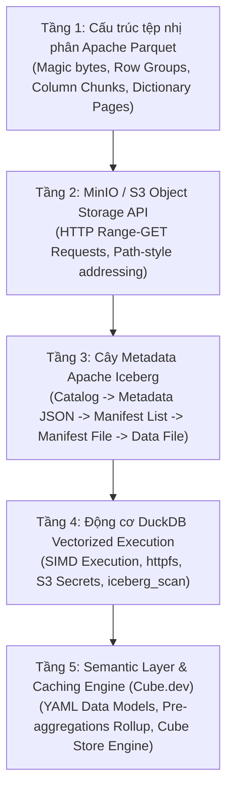
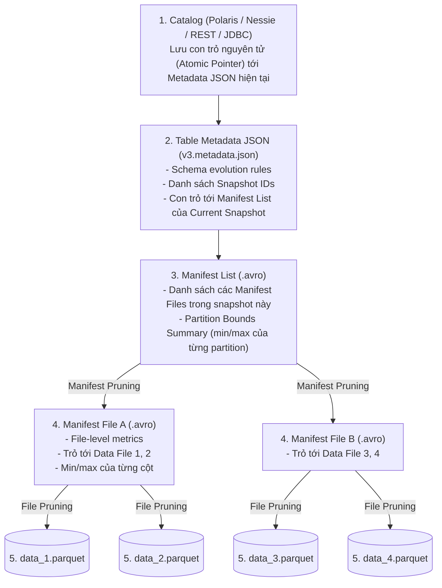

---
{"dg-publish":true,"permalink":"/knowledge/02-tech-second-brain/ai-core/data-lake-house/lakehouse-2-0/04-deep-dive-lakehouse-semantic-layer/","title":"Deep-Dive Kỹ Thuật - 5 Tầng Data Lakehouse & Semantic Layer","pinned":"false","tags":["type/course","topic/data-lakehouse","status/stable"]}
---

# Deep-Dive Kỹ Thuật: 5 Tầng Data Lakehouse & Semantic Layer
*(Tài liệu chuẩn trích xuất từ đặc tả kỹ thuật chính thức của Apache Parquet, Apache Iceberg, DuckDB và Cube.dev)*

Tài liệu này mổ xẻ chi tiết cấu trúc dữ liệu nhị phân, cây metadata và mã nguồn cấu hình thực tế cho toàn bộ chu trình 5 tầng:



---

## 1. TẦNG 1: CẤU TRÚC TỆP NHỊ PHÂN APACHE PARQUET

Thay vì lưu trữ tuần tự từng dòng như CSV hay SQLite, Parquet lưu trữ theo cột và chia khối dữ liệu từ vĩ mô đến vi mô.

### 1.1. Sơ đồ giải phẫu file Parquet (Binary Layout)

```text
+--------------------------------------------------------------------+
| 4-byte Magic Number: "PAR1"                                        |
+--------------------------------------------------------------------+
| ROW GROUP 1 (Thường chứa 100,000 - 1,000,000 dòng)                 |
|   ├── Column Chunk 'order_id'                                      |
|   │     ├── Page Header (Data Page 1: Compressed Snappy/ZSTD)      |
|   │     └── Page Header (Data Page 2...)                           |
|   ├── Column Chunk 'status'                                        |
|   │     ├── Dictionary Page (Ánh xạ: 0 -> 'NEW', 1 -> 'PAID')      |
|   │     └── Data Pages (Chỉ lưu mảng số nguyên: [0, 1, 1, 0, ...]) |
|   └── Column Chunk 'amount'                                        |
+--------------------------------------------------------------------+
| ROW GROUP 2...                                                     |
+--------------------------------------------------------------------+
| FILE METADATA (Footer - tuần tự hóa bằng Apache Thrift)            |
|   ├── Schema định nghĩa (Tên cột, kiểu dữ liệu, nested structs)    |
|   ├── Tổng số dòng (Num Rows)                                      |
|   └── Row Groups Metadata:                                         |
|         ├── Byte Offsets & Độ dài từng Column Chunk                |
|         └── Statistics: min_value, max_value, null_count           |
+--------------------------------------------------------------------+
| 4-byte File Metadata Length (Little Endian)                        |
+--------------------------------------------------------------------+
| 4-byte Magic Number: "PAR1"                                        |
+--------------------------------------------------------------------+
```

### 1.2. Tại sao Metadata lại nằm ở CUỐI file (Footer)?
Trong các hệ thống phân tán (Spark, Flink, DuckDB), dữ liệu được streaming ghi trực tiếp. Tại thời điểm bắt đầu ghi, engine chưa thể biết trước:
- File sẽ có bao nhiêu dòng?
- Giá trị nhỏ nhất (`min`) và lớn nhất (`max`) của cột `amount` là bao nhiêu?
- Kích thước nén cuối cùng là bao nhiêu byte?

Do đó, Parquet ghi toàn bộ dữ liệu (Data Pages) trước, sau đó tính toán thống kê và ghi **File Metadata** ở cuối cùng.

### 1.3. Cơ chế đọc tối ưu (Reader Execution Flow)
1. Engine gửi request đọc **8 byte cuối cùng** của file:
   - 4 byte cuối cùng: Kiểm tra đúng magic number `PAR1` không.
   - 4 byte liền kề trước: Đọc số nguyên biểu thị **độ dài (byte length)** của Footer.
2. Engine nhảy lùi lại (Seek) đúng số byte đó để đọc và giải mã **Thrift File Metadata**.
3. **Predicate Pushdown (Lọc sớm):** Giả sử query có điều kiện `WHERE amount > 1000`. Engine kiểm tra statistics của Row Group 1: nếu `max_value = 500`, engine **bỏ qua hoàn toàn (skip)** toàn bộ hàng chục megabyte của Row Group 1 mà không cần đọc hay giải nén một byte dữ liệu nào.

---

## 2. TẦNG 2: MINIO / S3 OBJECT STORAGE API

Trong kiến trúc Lakehouse, MinIO đóng vai trò kho lưu trữ đối tượng (Object Store) tương thích 100% chuẩn S3 API của AWS.

### 2.1. Bản chất tương tác qua mạng
- Object Store **không hỗ trợ** các thao tác POSIX thông thường như `fseek()` hay `append()`. File một khi đã ghi là bất biến (**Immutable**).
- Để DuckDB hay Trino không phải tải cả file 2GB về máy, chúng sử dụng header chuẩn HTTP:
  ```http
  GET /lakehouse/orders/data_001.parquet HTTP/1.1
  Host: minio:9000
  Range: bytes=209715200-209725440
  ```
  DuckDB chỉ yêu cầu đọc chính xác 10 KB chứa Footer Metadata hoặc 2 MB chứa đúng Column Chunk cần tính toán.

### 2.2. Quy ước cấu hình bắt buộc cho MinIO
Khác với AWS S3 dùng Virtual-host addressing (`bucket.s3.amazonaws.com`), các dịch vụ private như MinIO chạy trong mạng local sử dụng **Path-style URL**:
- `URL_STYLE`: `path` (Địa chỉ dạng `http://minio:9000/bucket_name/object_path`).
- `USE_SSL`: `false` (nếu chạy nội bộ không qua reverse proxy HTTPS).

---

## 3. TẦNG 3: CÂY METADATA APACHE ICEBERG

Nếu chỉ có file Parquet trên MinIO, bạn sẽ gặp các vấn đề:
- Không có Transaction ACID: Nếu 2 tiến trình cùng ghi, file sẽ bị đè hoặc hỏng.
- Không có Time Travel: Không thể truy vấn dữ liệu ở một thời điểm trong quá khứ.
- Liệt kê thư mục chậm: Quét `s3://bucket/` mất hàng chục giây nếu có 100,000 files.

Apache Iceberg giải quyết triệt để bằng cấu trúc cây Metadata dạng đồ thị:



### 3.1. Các tầng pruning trong Apache Iceberg
1. **Manifest-Level Pruning:** Engine đọc file `Manifest List (.avro)`. Nếu câu truy vấn lọc theo ngày `WHERE order_date = '2026-11-03'`, engine so sánh với `partition_summaries` trong Manifest List. Nếu `Manifest File B` chỉ chứa dữ liệu tháng 10, engine lập tức loại bỏ `Manifest File B`.
2. **File-Level Pruning:** Khi đọc `Manifest File A (.avro)`, engine đọc danh sách `Data Files` kèm theo khoảng giá trị cận trên/cận dưới (lower/upper bounds). Bất kỳ file Parquet nào không chứa giá trị tìm kiếm sẽ bị loại bỏ trước khi gửi request tới MinIO.

---

## 4. TẦNG 4: ĐỘNG CƠ TRUY VẤN DUCKDB (VECTORIZED ENGINE)

DuckDB là động cơ phân tích OLAP in-process hiện đại nhất. Khác với PostgreSQL (xử lý từng dòng qua Volcano Iterator Model: `next()` per row), DuckDB sử dụng **Morsel-driven Vectorized Execution**.

### 4.1. Bản chất Vectorized Execution
- Dữ liệu được nạp vào các thanh ghi CPU dưới dạng mảng (Vector) gồm **2048 giá trị** cùng lúc.
- Tận dụng tập lệnh phần cứng **SIMD (AVX-512 / AVX2)** của CPU: Một chỉ lệnh đơn của chip có thể cộng 8 hoặc 16 số thực cùng một chu kỳ xung nhịp.

### 4.2. Cấu hình kết nối MinIO và Scan Iceberg trong DuckDB (Code chuẩn)

```sql
-- 1. Cài đặt các extension chính thức
INSTALL httpfs;
INSTALL iceberg;
LOAD httpfs;
LOAD iceberg;

-- 2. Khai báo S3 Secret cho MinIO (Tối ưu hóa Path-style và bỏ SSL)
CREATE SECRET minio_lakehouse (
    TYPE s3,
    KEY_ID 'minioadmin',
    SECRET 'minioadminpassword',
    ENDPOINT 'localhost:9000',
    URL_STYLE 'path',
    USE_SSL false,
    REGION 'us-east-1'
);

-- 3. Cách A: Đọc trực tiếp bảng Iceberg từ đường dẫn thư mục MinIO (Không cần Metastore)
SELECT 
    status,
    COUNT(*) AS total_orders,
    ROUND(SUM(amount), 2) AS revenue
FROM iceberg_scan('s3://lakehouse/warehouse/orders', allow_moved_paths = true)
WHERE created_at >= TIMESTAMP '2026-01-01'
GROUP BY status;

-- 4. Cách B: Kết nối qua Iceberg REST Catalog (Nếu dùng Apache Polaris hoặc Nessie)
ATTACH 'http://localhost:8181/api/catalog' AS lakehouse_catalog (
    TYPE iceberg
);

SELECT * FROM lakehouse_catalog.sales.orders LIMIT 10;
```

---

## 5. TẦNG 5: SEMANTIC LAYER & CACHE (CUBE.DEV)

Cube đóng vai trò chốt chặn cuối cùng trước khi dữ liệu đi ra bên ngoài. Nó nhận yêu cầu nghiệp vụ, dịch thành SQL tối ưu cho DuckDB, và cache kết quả thông qua **Cube Store**.

### 5.1. Định nghĩa Data Model chuẩn YAML (`model/cubes/orders.yml`)

```yaml
version: 2

cubes:
  - name: orders
    # Truy vấn bảng thông qua DuckDB view hoặc iceberg_scan
    sql: >
      SELECT * FROM iceberg_scan('s3://lakehouse/warehouse/orders')

    description: "Mô hình ngữ nghĩa đơn hàng được tối ưu hóa pre-aggregations"

    dimensions:
      - name: id
        sql: id
        type: number
        primary_key: true

      - name: status
        sql: status
        type: string

      - name: created_at
        sql: created_at
        type: time

      - name: customer_city
        sql: customer_city
        type: string

    measures:
      - name: total_orders
        type: count
        description: "Tổng số đơn hàng thực tế"

      - name: total_revenue
        sql: amount
        type: sum
        description: "Tổng doanh thu gộp"

      - name: average_order_value
        sql: "{total_revenue} / NULLIF({total_orders}, 0)"
        type: number
        description: "Giá trị trung bình mỗi đơn (AOV)"

    pre_aggregations:
      # Tự động rollup vào Cube Store (Engine Rust in-memory)
      - name: daily_revenue_by_status
        type: rollup
        dimensions:
          - status
          - customer_city
        measures:
          - total_orders
          - total_revenue
        time_dimension: created_at
        granularity: day
        refresh_key:
          every: 30 minutes
```

### 5.2. Chu trình xử lý một truy vấn từ AI Agent vào Cube
1. **Agent gửi JSON qua REST API hoặc MCP:**
   ```json
   {
     "measures": ["orders.total_revenue", "orders.average_order_value"],
     "dimensions": ["orders.status"],
     "timeDimensions": [{
       "dimension": "orders.created_at",
       "dateRange": "This Month"
     }]
   }
   ```
2. **Kiểm tra Pre-aggregation Cache:** Cube kiểm tra xem bảng tổng hợp `daily_revenue_by_status` trong **Cube Store** có sẵn dữ liệu của tháng này chưa.
   - Nếu **Có (Cache Hit):** Trả về kết quả trong **15 - 30 mili-giây** trực tiếp từ Cube Store mà không cần đánh thức DuckDB hay MinIO.
   - Nếu **Không (Cache Miss):** Cube tự biên dịch thành SQL truy vấn bảng Iceberg trên DuckDB, trả dữ liệu cho Agent, đồng thời nạp dữ liệu vào Cube Store cho các lần gọi kế tiếp.

---

## 6. Bảng Tổng Hợp Kiểm Thức Kỹ Thuật (Cheat Sheet)

| Thành phần | Định dạng tệp / Giao thức | Nơi lưu trữ Metadata | Nút thắt hiệu năng (Bottleneck) |
| :--- | :--- | :--- | :--- |
| **Apache Parquet** | Binary columnar format | File Footer (Apache Thrift) | IO đọc đĩa / Giải nén CPU |
| **MinIO** | S3 API (HTTP REST) | Trong bộ nhớ của MinIO Server | Băng thông mạng (Network throughput) |
| **Apache Iceberg** | Avro (`.avro`) & JSON | Cây Metadata phân cấp ngoài Object Store | Chi phí commit Catalog khi ghi nhiều |
| **DuckDB** | In-process C++ library | Lưu tạm trong RAM tiến trình | Giới hạn RAM khi xử lý hash joins lớn |
| **Cube.dev** | YAML schema / REST / SQL API | Cube Store (Rust + RocksDB) | Thời gian xây dựng pre-aggregation lần đầu |
