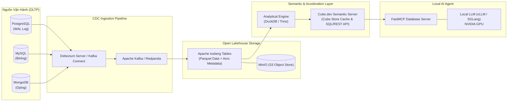

---
{"dg-publish":true,"permalink":"/knowledge/02-tech-second-brain/ai-core/data-lake-house/lakehouse-2-0/05-du-an-thuc-te-qa-chuyen-sau/","title":"Bộ Câu Hỏi Thực Chiến & Chiều Sâu Dự Án - Data Lakehouse, Cube.dev & Local LLM","pinned":"false","tags":["type/course","topic/data-lakehouse","status/stable"]}
---

# Bộ Câu Hỏi Thực Chiến & Chiều Sâu Dự Án: Data Lakehouse, Cube.dev & Local LLM
*(Tài liệu chuẩn bị phỏng vấn, bảo vệ kiến trúc và xử lý bài toán thực tế dựa trên bối cảnh: Dữ liệu vận hành MySQL, PostgreSQL, MongoDB $\to$ Lakehouse $\to$ Semantic Layer $\to$ Local AI)*

Tài liệu này được biên soạn dành riêng cho các kỹ sư chuẩn bị nhận trọng trách **thiết kế và làm chủ toàn bộ hạ tầng dữ liệu (Data Architect / AI Systems)** trong dự án thực tế, chuyển đổi từ các hệ cơ sở dữ liệu vận hành rời rạc sang một nền tảng dữ liệu mở phục vụ đa dự án và AI Agent.

---

## MỤC LỤC
1. [Bối Cảnh Dự Án Thực Tế & Thách Thức Kỹ Thuật](#1-bối-cảnh-dự-án-thực-tế--thách-thức-kỹ-thuật)
2. [Phần 1: Những Câu Hỏi Phổ Biến (Foundational & Screening Questions)](#2-phần-1-những-câu-hỏi-phổ-biến-foundational--screening-questions)
3. [Phần 2: Những Câu Hỏi Có Chiều Sâu Dự Án (In-Depth Engineering & Architectural Defense)](#3-phần-2-những-câu-hỏi-có-chiều-sâu-dự-án-in-depth-engineering--architectural-defense)
4. [Tài Liệu Tham Khảo & Trích Dẫn Chuẩn (References & Citations)](#4-tài-liệu-tham-khảo--trích-dẫn-chuẩn-references--citations)

---

## 1. BỐI CẢNH DỰ ÁN THỰC TẾ & THÁCH THỨC KỸ THUẬT

### 1.1. Hiện trạng hệ thống (As-Is)
- **Nguồn dữ liệu vận hành (OLTP):** Phân tán trên nhiều engine khác nhau gồm **MySQL**, **PostgreSQL** (dữ liệu quan hệ, bảng có cấu trúc chặt) và **MongoDB** (dữ liệu phi cấu trúc/bán cấu trúc, JSON documents linh hoạt).
- **Mục tiêu (To-Be):** 
  1. Hút dữ liệu thô (Raw Data) từ các DB vận hành về một kho dữ liệu tập trung dạng **Lakehouse (Apache Iceberg / Parquet trên Object Storage)** để nhiều dự án khác nhau cùng khai thác.
  2. Tuyệt đối **không làm chậm hoặc làm sập database vận hành (Production DB)** trong quá trình lấy dữ liệu.
  3. Xây dựng **Semantic Layer (Cube.dev)** làm tầng ngữ nghĩa và chuẩn hóa metrics duy nhất.
  4. Tích hợp **Local LLM (chạy trên GPU nội bộ)** qua **Model Context Protocol (MCP)** để hỏi đáp số liệu an toàn, không rò rỉ dữ liệu ra ngoài.



---

## 2. PHẦN 1: NHỮNG CÂU HỎI PHỔ BIẾN (FOUNDATIONAL & SCREENING QUESTIONS)

### Q1: "Làm thế nào để lấy dữ liệu liên tục từ MySQL, PostgreSQL và MongoDB về Lakehouse mà không làm chậm hệ thống vận hành?"
* **Câu trả lời chuẩn:**
  * **Không bao giờ dùng giải pháp truy vấn định kỳ (Polling Query):** Chạy lệnh `SELECT * FROM table WHERE updated_at > ...` mỗi 5 phút sẽ khóa bảng (table locks), quét CPU và làm sập ứng dụng đang phục vụ người dùng.
  * **Giải pháp chuẩn công nghiệp:** Sử dụng **Change Data Capture (CDC) dựa trên Transaction Log** bằng công cụ mã nguồn mở **Debezium**:
    - **PostgreSQL:** Đọc trực tiếp Write-Ahead Log (**WAL**) qua cơ chế Logical Decoding (`pgoutput`).
    - **MySQL:** Đọc nhị phân **Binlog** (Binary Log) ở chế độ `ROW` format.
    - **MongoDB:** Đọc **Oplog** (Operations Log) từ Replica Set.
  * **Cơ chế:** Debezium đóng vai trò như một DB replica vô hại, đọc stream các sự kiện nhị phân ngay trên đĩa cứng mà không cần thông qua query execution engine của database, tiêu tốn CPU gần như bằng 0.

---

### Q2: "MongoDB là dạng NoSQL không có schema cố định (JSON lồng nhau). Khi đưa vào Lakehouse dạng bảng cột (Parquet / Iceberg) thì xử lý thế nào?"
* **Câu trả lời chuẩn:**
  * **Chiến lược 2 lớp (Bronze $\to$ Silver) theo kiến trúc Medallion:**
    1. **Tầng Bronze (Raw Ingestion):** Lưu document thô dạng JSON string hoặc kiểu dữ liệu `STRUCT` / `MAP` linh hoạt của Parquet. Lúc này không ép schema, đảm bảo không bao giờ bị nghẽn hay rớt dữ liệu nếu schema thay đổi.
    2. **Tầng Silver (Standardized):** Dùng công cụ biến đổi dữ liệu (dbt hoặc DuckDB/Spark) để làm phẳng (Flattening) các trường quan trọng thành cột cố định:
       - Các trường định danh và chỉ số kinh doanh chính: Bóc tách thành cột primitive (`customer_id`, `total_price`, `status`).
       - Các trường metadata hoặc thuộc tính tùy biến linh hoạt: Giữ nguyên trong một cột kiểu `JSON` hoặc `MAP<STRING, STRING>`.
  * **Schema Evolution:** Apache Iceberg hỗ trợ tiến hóa schema tự nhiên (thêm cột, đổi tên cột, thăng cấp kiểu dữ liệu) mà không cần viết lại toàn bộ file Parquet lịch sử.

---

### Q3: "Tại sao không để AI Agent viết SQL query trực tiếp vào MySQL/Postgres mà phải dựng Lakehouse và Cube.dev?"
* **Câu trả lời chuẩn (3 lý do cốt tử):**
  1. **An toàn vận hành (Operational Isolation):** AI có thể vô tình sinh ra câu SQL quét bảng triệu dòng hoặc phép `CROSS JOIN` đệ quy làm tê liệt Database bán hàng của công ty.
  2. **Ảo giác ngữ nghĩa (Metric Hallucination):** Nếu để LLM tự viết SQL, nó sẽ bịa công thức. Ví dụ: "Doanh thu" có trừ đơn hủy (cancelled) hay trừ mã giảm giá (voucher) không? Khi dùng **Cube.dev**, metric `total_revenue` đã được viết cố định trong file code YAML. AI chỉ cần gọi tên metric, Cube sẽ tự động sinh câu lệnh SQL chuẩn 100%.
  3. **Hợp nhất đa nguồn (Cross-Engine Federation):** Khách hàng có thông tin nằm ở PostgreSQL, đơn hàng nằm ở MongoDB, logs nằm ở MySQL. AI không thể tự join qua 3 database khác nhau. Lakehouse gom tất cả về một định dạng chung (Iceberg), và Cube đứng trên cung cấp một mô hình ngữ nghĩa duy nhất.

---

### Q4: "Các chỉ số đo lường hiệu năng cốt lõi khi triển khai mô hình AI cục bộ (Local LLM) là gì?"
* **Câu trả lời chuẩn:**
  * **TTFT (Time-To-First-Token):** Thời gian từ khi Agent gửi prompt kèm database schema cho đến khi GPU trả về token đầu tiên. Chỉ số này đại diện cho tốc độ của pha **Prefill** (Compute-bound).
  * **ITL (Inter-Token Latency) / TPS (Tokens Per Second):** Tốc độ sinh từng token tiếp theo trong pha **Decode** (Memory-bandwidth-bound). Tốc độ đọc thông thường của con người là 5-10 tokens/s; một hệ thống phục vụ tốt cần đạt $\ge 25-40\text{ tokens/s}$.
  * **VRAM Footprint:** Tổng bộ nhớ GPU tiêu thụ = $\text{Model Weights} + \text{KV Cache} + \text{Activations}$.
  * **Concurrency Throughput:** Tổng số token hệ thống sinh ra được mỗi giây trên toàn bộ các user/agent gọi đồng thời (`req/s` và `tokens/s/GPU`).

---

## 3. PHẦN 2: NHỮNG CÂU HỎI CÓ CHIỀU SÂU DỰ ÁN (IN-DEPTH ENGINEERING & DEFENSE)

### Q5: "Khi hút dữ liệu CDC từ Debezium vào Iceberg liên tục từng phút, bảng Iceberg sẽ bị vấn đề 'Small Files Problem' làm chậm truy vấn nghiêm trọng. Bạn giải quyết như thế nào?"
* **Bản chất vấn đề:** 
  Mỗi transaction commit từ CDC streaming sẽ tạo ra một file Parquet nhỏ (vài chục KB) kèm theo các file **Position Delete**. Sau 1 tuần, bảng có thể chứa 500,000 file nhỏ, khiến metadata tree của Iceberg bị phình to và query engine tốn 90% thời gian chỉ để mở file (File-open overhead).
* **Giải pháp kỹ thuật chuyên sâu:**
  1. **Thiết lập chế độ Merge-on-Read (MOR):** Cho phép ghi nhanh các file delete nhỏ để không làm nghẽn pipeline streaming thời gian thực.
  2. **Lên lịch tác vụ nén định kỳ (Compaction Job) bằng `rewrite_data_files`:**
     - Chạy định kỳ (ví dụ: mỗi đêm hoặc mỗi 2 tiếng) một job chạy thủ tục bảo trì của Iceberg:
     ```sql
     CALL system.rewrite_data_files(
       table => 'lakehouse.orders',
       strategy => 'binpack',
       options => map(
         'target-file-size-bytes', '134217728', -- Gom các file nhỏ thành chuẩn 128 MB
         'min-input-files', '5'                -- Chỉ gom những nhóm có từ 5 file nhỏ trở lên
       )
     );
     ```
  3. **Thu dọn Snapshot cũ và xóa file rác (Expire Snapshots & Orphan Clean):**
     ```sql
     -- Xóa các snapshot cũ hơn 7 ngày để dọn dẹp các file Parquet đã bị xóa/thay thế
     CALL system.expire_snapshots(table => 'lakehouse.orders', older_than => TIMESTAMP '...');
     ```

---

### Q6: "Làm thế nào để Cube.dev vừa đáp ứng dữ liệu cập nhật liên tục (Near Real-Time) vừa giữ được tốc độ phản hồi mili-giây qua Pre-aggregations?"
* **Bản chất vấn đề:** 
  Nếu bật Pre-aggregations (Cube Store), kết quả query sẽ lấy từ cache. Nhưng dữ liệu đơn hàng dưới MySQL/Postgres được cập nhật liên tục từng phút. Nếu không làm mới cache thì số liệu bị sai lệch (stale), nhưng nếu làm mới liên tục toàn bộ bảng thì Database sẽ quá tải.
* **Giải pháp kỹ thuật chuyên sâu:**
  Áp dụng chiến lược **Partition Rolling & Incremental Refresh** của Cube:
  1. **Chia phân vùng pre-aggregation theo ngày/tháng:**
     - Các phân vùng trong quá khứ (ví dụ: tháng trước) là dữ liệu bất biến (immutable), Cube **không bao giờ phải build lại**.
     - Chỉ phân vùng của **ngày hôm nay** mới được đánh dấu làm mới định kỳ.
  2. **Cấu hình `refresh_key` thông minh bằng SQL:**
     Thay vì làm mới theo thời gian cố định, Cube kiểm tra sự thay đổi của bảng nguồn thông qua transaction log hoặc hàm `MAX(updated_at)`:
     ```yaml
     pre_aggregations:
       - name: rolling_orders
         type: rollup
         measures: [total_revenue, count]
         dimensions: [status]
         time_dimension: created_at
         granularity: day
         partition_granularity: month
         refresh_key:
           sql: SELECT MAX(updated_at) FROM orders WHERE created_at >= CURRENT_DATE
     ```
  Khi Debezium đẩy bản ghi mới vào Iceberg, giá trị `MAX(updated_at)` thay đổi, Cube Store sẽ **chỉ xây dựng lại duy nhất phân vùng của ngày hôm đó**.

---

### Q7: "Khi Local LLM tương tác với Database qua MCP, làm sao để kiểm soát bảo mật và phân quyền dòng (Row-Level Security) cho từng người dùng?"
* **Bản chất vấn đề:** 
  Nếu Agent được cấp quyền truy cập thẳng vào database, một câu lệnh SQL có thể truy xuất bảng lương nhân viên hoặc dữ liệu của chi nhánh khác.
* **Giải pháp kỹ thuật chuyên sâu:**
  1. **Tận dụng Security Context của Cube.dev:**
     Cube tích hợp sẵn cơ chế **Multi-tenancy và Row-Level Security (RLS)** thông qua hàm `query_rewrite` hoặc `COMPILE_CONTEXT`:
     ```javascript
     // cube.js (Security Context)
     module.exports = {
       queryRewrite: (query, { securityContext }) => {
         // Tự động chèn điều kiện lọc theo tổ chức/chi nhánh của người đang chat với AI
         if (securityContext.role !== 'admin') {
           query.filters.push({
             member: 'orders.branch_id',
             operator: 'equals',
             values: [securityContext.branch_id]
           });
         }
         return query;
       }
     };
     ```
  2. **Thẩm định cú pháp AST (Abstract Syntax Tree) tại MCP Server:**
     Tại tầng Python MCP Server (dùng thư viện `sqlglot`), bắt buộc parse toàn bộ câu truy vấn:
     - Chặn đứng 100% các từ khóa thay đổi dữ liệu: `DROP`, `DELETE`, `UPDATE`, `ALTER`, `TRUNCATE`.
     - Tự động cưỡng chế mệnh đề `LIMIT 100` để ngăn LLM sinh query trả về 1 triệu dòng làm tràn RAM của ứng dụng.

---

### Q8: "Khi triển khai Local LLM cho hệ thống Agent phân tích dữ liệu, nút thắt hạ tầng GPU lớn nhất là gì và tối ưu ra sao?"
* **Bản chất vấn đề:**
  Trong tác vụ hỏi đáp dữ liệu (Text-to-SQL / Semantic Query), phần System Prompt chứa danh sách Schema và Semantic Catalog có thể dài từ **2,000 đến 8,000 tokens**. Mỗi lần người dùng gửi một câu hỏi ngắn ("Doanh thu hôm nay?"), GPU lại phải chạy lại toàn bộ pha **Prefill** cho 8,000 tokens này, gây lãng phí tính toán và làm tăng độ trễ TTFT lên 3 - 5 giây.
* **Giải pháp kỹ thuật chuyên sâu:**
  1. **Sử dụng Prompt Caching / RadixAttention (Framework SGLang hoặc vLLM):**
     - SGLang quản lý KV Cache của prompt dưới dạng cấu trúc cây tiền tố (**Radix Tree**).
     - Toàn bộ 8,000 tokens của Semantic Schema chỉ cần tính toán đúng **1 lần duy nhất** trên GPU. Các câu hỏi tiếp theo của người dùng sẽ tái sử dụng trực tiếp các khối KV Cache đã có trong VRAM $\to$ **Thời gian TTFT giảm từ 4 giây xuống còn dưới 100 mili-giây**.
  2. **Chọn đúng model và định dạng lượng tử hóa (Quantization):**
     - Với năng lực viết code và suy luận cấu trúc dữ liệu, các model mã nguồn mở hàng đầu hiện nay là **Qwen 2.5-Coder-14B/32B** hoặc **DeepSeek-R1-Distill-Qwen-14B**.
     - Sử dụng định dạng **AWQ (INT4)** trên vLLM: Giảm dung lượng VRAM cần thiết từ 28 GB (FP16) xuống còn **~9.5 GB**, cho phép chạy mượt mà trên 1 card đồ họa dân dụng (như RTX 3090 / 4090 24GB VRAM) mà vẫn giữ được >99% độ chính xác của câu lệnh SQL.

---

## 4. TÀI LIỆU THAM KHẢO & TRÍCH DẪN CHUẨN (REFERENCES & CITATIONS)

1. **Debezium & Change Data Capture (CDC):**
   * Debezium Documentation: *Debezium Architecture and Connectors for PostgreSQL, MySQL, and MongoDB*. [debezium.io/documentation](https://debezium.io/documentation/reference/stable/architecture.html).
2. **Apache Iceberg Table Maintenance & Compaction:**
   * Apache Iceberg Official Spec: *Maintenance Procedures: `rewrite_data_files` and `expire_snapshots`*. [iceberg.apache.org/docs](https://iceberg.apache.org/docs/latest/spark-procedures/#rewrite_data_files).
3. **Cube.dev Semantic Layer & Cube Store:**
   * Cube.dev Documentation: *Pre-aggregations, Partition Rolling, and Row-Level Security*. [cube.dev/docs](https://cube.dev/docs/caching/pre-aggregations/getting-started).
4. **RadixAttention & Agentic Serving Optimization:**
   * Zheng, L., et al. (2024). *SGLang: Efficient Execution of Structured Language Model Programs*. arXiv preprint [arXiv:2312.07104](https://arxiv.org/abs/2312.07104).
5. **Model Context Protocol (MCP) Architecture:**
   * Anthropic PBC. (2024). *Model Context Protocol Specification*. [modelcontextprotocol.io](https://modelcontextprotocol.io).
