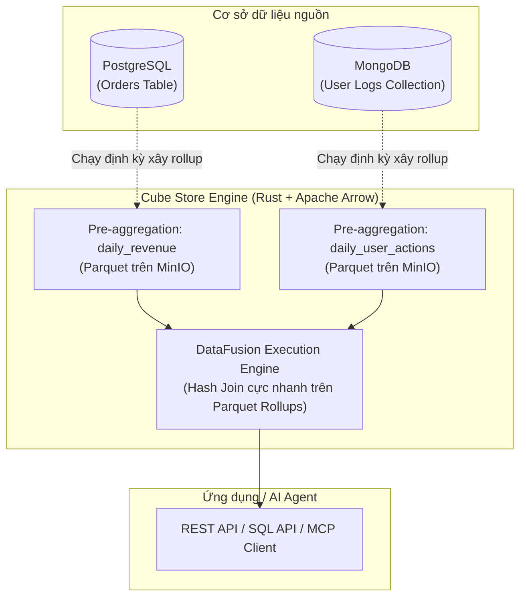
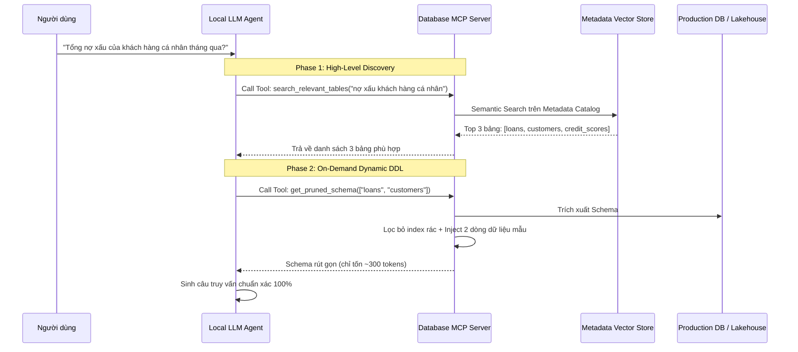
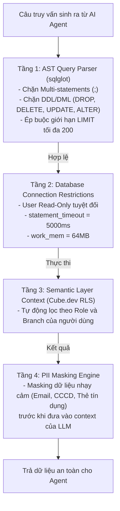

---
{"dg-publish":true,"permalink":"/knowledge/02-tech-second-brain/ai-core/data-lake-house/lakehouse-2-0/06-chuyen-sau-kien-truc-du-an/","title":"Chuyên Sâu Kiến Trúc Dự Án - 5 Khía Cạnh Cốt Lõi Từ Trao Đổi Thực Tế","pinned":"false","tags":["type/course","topic/data-lakehouse","status/stable"]}
---

# Chuyên Sâu Kiến Trúc Dự Án: 5 Khía Cạnh Cốt Lõi Từ Trao Đổi Thực Tế
*(Tài liệu bảo vệ kiến trúc, xử lý bài toán thực chiến và giải quyết các câu hỏi hóc búa nhất xoay quanh: Data Contracts, MongoDB CDC, Cube Store Federation, GPU Serving & Database MCP)*

Tài liệu này được tổng hợp và phân tích chuyên sâu từ các Engineering Blogs hàng đầu (Databricks, Netflix, Uber, PayPal, Confluent, Cube.dev, vLLM, SGLang, Anthropic) và tài liệu kỹ thuật chính thức nhằm giải quyết trọn vẹn 5 khía cạnh cốt lõi được đặt ra trong bài toán thực tế.

---

## MỤC LỤC
- [Chủ đề 1: "Từ data raw đưa về dạng mà nhiều dự án dùng được"](#chủ-đề-1-từ-data-raw-phải-đưa-nó-về-dạng-mà-nhiều-dự-án-dùng-được)
  - [Q1: Data Contracts & Ngăn chặn Silent Schema Breaking Changes](#q1-data-contracts--ngăn-chặn-silent-schema-breaking-changes)
  - [Q2: Multi-tenant Lakehouse: Namespaces, Compute Isolation & Credential Vending](#q2-multi-tenant-lakehouse-namespaces-compute-isolation--credential-vending)
- [Chủ đề 2: "Nhiều engine: MySQL, PostgreSQL vs MongoDB chủ yếu"](#chủ-đề-2-nhiều-engine-mysql-postgresql-vs-mongodb-chủ-yếu)
  - [Q3: MongoDB CDC: Xử lý Partial Updates ($set / $unset) và Tái tạo Document](#q3-mongodb-cdc-xử-lý-partial-updates-set--unset-và-tái-tạo-document)
  - [Q4: Ánh xạ BSON Types & Xử lý Polymorphic Schema Drift trong Parquet](#q4-ánh-xạ-bson-types--xử-lý-polymorphic-schema-drift-trong-parquet)
- [Chủ đề 3: "Cube.dev Semantic Layer Server"](#chủ-đề-3-cubedev-semantic-layer-server)
  - [Q5: Multi-source Query Federation: Bottleneck In-Memory & Giải pháp Cube Store](#q5-multi-source-query-federation-bottleneck-in-memory--giải-pháp-cube-store)
  - [Q6: Modeling Dữ liệu Document MongoDB & Chống Bẫy Fan-Out trong Join 1-N](#q6-modeling-dữ-liệu-document-mongodb--chống-bẫy-fan-out-trong-join-1-n)
  - [Q7: Chiến lược Partition Rolling & Invalidation cho Bảng Trăm Triệu Dòng](#q7-chiến-lược-partition-rolling--invalidation-cho-bảng-trăm-triệu-dòng)
- [Chủ đề 4: "Xây dựng Local Model & Inference với GPU"](#chủ-đề-4-xây-dựng-local-model--inference-với-gpu)
  - [Q8: Hiện tượng Prefill Starvation & Cơ chế Chunked Prefill trong vLLM/SGLang](#q8-hiện-tượng-prefill-starvation--cơ-chế-chunked-prefill-trong-vllmsglang)
  - [Q9: Đánh giá Điểm Bão Hòa của Speculative Decoding (EAGLE-2 vs Draft Model)](#q9-đánh-giá-điểm-bão-hòa-của-speculative-decoding-eagle-2-vs-draft-model)
  - [Q10: Nút thắt PCIe vs NVLink trong Tensor Parallelism trên Cụm GPU On-Premise](#q10-nút-thắt-pcie-vs-nvlink-trong-tensor-parallelism-trên-cụm-gpu-on-premise)
- [Chủ đề 5: "MCP & Tương tác Database"](#chủ-đề-5-mcp--tương-tác-database)
  - [Q11: Two-Phase Tool Routing & Dynamic Context Pruning cho Hàng Trăm Bảng](#q11-two-phase-tool-routing--dynamic-context-pruning-cho-hàng-trăm-bảng)
  - [Q12: Tối ưu Deterministic Structured Prompt cho Prompt Caching / RadixAttention](#q12-tối-ưu-deterministic-structured-prompt-cho-prompt-caching--radixattention)
  - [Q13: Kiến trúc Phòng Thủ 4 Tầng (Defense-in-depth) cho Database MCP Server](#q13-kiến-trúc-phòng-thủ-4-tầng-defense-in-depth-cho-database-mcp-server)
- [Danh Mục Tài Liệu Tham Khảo (References)](#danh-mục-tài-liệu-tham-khảo-references)

---

## CHỦ ĐỀ 1: "TỪ DATA RAW PHẢI ĐƯA NÓ VỀ DẠNG MÀ NHIỀU DỰ ÁN DÙNG ĐƯỢC"
*(Data Sharing Across Projects, Multi-tenant Lakehouse, Data Contracts, Apache Iceberg Governance)*

### Q1: Data Contracts & Ngăn chặn Silent Schema Breaking Changes
> *"Trong kiến trúc Lakehouse đa dự án, làm thế nào để thiết lập và thực thi Data Contracts giữa các Data Producers (Microservices/OLTP) và Data Consumers nhằm ngăn chặn 'silent schema breaking changes' mà không làm giảm tốc độ phát triển của các team upstream?"*

#### 1. Bản chất vấn đề:
Các team phát triển ứng dụng (Producers) thường coi database vận hành là chi tiết cài đặt nội bộ. Họ có thể tùy tiện chạy `ALTER TABLE`, xóa cột, đổi kiểu dữ liệu hoặc thay đổi định nghĩa nghiệp vụ của một trường. Khi CDC hút dữ liệu vào Lakehouse, các pipeline downstream của các dự án khác (BI, Marketing, Fraud Detection, AI Agents) sẽ bị gãy âm thầm hoặc sinh ra số liệu sai lệch mà không ai hay biết.

#### 2. Giải pháp kiến trúc chuẩn công nghiệp:
1. **Chuẩn hóa Data Contract Specification:**
   * Sử dụng chuẩn **OpenDataContract** (tiêu chuẩn mở khởi xướng bởi PayPal & Bitol) định nghĩa qua YAML/JSON Schema gồm 4 phần:
     - `schema`: Tên trường, kiểu dữ liệu, ràng buộc nullability, enum values.
     - `semantics`: Mô tả ý nghĩa nghiệp vụ, SLA về độ tươi của dữ liệu (freshness).
     - `quality`: Các quy tắc kiểm tra (ví dụ: `price >= 0`, `status IN ('NEW', 'PAID')`).
     - `governance`: Chủ sở hữu (Owner), phân loại dữ liệu nhạy cảm (PII classification).
2. **Shift-Left Enforcement trong CI/CD Pipeline:**
   * Tích hợp công cụ kiểm tra (Contract Linter / Testing CLI) vào pipeline Git của Microservice.
   * Khi một Pull Request chứa migration script làm thay đổi schema vi phạm tính tương thích ngược (Backward Compatibility — ví dụ: xóa cột, đổi `INT` sang `VARCHAR`, thêm cột non-nullable không có giá trị mặc định), **CI pipeline sẽ lập tức chặn không cho merge code**.
3. **Cơ chế Quarantine / Dead-Letter Queue (DLQ) tại tầng Ingestion:**
   * Tại tầng Ingestion (Kafka Connect + Schema Registry): Thiết lập chế độ tương thích `BACKWARD_TRANSITIVE`.
   * Khi xuất hiện bản ghi vi phạm hợp đồng dữ liệu: Pipeline **không làm sập luồng streaming**, mà tự động định tuyến bản ghi lỗi sang bảng `_quarantine_records` trong Iceberg kèm mã lỗi và snapshot metadata để gửi cảnh báo Slack/PagerDuty, trong khi các bản ghi hợp lệ tiếp tục chảy vào tầng Silver.

---

### Q2: Multi-tenant Lakehouse: Namespaces, Compute Isolation & Credential Vending
> *"Khi nhiều dự án (Fintech, BI, Marketing, Fraud) dùng chung một Data Lakehouse (S3/MinIO + Apache Iceberg), làm sao giải quyết bài toán: Phân quyền logic (Namespaces), Cô lập tính toán (Compute isolation), và Kiểm soát dữ liệu dòng/cột (RLS/CLS & Masking) mà không tạo ra các silo dữ liệu?"*

#### 1. Bản chất vấn đề:
Chia sẻ chung Storage layer (Parquet files) nhưng không thể cho phép team Marketing đọc cột CMND/CCCD hoặc doanh thu chưa công bố của team Fintech; đồng thời một câu query quét hàng terabyte của Data Science không được chiếm hết CPU của dashboard BI điều hành.

#### 2. Giải pháp kiến trúc:
1. **Phân cấp Namespaces & Open REST Catalog (Apache Polaris / Project Nessie):**
   * Tổ chức cấu trúc phân cấp chuẩn: `<tenant_project>.<domain>.<table_name>` (ví dụ: `fintech.payments.transactions`, `growth.marketing.attribution`).
   * Sử dụng **Open REST Catalog** như **Apache Polaris** (chuẩn nguồn mở từ Snowflake) hỗ trợ tính năng **Credential Vending**:
     - Client/Engine không bao giờ được cấp root IAM key truy cập toàn bộ MinIO bucket.
     - Khi một engine yêu cầu đọc bảng `growth.marketing.attribution`, Polaris Catalog sẽ xác thực quyền và sinh ra **temporary scoped presigned credentials** chỉ có hiệu lực trong vài phút và **chỉ được phép đọc đúng các file Parquet thuộc snapshot của bảng đó**.
2. **Fine-grained Access Control (Row-Level Security & Column Masking):**
   * **Column Masking:** Dynamic masking dựa trên role:
     ```sql
     -- Với role 'analyst', tự động ẩn số điện thoại khách hàng
     CASE WHEN current_role() = 'admin' THEN phone 
          ELSE CONCAT('***-***-', SUBSTRING(phone, 8, 4)) END
     ```
   * **Row-Level Filtering:** Tự động inject điều kiện lọc `WHERE branch_id = session_user_branch()` vào Logical Query Plan trước khi sinh physical plan.
3. **Mô hình Compute Isolation (Tách rời hoàn toàn Storage & Compute):**
   * Triển khai các cụm engine độc lập theo từng dự án/tenant:
     - Dedicated **Trino Cluster** nhỏ, tối ưu RAM cho Dashboard BI điều hành.
     - Dedicated **DuckDB / Spark on K8s** co giãn linh hoạt cho các tác vụ nặng của AI & Data Science.
   * Cả hai cùng đọc chung metadata trên Iceberg Catalog mà không bao giờ tranh chấp tài nguyên CPU/RAM của nhau.

---

## CHỦ ĐỀ 2: "NHIỀU ENGINE: MYSQL, POSTGRESQL VS MONGODB CHỦ YẾU"
*(CDC từ MongoDB qua Debezium/Change Streams sang Lakehouse: Xử lý BSON Partial Updates & Schema Drift)*

### Q3: MongoDB CDC: Xử lý Partial Updates ($set / $unset) và Tái tạo Document
> *"Tại sao CDC từ MongoDB qua Debezium phức tạp hơn nhiều so với MySQL Binlog / PostgreSQL WAL? Khi xuất hiện các phép cập nhật cục bộ ($set, $unset), làm thế nào pipeline Lakehouse tái tạo được Full Document Snapshot với throughput cao?"*

#### 1. Bản chất kỹ thuật:
* MySQL Binlog (`ROW` format) và PostgreSQL WAL (`REPLICA IDENTITY FULL`) luôn cung cấp toàn bộ trạng thái `before` và `after` của dòng dữ liệu.
* Ngược lại, **MongoDB Change Streams (Oplog)** khi có lệnh cập nhật cục bộ mặc định chỉ trả về `updateDescription` chứa phần delta:
  ```json
  {
    "updatedFields": { "profile.address.city": "HN" },
    "removedFields": ["temp_token"]
  }
  ```
  Nó hoàn toàn không chứa các trường dữ liệu khác của document!

#### 2. So sánh các phương án xử lý thực tế:

| Tiêu chí | Cách 1: `changeStream.fullDocument: "updateLookup"` | Cách 2: Stateful Stream Reconstruction (Flink/RocksDB) | Cách 3: Lakehouse-Native ELT Merge (Khuyên Dùng) |
| :--- | :--- | :--- | :--- |
| **Cơ chế** | MongoDB server tự động đọc lại document hiện tại và gửi kèm vào event. | Job Flink duy trì RocksDB lưu trạng thái document mới nhất theo `_id`, tự merge in-memory. | Ghi raw deltas vào Bronze Iceberg table; định kỳ chạy dbt/DuckDB merge dùng `json_merge_patch()`. |
| **Tác động lên MongoDB** | **Rất cao (Nguy hiểm):** Gây nghẽn cache WiredTiger và I/O của DB khi ghi nhiều. | **Bằng 0:** Đọc stream tuần tự từ Oplog, không query ngược. | **Bằng 0:** Đọc stream tuần tự từ Oplog, không query ngược. |
| **Rủi ro Race Condition** | **Có:** Nếu doc update liên tục, `lookup` có thể lấy trúng phiên bản tương lai thay vì đúng thời điểm update. | **Không:** Đảm bảo thứ tự theo oplog sequence. | **Không:** Đảm bảo thứ tự theo `ts_ms` của oplog. |
| **Khuyến nghị** | Chỉ dùng cho DB nhỏ, write volume thấp. | Phù hợp khi cần Real-time < 1 giây. | **Tốt nhất cho Lakehouse:** Ổn định, chi phí thấp, tận dụng sức mạnh tính toán của Lakehouse. |

---

### Q4: Ánh xạ BSON Types & Xử lý Polymorphic Schema Drift trong Parquet
> *"MongoDB lưu trữ kiểu dữ liệu BSON đặc thù (ObjectId, ISODate, Decimal128) và cấu trúc lồng nhau (nested arrays/polymorphic fields). Khi ghi vào Apache Iceberg/Parquet vốn có schema định kiểu chặt chẽ (strictly typed), làm sao xử lý schema drift mà không làm gián đoạn streaming job?"*

#### 1. Bản chất kỹ thuật:
Parquet là định dạng lưu trữ theo cột định kiểu tĩnh (strongly typed). Nếu một collection trong MongoDB có document mang `status: "PENDING"` (string) và document khác lại mang `status: 1` (int), Parquet writer của Spark/Flink sẽ lập tức văng lỗi `SchemaMismatchException`.

#### 2. Chiến lược giải quyết chuẩn:
1. **Chuẩn hóa BSON Type Converter tại tầng Ingestion:**
   * Sử dụng SMT (Single Message Transform) của Kafka Connect:
     - `ObjectId`: Ép kiểu thành `STRING` chuẩn 24 ký tự hex.
     - `ISODate`: Chuẩn hóa thành ISO-8601 UTC `TIMESTAMP_LTZ` (độ chính xác microsecond).
     - `Decimal128`: Ép kiểu về `DECIMAL(38, 18)` hoặc `STRING` để tránh mất độ chính xác dấu phẩy động.
2. **Mô hình "Hybrid Strongly-Typed Columns + Variant Data Type":**
   * Đối với 80% trường cốt lõi đã ổn định (`_id`, `created_at`, `customer_id`): Khai báo thành các cột Parquet first-class để tối ưu hóa nén cột (columnar compression) và lọc sớm (predicate pushdown).
   * Đối với các trường động (dynamic / polymorphic attributes): Lưu dưới dạng **Variant Data Type** (chuẩn mới theo đặc tả Apache Iceberg v3 / Spark 4.0 lấy cảm hứng từ Snowflake) hoặc lưu dưới dạng `JSON String`.
3. **Cơ chế Schema Evolution tự nhiên của Iceberg:**
   * Khi MongoDB xuất hiện trường mới: Iceberg cho phép `ALTER TABLE ADD COLUMN` tự động mà không cần viết lại toàn bộ dữ liệu cũ. Các file Parquet cũ khi đọc sẽ tự động nhận giá trị `NULL` cho cột mới.

---

## CHỦ ĐỀ 3: "CUBE.DEV SEMANTIC LAYER SERVER"
*(Multi-source Federation, Modeling Relational vs Document, Tối ưu Cube Store Pre-aggregations)*

### Q5: Multi-Source Query Federation: Bottleneck In-Memory & Giải pháp Cube Store
> *"Cube.dev thực hiện query federation như thế nào khi người dùng cần một metric tổng hợp join giữa một bảng trong PostgreSQL và một collection trong MongoDB hoặc bảng trong Lakehouse? Đâu là nút thắt cổ chai và cách khắc phục?"*

#### 1. Bản chất kỹ thuật & Rủi ro:
Cube.dev bản chất không phải là một công cụ tính toán phân tán quét dữ liệu thô như Trino. Nếu bạn cấu hình Cube join trực tiếp giữa PostgreSQL và MongoDB mà **không bật Pre-aggregations**:
- Cube sẽ sinh ra 2 truy vấn riêng biệt đẩy xuống Postgres và MongoDB.
- Sau đó kéo toàn bộ kết quả trung gian về RAM của Cube Server để thực hiện in-memory Data Blending bằng JavaScript/DataFusion.
- **Hậu quả:** Server Cube sẽ bị **Out-Of-Memory (OOM) hoặc timeout ngay lập tức** nếu lượng dữ liệu vượt quá vài chục ngàn dòng!

#### 2. Giải pháp kiến trúc tối ưu với Cube Store:



* **Eager Materialization vào Cube Store:**
  - Định nghĩa các khối `pre_aggregations` độc lập cho từng nguồn dữ liệu.
  - **Cube Store** (viết bằng Rust trên nền tảng Apache Arrow & DataFusion) sẽ định kỳ truy vấn nguồn, tính sẵn các bản tổng hợp (Rollups), và ghi ra các file Parquet phân vùng trên MinIO/S3.
* **Join Pushdown xuống Cube Store:**
  - Khi có truy vấn liên nguồn, Cube chuyển toàn bộ câu lệnh sang **Cube Store**. Động cơ DataFusion thực hiện Hash Join trực tiếp trên các bảng Parquet pre-aggregated. 
  - **Kết quả:** Tốc độ phản hồi đạt **dưới 100 mili-giây** và hoàn toàn không chạm một request nào vào PostgreSQL hay MongoDB vận hành!

---

### Q6: Modeling Dữ liệu Document MongoDB & Chống Bẫy Fan-Out trong Join 1-N
> *"Khi ánh xạ dữ liệu MongoDB (ví dụ collection `Orders` chứa mảng con `items: [{sku, price, qty}]`) vào Cube Data Model, làm thế nào để mô hình hóa và tránh hiện tượng nhân bản số liệu (fan-out trap) khi unnest mảng?"*

#### 1. Kỹ thuật Modeling chuẩn: Normalized Two-Cube Pattern
Tách cấu trúc document lồng nhau thành 2 Cube logic độc lập:
```yaml
# model/cubes/orders.yml (Cube Cha)
cubes:
  - name: orders
    sql_table: lakehouse.orders
    joins:
      - name: order_items
        relationship: one_to_many
        sql: "{CUBE}.id = {order_items}.order_id"
    measures:
      - name: shipping_fee_total
        sql: shipping_fee
        type: sum

# model/cubes/order_items.yml (Cube Con)
cubes:
  - name: order_items
    sql: "SELECT id AS order_id, UNNEST(items) AS item FROM lakehouse.orders"
    dimensions:
      - name: sku
        sql: "item.sku"
        type: string
    measures:
      - name: item_revenue
        sql: "item.price * item.qty"
        type: sum
```

#### 2. Chống bẫy Fan-Out (Duplicate Measures):
* **Bẫy Fan-Out:** Nếu một đơn hàng có 3 items, thao tác join 1-N sẽ nhân bản dòng của đơn hàng đó thành 3 dòng. Khi đó, phép tính `SUM(shipping_fee)` ở Cube Cha sẽ bị **phóng đại lên gấp 3 lần thực tế**!
* **Cách khắc phục trong Cube:**
  - Đối với các chỉ số thuộc Cube Cha khi có nguy cơ join 1-N: Sử dụng `type: number` kết hợp SQL subquery hoặc tính toán trước trong Pre-aggregation của Cube Cha trước khi thực hiện join.

---

### Q7: Chiến lược Partition Rolling & Invalidation cho Bảng Trăm Triệu Dòng
> *"Làm thế nào để thiết kế Pre-aggregations trong Cube Store cho bảng hàng trăm triệu dòng để vừa đảm bảo sub-second latency cho dashboard, vừa đảm bảo data freshness trong vòng 5 phút mà không rebuild toàn bộ dữ liệu?"*

#### 1. Kiến trúc Partition Rolling & Incremental Refresh:
```yaml
pre_aggregations:
  - name: rolling_daily_metrics
    type: rollup
    measures: [total_revenue, count]
    dimensions: [status]
    time_dimension: created_at
    granularity: day
    partition_granularity: month

    # Chiến lược kiểm tra độ tươi dữ liệu thông minh
    refresh_key:
      every: 5 minutes
      sql: >
        SELECT MAX(updated_at) 
        FROM lakehouse.orders 
        WHERE created_at >= DATE_TRUNC('month', CURRENT_DATE)
```

#### 2. Cơ chế hoạt động:
1. **Dữ liệu quá khứ bất biến (Immutable History):** Toàn bộ các partition của các tháng trước được đánh dấu là bất biến. Cube Store **không bao giờ quét hay build lại**, tiết kiệm 95% chi phí tính toán.
2. **Theo dõi qua Metadata Trigger:** Mỗi 5 phút, Cube chỉ chạy một câu SQL cực nhẹ kiểm tra `MAX(updated_at)` của tháng hiện tại.
3. Khi có đơn hàng mới từ CDC đẩy vào, giá trị `MAX(updated_at)` thay đổi, Cube Store sẽ **chỉ xây dựng lại duy nhất phân vùng của ngày/tháng hiện tại**, sau đó tự động ghép (Union) với dữ liệu lịch sử để trả về cho người dùng.

---

## CHỦ ĐỀ 4: "XÂY DỰNG LOCAL MODEL & INFERENCE VỚI GPU"
*(Inference Serving Nâng Cao: Chunked Prefill, Speculative Decoding, Multi-GPU Tensor Parallelism Tuning)*

### Q8: Hiện tượng Prefill Starvation & Cơ chế Chunked Prefill trong vLLM/SGLang
> *"Trong một cụm LLM serving nội bộ vừa phục vụ ứng dụng RAG (document dài hàng nghìn tokens) vừa phục vụ Chatbot tương tác thời gian thực, tại sao hiện tượng 'Prefill Starvation' xảy ra, và cơ chế Chunked Prefill trong vLLM / SGLang giải quyết bài toán này như thế nào?"*

#### 1. Bản chất kỹ thuật & Nút thắt:
* Giai đoạn **Prefill**: Tính toán song song toàn bộ prompt đầu vào, thuộc nhóm **Compute-bound** (chiếm trọn Tensor Cores của GPU).
* Giai đoạn **Decode**: Sinh từng token một tuần tự, thuộc nhóm **Memory-bandwidth-bound** (chờ nạp ma trận trọng số và KV Cache từ VRAM).
* **Vấn đề Prefill Starvation:** Khi một request RAG đẩy vào prompt 8.000 tokens, GPU sẽ bị chiếm dụng 100% tài nguyên tính toán để xử lý prompt đó trong khoảng 500ms - 1.5s. Trong suốt thời gian này, **tất cả các user đang chat trực tiếp sẽ bị đứng hình** vì không có chu kỳ tính toán nào để sinh token decode tiếp theo $\to$ Chỉ số biến thiên độ trễ **Inter-Token Latency (ITL / Jitter)** tăng vọt, gây trải nghiệm người dùng rất giật cục.

#### 2. Đột phá của Chunked Prefill (vLLM `--enable-chunked-prefill` / SGLang):
Thay vì xử lý nguyên khối 8.000 tokens trong một bước duy nhất:
1. Engine băm nhỏ (chunk) prompt thành các khối cố định (ví dụ: mỗi khối 512 tokens).
2. Tại mỗi chu kỳ lập lịch (iteration), engine ghép **1 khối prefill 512 tokens** cùng với **các decode tokens của các user khác** vào chung một batch (Kỹ thuật Piggybacking).
3. **Hiệu quả:** Tận dụng được năng lực tính toán của Tensor Cores để "tiêu hóa" dần prompt dài, trong khi luồng sinh token cho các user khác vẫn chạy đều đặn mỗi 20-30ms. P99 Latency của hệ thống giảm hơn 3 lần!

---

### Q9: Đánh giá Điểm Bão Hòa của Speculative Decoding (EAGLE-2 vs Draft Model)
> *"Khi triển khai trên phần cứng On-premise có giới hạn VRAM, khi nào NÊN và KHÔNG NÊN dùng Speculative Decoding? So sánh Draft-Model Speculation vs Self-Speculative (EAGLE-2 / Medusa)?"*

#### 1. So sánh 2 trường phái Speculative Decoding:
* **Draft-Model Speculation (ví dụ Llama-3-8B làm draft cho Llama-3-70B):**
  - Đòi hỏi phải nạp cả 2 mô hình vào VRAM cùng lúc. Trên máy chủ On-premise, việc chia sẻ 16-20 GB VRAM cho draft model làm giảm nghiêm trọng quỹ bộ nhớ dành cho KV-Cache Pool, khiến số lượng người dùng đồng thời (concurrency) bị giảm sút.
* **Self-Speculative / Feature-based (EAGLE-2):**
  - Không cần nạp model riêng. EAGLE-2 chỉ thêm 1-2 decoder layers siêu nhẹ (~vài trăm MB) và dùng hidden states của chính target model ở bước trước để dự đoán trước 3 - 5 tokens. Tốc độ sinh token tăng từ **2x đến 3.5x**.

#### 2. Điểm bão hòa quan trọng (Crucial Production Trade-Off):
* **NÊN DÙNG:** Khi hệ thống có **tải đồng thời thấp (Low Concurrency, Concurrency $\le 4$)**. Khi đó GPU đang dư thừa năng lực tính toán (Compute), speculative decoding sẽ kéo độ trễ sinh từ 30ms xuống 10ms/token.
* **KHÔNG NÊN DÙNG:** Khi hệ thống có **tải đồng thời cao (High Concurrency, Concurrency $\ge 32 - 64$)**. Khi có nhiều request, GPU đã bão hòa compute do phải gộp batch lớn. Lúc này, chi phí kiểm tra (verification) của speculative decoding sẽ làm **suy giảm thông lượng tổng thể (Total Throughput)** của cả hệ thống!

---

### Q10: Nút thắt PCIe vs NVLink trong Tensor Parallelism trên Cụm GPU On-Premise
> *"Khi dựng cụm inference on-premise dùng Consumer GPUs (ví dụ 4x RTX 4090/3090 cắm qua PCIe Gen4) so với Enterprise GPUs (A100/H100 có NVLink), Tensor Parallelism (TP) gặp nút thắt gì và chiến lược điều chỉnh ra sao?"*

#### 1. Nút thắt băng thông kết nối (Interconnect Bottleneck):
* Trong kỹ thuật **Tensor Parallelism (TP)**, các ma trận trọng số được chia nhỏ ra các GPU. Sau **MỖI layer** của Transformer, các GPU bắt buộc phải gửi nhận dữ liệu với nhau qua 2 thao tác **`All-Reduce`** để đồng bộ kết quả.
* **So sánh phần cứng:**
  - Cổng **NVLink** trên A100/H100 có băng thông **600 - 900 GB/s**.
  - Khe cắm **PCIe Gen4 x16** trên mainboard dân dụng chỉ đạt tối đa **~31.5 GB/s** (chậm hơn gần 30 lần!).
* Trên dàn 4x RTX 4090 kết nối qua PCIe, thời gian truyền dữ liệu `All-Reduce` qua lại giữa các card còn lâu hơn thời gian GPU tính toán ma trận. GPU utilization thường tụt xuống dưới 30% vì GPU liên tục bị nghẽn (stall) chờ bus PCIe!

#### 2. Chiến lược xử lý thực tế trên cụm máy tính On-Premise:
1. **Tuyệt đối tránh chạy TP cao trên bus PCIe:**
   - Thay vì chạy TP=4, hãy lượng tử hóa model về **AWQ (INT4)** hoặc **FP8**. Khi đó một model 70B có thể nhét vừa trong 2 card thay vì 4 card, hoặc model 14B/32B nhét vừa vặn trong 1 card duy nhất.
2. **Chuyển sang Data Parallelism (DP):**
   - Dựng 4 tiến trình vLLM độc lập (mỗi tiến trình chạy TP=1 trên 1 GPU riêng biệt) và dùng Nginx/Traefik làm bộ cân bằng tải ở phía trước. Thông lượng phục vụ thực tế sẽ **cao gấp 3 đến 4 lần** so với việc cố ép chạy 1 tiến trình TP=4 qua PCIe.
3. **Sử dụng Pipeline Parallelism (PP) nếu model quá lớn:**
   - Nếu bắt buộc phải chia model vượt quá 1 card: Hãy dùng Pipeline Parallelism (PP). PP chỉ truyền activation tensor ở ranh giới giữa các tầng mạng (Giao tiếp Point-to-Point `P2P`), khối lượng dữ liệu trao đổi qua PCIe ít hơn hàng chục lần so với `All-Reduce` liên tục của TP.

---

## CHỦ ĐỀ 5: "MCP & TƯƠNG TÁC DATABASE"
*(Agent Tool Routing cho Đa Cơ Sở Dữ Liệu, Dynamic Context Pruning, Prompt Caching)*

### Q11: Two-Phase Tool Routing & Dynamic Context Pruning cho Hàng Trăm Bảng
> *"Trong hệ thống doanh nghiệp có hàng trăm bảng trong Database quan hệ và hàng chục collections trong MongoDB, việc inject toàn bộ DDL/JSON Schema vào prompt của LLM gây tràn Context Window, tăng chi phí và gây ảo giác (hallucination). Làm thế nào để thiết kế MCP Agent với Dynamic Context Pruning và Two-Phase Routing?"*

#### 1. Vấn đề:
Nhồi 100 bảng DDL tốn từ 30.000 - 60.000 tokens. LLM sẽ bị hiện tượng "Lost in the middle", nhầm lẫn giữa các bảng có tên tương tự nhau, và sinh SQL/MQL sai.

#### 2. Kiến trúc 2-Phase Tool Routing qua MCP:



* **Context Pruning Engine tại MCP Server:**
  - Tự động cắt bỏ các định nghĩa index phức tạp, trigger, sequence và default values dài dòng.
  - **Sample Injection:** Trích xuất 2 dòng dữ liệu mẫu thực tế cho các cột dạng phân loại (ví dụ: `status: ['ACTIVE', 'DEFAULTED']`) để LLM biết chính xác giá trị cần điền vào mệnh đề `WHERE` mà không cần đoán mò.

---

### Q12: Tối ưu Deterministic Structured Prompt cho Prompt Caching / RadixAttention
> *"Làm thế nào để tận dụng triệt để Anthropic Prompt Caching (`cache_control`) hoặc SGLang / vLLM Prefix Caching (RadixAttention) trong Multi-turn Database Agents để giảm 80-90% TTFT và chi phí?"*

#### 1. Bản chất kỹ thuật của Prompt Caching:
Prompt Caching dựa trên việc so khớp tiền tố nhị phân (**Prefix Matching**). Nếu chỉ cần 1 token ở đầu hoặc giữa chuỗi bị thay đổi (ví dụ: chèn một timestamp ngẫu nhiên hoặc thay đổi thứ tự khai báo tool), **TOÀN BỘ cache từ điểm đó trở đi sẽ bị vô hiệu hóa (Cache Miss)**.

#### 2. Quy tắc sắp xếp Prompt Layout bất biến (Deterministic Layout):
Sắp xếp context từ **Tĩnh nhất đến Động nhất**:
1. **Block 1 (Static System Instructions):** Quy tắc an toàn (Chỉ dùng `SELECT`, bắt buộc có `LIMIT <= 100`, tuyệt đối không dùng DDL/DML), persona, format JSON. $\to$ *Gắn cờ Cache Ephemeral*.
2. **Block 2 (Static Tool Definitions):** Toàn bộ khai báo công cụ của MCP Server (Tool Signatures). $\to$ *Gắn cờ Cache Ephemeral*.
3. **Block 3 (Session-Retained Schemas):** Các cấu trúc bảng đã trích xuất ở Turn trước.
4. **Block 4 (Dynamic Volatile Context):** Câu hỏi mới của người dùng và kết quả truy vấn vừa thực thi.

* **Hiệu quả:** Khi người dùng chat đến câu thứ 2, thứ 3 trong phiên làm việc, Block 1 và Block 2 đạt **100% Cache Hit**. Thời gian phản hồi (TTFT) giảm từ 2.5 giây xuống **dưới 200 mili-giây**, tiết kiệm 90% chi phí xử lý prompt trên GPU!

---

### Q13: Kiến trúc Phòng Thủ 4 Tầng (Defense-in-depth) cho Database MCP Server
> *"Khi cung cấp MCP server kết nối Database / Lakehouse cho AI Agent tự sinh query, các rủi ro bảo mật chính (SQL Injection gián tiếp, DoS qua Cartesian Joins, Data Exfiltration) là gì và kiến trúc phòng thủ đa tầng (Defense-in-depth) như thế nào?"*



1. **Tầng 1 - Thẩm định cú pháp AST (Abstract Syntax Tree):** Sử dụng thư viện `sqlglot` trong Python để dịch và bóc tách câu lệnh SQL thành cây cú pháp. Từ chối thực thi bất kỳ câu lệnh nào có chứa token thay đổi dữ liệu (`DROP`, `DELETE`, `UPDATE`, `ALTER`, `TRUNCATE`) hoặc chứa dấu chấm phẩy `;` nối lệnh.
2. **Tầng 2 - Cưỡng chế quyền hạn ở cấp độ Database Connection:** Tài khoản kết nối DB của MCP server **chỉ có quyền `GRANT SELECT`**. Thiết lập `statement_timeout = 5000ms` để triệt tiêu các câu query quét nặng gây quá tải DB.
3. **Tầng 3 - Tự động áp dụng Row-Level Security qua Cube.dev:** Ngăn chặn việc nhân viên chi nhánh này xem được dữ liệu chi nhánh khác thông qua Security Context.
4. **Tầng 4 - Lọc dữ liệu nhạy cảm (PII Masking) ở đầu ra:** Sử dụng bộ lọc Regex tự động mask thông tin nhạy cảm (Số CMND/CCCD, thẻ ngân hàng, mật khẩu) trước khi trả dữ liệu về context của mô hình AI.

---

## DANH MỤC TÀI LIỆU THAM KHẢO (REFERENCES)

1. **Data Contracts & Data Mesh Governance:**
   * PayPal Technology Blog (Chad Sanderson): *Data Contracts - Building trust into data products*.
   * Bitol Open Data Contract Standard: [opendatacontract.com](https://opendatacontract.com).
2. **Multi-tenant Lakehouse & Apache Polaris Catalog:**
   * Apache Polaris (Incubating) Documentation: *REST Catalog, Multi-tenant RBAC, and Scoped Credential Vending*. [polaris.apache.org](https://polaris.apache.org).
   * Netflix Technology Blog: *Evolution of Data Access Control on Iceberg Lakehouse*.
3. **Debezium CDC & MongoDB Change Streams:**
   * Debezium Documentation: *Debezium Connector for MongoDB - Change Streams & Update Modes*. [debezium.io](https://debezium.io/documentation/reference/stable/connectors/mongodb.html).
   * MongoDB Manual: *Change Streams - Lookup Full Document for Update Operations*.
4. **Cube.dev Semantic Layer & Cube Store Internals:**
   * Cube.dev Documentation: *Data Blending, Multi-Database Federation, and Pre-aggregations*. [cube.dev/docs](https://cube.dev/docs).
   * Cube Engineering Blog: *Building Cube Store: A distributed SQL engine on Rust, Apache Arrow, and DataFusion*.
5. **GPU Inference Mechanics & Serving Systems:**
   * vLLM Project Documentation: *Chunked Prefill, Memory Management, and Distributed Serving*. [docs.vllm.ai](https://docs.vllm.ai).
   * Sarathi-Serve Paper (OSDI 2024): *Taming Throughput-Latency Tradeoff in LLM Serving with Chunked-Prefills*. [arXiv:2308.16369](https://arxiv.org/abs/2308.16369).
   * EAGLE-2 Paper (ICML 2024): *Faster Sub-step Speculative Decoding*. [arXiv:2406.16858](https://arxiv.org/abs/2406.16858).
   * SGLang Paper (2024): *Efficiently Serving LLMs with RadixAttention and Prefix Caching*. [arXiv:2312.07104](https://arxiv.org/abs/2312.07104).
6. **Model Context Protocol (MCP) & Security:**
   * Anthropic PBC: *Model Context Protocol Specification & Security Best Practices*. [modelcontextprotocol.io](https://modelcontextprotocol.io).
   * OWASP: *Top 10 for Large Language Model Applications (2025/2026)*. [owasp.org](https://owasp.org/www-project-top-10-for-large-language-model-applications/).
