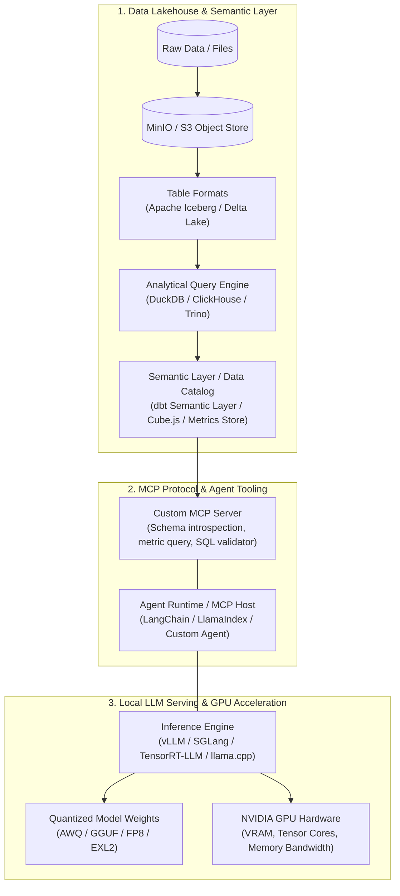
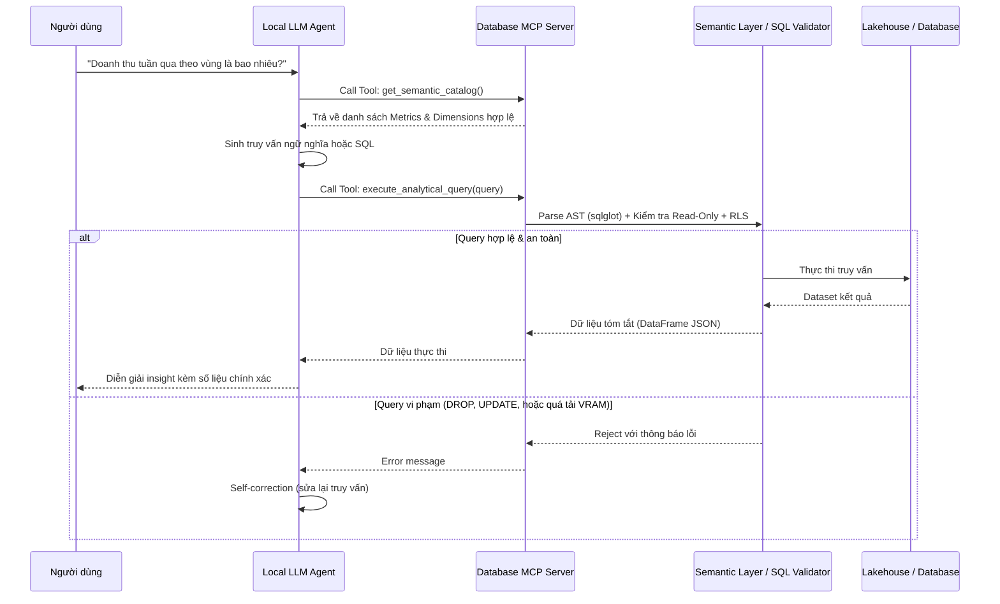
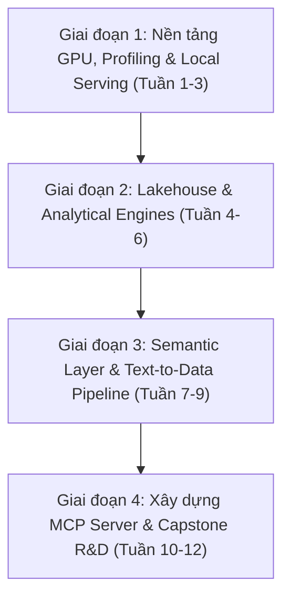

---
{"dg-publish":true,"permalink":"/knowledge/02-tech-second-brain/ai-core/data-lake-house/local-llm/01-12-week-r-and-d-roadmap/","title":"Lộ trình Kỹ sư R&D - Data Lakehouse, Semantic Layer và Local LLM GPU Inference","pinned":"false","tags":["type/course","topic/data-lakehouse","status/stable"]}
---

# Lộ trình Kỹ sư R&D: Data Lakehouse, Semantic Layer và Local LLM GPU Inference

> **Mục tiêu:** xây dựng năng lực R&D từ hạ tầng dữ liệu hiện đại đến local LLM và MCP.  
> **Thời lượng đề xuất:** 12 tuần  
> **Hình thức:** học theo tầng, mỗi tầng có lab chạy được trên máy local

Tài liệu này vạch ra lộ trình học tập, nghiên cứu và thực hành chuyên sâu (R&D) dành cho kỹ sư muốn làm chủ từ hạ tầng dữ liệu hiện đại (**Lakehouse, Semantic Layer**) đến tầng mô hình nội bộ (**Local LLMs, GPU Mechanics, Quantization**) và tích hợp thông minh qua **Model Context Protocol (MCP)**.

## Mục lục

- [Bản đồ tổng thể kiến trúc](#1-bản-đồ-tổng-thể-kiến-trúc-end-to-end-architecture)
- [Data Lake, Lakehouse và Semantic Layer](#2-trụ-cột-1-data-lake-lakehouse--semantic-layer)
- [GPU Architecture và cơ chế inference](#3-trụ-cột-2-gpu-architecture--cơ-chế-inference-llm)
- [Local Models, Quantization và Serving](#4-trụ-cột-3-local-models-quantization--serving-frameworks)
- [MCP và Data Interaction](#5-trụ-cột-4-model-context-protocol-mcp--data-interaction)
- [Lộ trình thực hiện](#6-lộ-trình-4-giai-đoạn-thực-hiện-actionable-phases)
- [Tech stack](#7-tech-stack--công-cụ-khuyến-nghị-cho-rd)
- [Bước tiếp theo](#8-các-câu-hỏi-định-hướng-kế-tiếp-next-steps)

---

## 1. Bản Đồ Tổng Thể Kiến Trúc (End-to-End Architecture)

Hệ thống kết hợp giữa Data Platform hiện đại và Local AI Agent hoạt động theo chu trình sau:




---

## 2. Trụ Cột 1: Data Lake, Lakehouse & Semantic Layer


### 2.1. Tiến hóa kiến trúc dữ liệu
- **Database (OLTP vs OLAP):**
  - **OLTP** (PostgreSQL, MySQL): Tối ưu ghi từng dòng (row-oriented), ACID chặt chẽ, phục vụ transactional apps.
  - **OLAP** (ClickHouse, DuckDB): Tối ưu đọc cột (column-oriented), nén dữ liệu cực cao, vector execution (SIMD), phục vụ phân tích triệu/tỉ dòng trong tích tắc.
- **Data Lake (Hồ dữ liệu):**
  - Lưu trữ phi cấu trúc/bán cấu trúc (JSON, CSV, Parquet, Images, Audio) trên Object Storage giá rẻ (S3, MinIO, Ceph).
  - Điểm yếu: Thiếu ACID, khó quản lý schema drift, khó xóa/sửa dữ liệu theo GDPR/CCPA.
- **Data Lakehouse:**
  - Kết hợp giá rẻ của Data Lake + khả năng quản trị và ACID của Data Warehouse.
  - **Open Table Formats**: **Apache Iceberg**, **Delta Lake**, **Apache Hudi**.
    - Cơ chế Metadata: Snapshot isolation, Time travel (truy vấn dữ liệu tại thời điểm $t$), Schema evolution, Partition pruning.
    - Định dạng file cốt lõi: **Apache Parquet** (Snappy/ZSTD compression, dictionary encoding, stats min/max per row-group).

### 2.2. Semantic Layer (Tầng ngữ nghĩa) là gì & Tại sao LLM cần nó?
Nếu đưa thẳng raw SQL schema cho LLM:
- LLM sẽ tự đoán định nghĩa doanh thu (ví dụ: `revenue = price * quantity` hay đã trừ hoàn tiền/voucher?).
- Khó quản lý quyền hạn (Row-level Security).
- LLM hallucinate ra tên cột hoặc join sai quan hệ.

**Semantic Layer** giải quyết điều này bằng cách:
1. Đóng gói logic nghiệp vụ (Metrics, Dimensions, Calculations) thành code (dbt metrics, Cube.js, Malloy).
2. Cung cấp API/Interfaces chuẩn: Thay vì yêu cầu LLM viết SQL phức tạp 50 dòng, LLM chỉ cần tạo query ngữ nghĩa dạng:
   ```json
   {
     "metrics": ["net_revenue", "churn_rate"],
     "dimensions": ["customer.tier", "time.monthly"],
     "filters": [{"field": "time.year", "operator": "equals", "value": "2025"}]
   }
   ```
3. Động cơ Semantic Layer sẽ tự compile cấu trúc này thành câu SQL chuẩn xác nhất cho DB đích.

---

## 3. Trụ Cột 2: GPU Architecture & Cơ Chế Inference LLM

Phần lớn kỹ sư dừng lại ở việc gọi API hoặc chạy `ollama run`. Để làm R&D chuyên sâu, bạn cần hiểu bản chất phần cứng và thuật toán tính toán.

### 3.1. Cấu trúc phần cứng NVIDIA GPU
- **SM (Streaming Multiprocessors):** Đơn vị tính toán lõi của GPU, chứa:
  - **CUDA Cores:** Xử lý các phép toán vô hướng (FP32, FP64, INT32).
  - **Tensor Cores:** Phần cứng chuyên dụng cho phép nhân ma trận tích lũy (Fused Matrix Multiply-Accumulate: $D = A \times B + C$) với tốc độ cực đại (FP16, BF16, INT8, FP8).
- **Hệ thống phân cấp bộ nhớ (Memory Hierarchy):**
  - **SRAM (Shared Memory / L1 Cache):** Nằm ngay trong SM, dung lượng nhỏ (~100-250 KB/SM), nhưng tốc độ cực nhanh (~19-30 TB/s).
  - **L2 Cache:** Dung lượng trung bình (vài chục MB), tốc độ ~3-5 TB/s.
  - **HBM / VRAM (Global Memory):** Dung lượng lớn (16GB - 80GB), nhưng băng thông thấp hơn nhiều (GDDR6X: ~1 TB/s; HBM3: ~3.3 TB/s).

> [!IMPORTANT]
> **Nút thắt cổ chai lớn nhất của LLM Generation là Băng thông bộ nhớ (Memory Bandwidth), không phải sức mạnh tính toán (Compute/TFLOPS).**

### 3.2. Hai pha Inference: Prefill vs. Decode
Khi bạn gửi một prompt và model sinh ra token:

| Tiêu chí | Prefill Phase (Prompt Evaluation) | Decode Phase (Token Generation) |
| :--- | :--- | :--- |
| **Bản chất** | Xử lý toàn bộ prompt đầu vào song song ($N$ tokens cùng lúc) | Sinh từng token một tuần tự ($t_{k+1}$ phụ thuộc vào $t_k$) |
| **Loại phép tính** | GEMM (General Matrix Multiply) | GEMV (General Matrix-Vector Multiply) |
| **Nút thắt (Bottleneck)** | **Compute-bound** (TFLOPS của Tensor Core) | **Memory Bandwidth-bound** (Tốc độ đọc VRAM sang SRAM) |
| **Lý do** | Tái sử dụng trọng số ma trận cho hàng trăm/nghìn token trong batch | Với mỗi token sinh ra, GPU phải kéo toàn bộ trọng số mô hình (vài chục GB) từ VRAM vào SRAM chỉ để tính cho 1 vector! |

### 3.3. Các cơ chế tối ưu Inference hiện đại
1. **KV Cache:**
   - Lưu trữ các ma trận Key và Value của các token trước đó trong Attention để tránh tính toán lại từ đầu.
2. **FlashAttention (1, 2, 3):**
   - Không ghi ma trận Attention khổng lồ ($N \times N$) ra VRAM.
   - Sử dụng kỹ thuật **Tiling** (chia nhỏ khối) và tính toán softmax trực tiếp trong **SRAM**, giúp giảm truy xuất bộ nhớ từ $O(N^2)$ xuống $O(N)$.
3. **PagedAttention & vLLM:**
   - Trong serving truyền thống, KV Cache bị cấp phát cố định, gây lãng phí 60-80% VRAM do phân mảnh bộ nhớ (memory fragmentation).
   - PagedAttention áp dụng cơ chế **Virtual Memory / Paging** của OS: Chia KV Cache thành các "Page" kích thước cố định, cho phép cấp phát động và chia sẻ KV Cache giữa các request (Copy-on-Write).
4. **Continuous Batching (Orca / vLLM):**
   - Không đợi tất cả request trong batch hoàn thành mới nạp batch mới. Ngay khi một request kết thúc ở bước decode, request mới lập tức được chèn vào batch tại chu kỳ tiếp theo.
5. **Speculative Decoding:**
   - Dùng một model nhỏ (Draft Model, e.g. 1B) đoán trước 4-5 token với tốc độ cao, sau đó dùng model lớn (Target Model, e.g. 70B) kiểm tra đồng thời tất cả các token đó trong một bước Prefill đơn lẻ.

---

## 4. Trụ Cột 3: Local Models, Quantization & Serving Frameworks

### 4.1. Công thức tính toán dung lượng VRAM thực tế
Tổng VRAM cần để chạy một model được tính theo công thức:

$$\text{VRAM}_{\text{total}} = \text{VRAM}_{\text{weights}} + \text{VRAM}_{\text{KV\_Cache}} + \text{VRAM}_{\text{activation}} + \text{VRAM}_{\text{overhead}}$$

Trong đó:
- **Trọng số:**
  $$\text{VRAM}_{\text{weights}} \approx \text{Số lượng tham số (tỷ)} \times \frac{\text{Số bit}}{8} \times 1.15 \text{ (GB)}$$
  *(Ví dụ: Model 8B ở FP16 = $8 \times 2 \times 1.15 \approx 18.4\text{ GB}$; ở INT4 = $8 \times 0.5 \times 1.15 \approx 4.6\text{ GB}$)*.
- **KV Cache cho mỗi session:**
  $$\text{KV Size per Token} = 2 \times n_{\text{layers}} \times n_{\text{heads\_kv}} \times d_{\text{head}} \times \text{bytes\_per\_element}$$

### 4.2. Bản đồ Quantization (Lượng tử hóa)

```mermaid
flowchart LR
    Origin["Full Precision (FP16/BF16 - 16 bits)"] --> QuantType{"Mục đích triển khai"}
    QuantType -->|Local Desktop / CPU+GPU / Edge| GGUF["GGUF / llama.cpp\n(K-Quants: Q4_K_M, Q5_K_M)\nCho phép offload từng phần sang RAM"]
    QuantType -->|NVIDIA GPU Serving / vLLM| AWQ["AWQ (Activation-aware)\nBảo toàn 1% trọng số quan trọng nhất,\nít suy giảm độ chính xác nhất ở INT4"]
    QuantType -->|Ultra-fast GPU Inference| EXL2["EXL2 (ExLlamaV2)\nTối ưu cực độ cho single-user decode"]
    QuantType -->|Modern Enterprise Hardware (Ada/Hopper)| FP8["FP8 (E4M3 / E5M2)\nTăng gấp đôi throughput trên RTX 4090 / H100"]
```

### 4.3. Lựa chọn Serving Engine

| Framework | Điểm mạnh nhất | Phù hợp cho | Hạn chế |
| :--- | :--- | :--- | :--- |
| **vLLM** | Thông lượng (Throughput) cực cao, PagedAttention, chuẩn OpenAI API | Server đa người dùng, Pipeline sản phẩm production | Cần GPU NVIDIA, ngốn VRAM cho cache |
| **SGLang** | Tối ưu RadixAttention (cực mạnh cho multi-turn, agent, structured outputs) | Ứng dụng Agent, Text-to-SQL lặp lại schema | Còn mới, ecosystem đang hoàn thiện |
| **llama.cpp / Ollama** | Khởi chạy cực nhanh, chạy được trên cả Mac Silicon, CPU, GPU yếu | Dev test cá nhân, offline desktop apps | Throughput concurrency kém hơn vLLM |
| **TensorRT-LLM** | Khai thác tối đa 100% phần cứng của NVIDIA | Doanh nghiệp lớn với cụm GPU cố định | Cực kỳ phức tạp khi compile model engine |

---

## 5. Trụ Cột 4: Model Context Protocol (MCP) & Data Interaction

### 5.1. MCP là gì?
**Model Context Protocol (MCP)** là giao thức mở chuẩn hóa cách các mô hình AI kết nối an toàn với các công cụ (Tools), tài nguyên (Resources) và ngữ cảnh bên ngoài (Prompt Templates).

Thay vì phải tự viết các hàm function calling phân mảnh:
- **MCP Server:** Expose các năng lực truy vấn DB, đọc schema, chạy query analytical.
- **MCP Client (Local AI Agent):** Nhận diện công cụ qua giao thức JSON-RPC chuẩn và gọi khi cần.

### 5.2. Luồng bảo mật khi LLM tương tác với Database qua MCP



---

## 6. Lộ Trình 4 Giai Đoạn Thực Hiện (Actionable Phases)

### Kế hoạch 12 tuần

Giả định **8–10 giờ/tuần**. Bốn giai đoạn bên dưới được chia thành các mốc 3 tuần để dễ thực hành, đo lường và hoàn thiện capstone.

<?xml version="1.0" encoding="UTF-8"?>
<svg xmlns="http://www.w3.org/2000/svg" xmlns:xlink="http://www.w3.org/1999/xlink" width="416.603" height="226.691" viewBox="0 0 416.603 226.691">
<defs>
<g>
<g id="glyph-0-0">
<path d="M 2.234375 -4.71875 L 2.078125 -4.71875 C 1.625 -4.296875 1.0625 -4.265625 0.640625 -4.265625 L 0.640625 -3.8125 C 0.90625 -3.828125 1.265625 -3.84375 1.609375 -3.984375 L 1.609375 -0.4375 L 0.6875 -0.4375 L 0.6875 0 L 3.15625 0 L 3.15625 -0.4375 L 2.234375 -0.4375 Z M 2.234375 -4.71875 "/>
</g>
<g id="glyph-0-1">
<path d="M 1.96875 -0.53125 C 1.890625 -0.53125 1.8125 -0.53125 1.71875 -0.53125 L 0.921875 -0.53125 L 2 -1.484375 C 2.125 -1.59375 2.46875 -1.859375 2.609375 -1.96875 C 2.90625 -2.25 3.328125 -2.609375 3.328125 -3.21875 C 3.328125 -4 2.734375 -4.71875 1.734375 -4.71875 C 1 -4.71875 0.546875 -4.328125 0.3125 -3.609375 L 0.640625 -3.203125 C 0.796875 -3.78125 1.03125 -4.234375 1.640625 -4.234375 C 2.234375 -4.234375 2.671875 -3.828125 2.671875 -3.203125 C 2.671875 -2.625 2.328125 -2.296875 1.921875 -1.890625 C 1.78125 -1.75 1.40625 -1.4375 1.25 -1.296875 C 1.046875 -1.125 0.578125 -0.65625 0.375 -0.484375 L 0.375 0 L 3.328125 0 L 3.328125 -0.53125 Z M 1.96875 -0.53125 "/>
</g>
<g id="glyph-0-2">
<path d="M 0.703125 -3.578125 C 0.984375 -4.125 1.484375 -4.28125 1.8125 -4.28125 C 2.234375 -4.28125 2.53125 -4.046875 2.53125 -3.65625 C 2.53125 -3.28125 2.28125 -2.828125 1.75 -2.734375 C 1.71875 -2.734375 1.6875 -2.734375 1.234375 -2.703125 L 1.234375 -2.234375 L 1.78125 -2.234375 C 2.4375 -2.234375 2.6875 -1.71875 2.6875 -1.28125 C 2.6875 -0.734375 2.34375 -0.3125 1.8125 -0.3125 C 1.3125 -0.3125 0.75 -0.546875 0.390625 -1 L 0.3125 -0.546875 C 0.703125 -0.09375 1.28125 0.140625 1.8125 0.140625 C 2.734375 0.140625 3.390625 -0.53125 3.390625 -1.265625 C 3.390625 -1.84375 2.921875 -2.296875 2.375 -2.453125 C 2.90625 -2.734375 3.171875 -3.203125 3.171875 -3.65625 C 3.171875 -4.25 2.578125 -4.71875 1.828125 -4.71875 C 1.21875 -4.71875 0.703125 -4.390625 0.40625 -3.984375 Z M 0.703125 -3.578125 "/>
</g>
<g id="glyph-0-3">
<path d="M 2.765625 -1.15625 L 3.484375 -1.15625 L 3.484375 -1.625 L 2.765625 -1.625 L 2.765625 -4.578125 L 2.0625 -4.578125 L 0.203125 -1.625 L 0.203125 -1.15625 L 2.15625 -1.15625 L 2.15625 0 L 2.765625 0 Z M 0.796875 -1.625 C 1.015625 -1.953125 2.203125 -3.8125 2.203125 -4.234375 L 2.203125 -1.625 Z M 0.796875 -1.625 "/>
</g>
<g id="glyph-0-4">
<path d="M 1.140625 -4.09375 L 3.078125 -4.09375 L 3.078125 -4.578125 L 0.578125 -4.578125 L 0.578125 -1.96875 L 1.09375 -1.96875 C 1.265625 -2.34375 1.59375 -2.515625 1.90625 -2.515625 C 2.1875 -2.515625 2.625 -2.3125 2.625 -1.421875 C 2.625 -0.515625 2.046875 -0.3125 1.6875 -0.3125 C 1.21875 -0.3125 0.78125 -0.5625 0.546875 -0.953125 L 0.28125 -0.53125 C 0.625 -0.109375 1.140625 0.140625 1.6875 0.140625 C 2.609375 0.140625 3.328125 -0.5625 3.328125 -1.421875 C 3.328125 -2.28125 2.6875 -2.96875 1.921875 -2.96875 C 1.609375 -2.96875 1.359375 -2.859375 1.140625 -2.6875 Z M 1.140625 -4.09375 "/>
</g>
<g id="glyph-0-5">
<path d="M 3.0625 -4.578125 C 2.6875 -4.71875 2.421875 -4.71875 2.28125 -4.71875 C 1.21875 -4.71875 0.3125 -3.71875 0.3125 -2.25 C 0.3125 -0.359375 1.15625 0.140625 1.859375 0.140625 C 2.421875 0.140625 2.71875 -0.125 2.9375 -0.34375 C 3.375 -0.8125 3.390625 -1.3125 3.390625 -1.546875 C 3.390625 -2.46875 2.890625 -3.21875 2.21875 -3.21875 C 1.53125 -3.21875 1.15625 -2.875 0.96875 -2.671875 C 1.046875 -3.625 1.546875 -4.28125 2.296875 -4.28125 C 2.4375 -4.28125 2.703125 -4.265625 3.0625 -4.140625 Z M 0.96875 -1.53125 C 0.96875 -1.578125 0.96875 -1.671875 0.96875 -1.71875 C 0.96875 -2.1875 1.28125 -2.765625 1.890625 -2.765625 C 2.75 -2.765625 2.75 -1.796875 2.75 -1.546875 C 2.75 -1.296875 2.75 -1 2.5625 -0.703125 C 2.390625 -0.453125 2.1875 -0.3125 1.859375 -0.3125 C 1.125 -0.3125 1 -1.21875 0.96875 -1.53125 Z M 0.96875 -1.53125 "/>
</g>
<g id="glyph-0-6">
<path d="M 1.71875 -4.03125 C 1.8125 -4.03125 1.890625 -4.046875 1.96875 -4.046875 L 2.84375 -4.046875 C 1.796875 -3 1.109375 -1.546875 1.109375 0.0625 L 1.765625 0.0625 C 1.765625 -1.96875 2.765625 -3.421875 3.390625 -4.078125 L 3.390625 -4.578125 L 0.3125 -4.578125 L 0.3125 -4.03125 Z M 1.71875 -4.03125 "/>
</g>
<g id="glyph-0-7">
<path d="M 2.390625 -2.46875 C 2.84375 -2.609375 3.28125 -2.984375 3.28125 -3.5 C 3.28125 -4.125 2.671875 -4.71875 1.84375 -4.71875 C 1.015625 -4.71875 0.40625 -4.125 0.40625 -3.5 C 0.40625 -2.96875 0.859375 -2.609375 1.3125 -2.46875 C 0.703125 -2.28125 0.3125 -1.8125 0.3125 -1.265625 C 0.3125 -0.515625 0.96875 0.140625 1.84375 0.140625 C 2.71875 0.140625 3.390625 -0.515625 3.390625 -1.265625 C 3.390625 -1.8125 2.984375 -2.28125 2.390625 -2.46875 Z M 1.84375 -2.703125 C 1.359375 -2.703125 0.953125 -2.984375 0.953125 -3.484375 C 0.953125 -3.9375 1.265625 -4.28125 1.84375 -4.28125 C 2.421875 -4.28125 2.75 -3.9375 2.75 -3.484375 C 2.75 -3 2.359375 -2.703125 1.84375 -2.703125 Z M 1.84375 -0.3125 C 1.359375 -0.3125 0.9375 -0.625 0.9375 -1.28125 C 0.9375 -1.90625 1.34375 -2.234375 1.84375 -2.234375 C 2.34375 -2.234375 2.75 -1.890625 2.75 -1.28125 C 2.75 -0.625 2.328125 -0.3125 1.84375 -0.3125 Z M 1.84375 -0.3125 "/>
</g>
<g id="glyph-0-8">
<path d="M 0.53125 -0.171875 C 0.875 0.078125 1.1875 0.140625 1.515625 0.140625 C 2.5 0.140625 3.390625 -0.84375 3.390625 -2.328125 C 3.390625 -4.234375 2.546875 -4.71875 1.875 -4.71875 C 1.25 -4.71875 0.96875 -4.421875 0.765625 -4.21875 C 0.328125 -3.765625 0.3125 -3.296875 0.3125 -3.015625 C 0.3125 -2.125 0.796875 -1.34375 1.484375 -1.34375 C 2.265625 -1.34375 2.703125 -1.875 2.734375 -1.90625 C 2.640625 -0.796875 2.09375 -0.3125 1.515625 -0.3125 C 1.15625 -0.3125 0.9375 -0.453125 0.78125 -0.578125 Z M 2.703125 -3.03125 C 2.71875 -2.984375 2.71875 -2.90625 2.71875 -2.875 C 2.71875 -2.359375 2.40625 -1.8125 1.796875 -1.8125 C 1.53125 -1.8125 1.328125 -1.875 1.140625 -2.171875 C 0.96875 -2.4375 0.953125 -2.703125 0.953125 -3.015625 C 0.953125 -3.296875 0.953125 -3.609375 1.15625 -3.90625 C 1.3125 -4.125 1.515625 -4.28125 1.875 -4.28125 C 2.546875 -4.28125 2.6875 -3.46875 2.703125 -3.03125 Z M 2.703125 -3.03125 "/>
</g>
<g id="glyph-0-9">
<path d="M 3.40625 -2.265625 C 3.40625 -2.59375 3.40625 -3.421875 3.078125 -3.984375 C 2.71875 -4.609375 2.1875 -4.71875 1.84375 -4.71875 C 1.53125 -4.71875 0.984375 -4.625 0.640625 -4.015625 C 0.3125 -3.46875 0.296875 -2.703125 0.296875 -2.265625 C 0.296875 -1.75 0.328125 -1.109375 0.609375 -0.578125 C 0.921875 -0.015625 1.4375 0.140625 1.84375 0.140625 C 2.546875 0.140625 2.921875 -0.265625 3.140625 -0.703125 C 3.375 -1.1875 3.40625 -1.828125 3.40625 -2.265625 Z M 1.84375 -0.3125 C 1.546875 -0.3125 1.21875 -0.484375 1.046875 -0.984375 C 0.90625 -1.40625 0.90625 -1.84375 0.90625 -2.359375 C 0.90625 -3 0.90625 -4.265625 1.84375 -4.265625 C 2.796875 -4.265625 2.796875 -3 2.796875 -2.359375 C 2.796875 -1.890625 2.796875 -1.375 2.625 -0.921875 C 2.4375 -0.421875 2.078125 -0.3125 1.84375 -0.3125 Z M 1.84375 -0.3125 "/>
</g>
<g id="glyph-0-10">
<path d="M 4.953125 -3.09375 L 4.40625 -3.09375 C 4.34375 -2.90625 3.953125 -1.71875 3.734375 -1 C 3.671875 -0.796875 3.609375 -0.578125 3.59375 -0.40625 L 3.578125 -0.40625 C 3.546875 -0.703125 3.296875 -1.453125 3.28125 -1.5 L 2.765625 -3.09375 L 2.234375 -3.09375 C 2.03125 -2.5 1.515625 -0.9375 1.453125 -0.421875 C 1.390625 -0.921875 0.875 -2.453125 0.765625 -2.796875 C 0.703125 -2.96875 0.703125 -2.96875 0.671875 -3.09375 L 0.109375 -3.09375 L 1.125 0 L 1.703125 0 C 1.71875 -0.03125 1.90625 -0.578125 2.140625 -1.359375 C 2.25 -1.6875 2.453125 -2.359375 2.5 -2.671875 C 2.515625 -2.53125 2.5625 -2.375 2.609375 -2.203125 C 2.65625 -2.03125 2.703125 -1.84375 2.75 -1.671875 L 3.296875 0 L 3.9375 0 Z M 4.953125 -3.09375 "/>
</g>
<g id="glyph-0-11">
<path d="M 3 -0.765625 C 2.609375 -0.484375 2.171875 -0.390625 1.875 -0.390625 C 1.265625 -0.390625 0.796875 -0.890625 0.78125 -1.53125 L 3.0625 -1.53125 C 3.0625 -1.84375 3.03125 -2.3125 2.765625 -2.703125 C 2.515625 -3.0625 2.09375 -3.203125 1.75 -3.203125 C 0.90625 -3.203125 0.25 -2.453125 0.25 -1.5625 C 0.25 -0.671875 0.9375 0.0625 1.859375 0.0625 C 2.265625 0.0625 2.6875 -0.046875 3.03125 -0.265625 Z M 0.828125 -1.9375 C 0.984375 -2.5 1.40625 -2.734375 1.75 -2.734375 C 2.0625 -2.734375 2.515625 -2.59375 2.640625 -1.9375 Z M 0.828125 -1.9375 "/>
</g>
<g id="glyph-0-12">
<path d="M 2.078125 -1.890625 L 3.328125 -3.09375 L 2.640625 -3.09375 L 1.15625 -1.65625 L 1.15625 -4.84375 L 0.609375 -4.84375 L 0.609375 0 L 1.125 0 L 1.125 -0.96875 L 1.71875 -1.546875 L 2.875 0 L 3.484375 0 Z M 2.078125 -1.890625 "/>
</g>
<g id="glyph-0-13">
<path d="M 3.875 -2.421875 C 3.796875 -2.203125 3.296875 -0.984375 3.21875 -0.6875 C 3.171875 -0.890625 2.84375 -1.6875 2.78125 -1.875 L 1.578125 -4.84375 L 0.734375 -4.84375 L 0.734375 0 L 1.3125 0 L 1.3125 -4.28125 L 1.328125 -4.28125 C 1.375 -4.03125 1.734375 -3.109375 1.78125 -3.03125 L 2.9375 -0.140625 L 3.484375 -0.140625 L 4.53125 -2.703125 C 4.53125 -2.71875 5.015625 -3.90625 5.125 -4.28125 L 5.140625 -4.28125 L 5.140625 0 L 5.71875 0 L 5.71875 -4.84375 L 4.859375 -4.84375 Z M 3.875 -2.421875 "/>
</g>
<g id="glyph-0-14">
<path d="M 3.5 -3.15625 C 3.359375 -3.15625 2.890625 -3.15625 2.359375 -2.953125 L 2.34375 -2.953125 C 2.09375 -3.109375 1.84375 -3.15625 1.640625 -3.15625 C 0.96875 -3.15625 0.453125 -2.625 0.453125 -2.03125 C 0.453125 -1.78125 0.53125 -1.53125 0.703125 -1.34375 C 0.59375 -1.21875 0.5 -1.03125 0.5 -0.765625 C 0.5 -0.484375 0.609375 -0.3125 0.671875 -0.234375 C 0.28125 0 0.203125 0.3125 0.203125 0.484375 C 0.203125 1.015625 0.9375 1.421875 1.84375 1.421875 C 2.765625 1.421875 3.484375 1.015625 3.484375 0.484375 C 3.484375 -0.5 2.265625 -0.5 1.96875 -0.5 L 1.3125 -0.5 C 1.203125 -0.5 0.90625 -0.5 0.90625 -0.859375 C 0.90625 -1 0.953125 -1.078125 0.96875 -1.09375 C 1.203125 -0.9375 1.453125 -0.890625 1.640625 -0.890625 C 2.328125 -0.890625 2.828125 -1.421875 2.828125 -2.015625 C 2.828125 -2.25 2.765625 -2.453125 2.640625 -2.640625 C 2.609375 -2.671875 2.609375 -2.6875 2.609375 -2.6875 C 2.609375 -2.71875 3.03125 -2.71875 3.0625 -2.71875 C 3.078125 -2.71875 3.34375 -2.71875 3.59375 -2.6875 Z M 1.640625 -1.3125 C 1.265625 -1.3125 0.984375 -1.546875 0.984375 -2.015625 C 0.984375 -2.5625 1.34375 -2.734375 1.640625 -2.734375 C 2.015625 -2.734375 2.296875 -2.5 2.296875 -2.03125 C 2.296875 -1.484375 1.9375 -1.3125 1.640625 -1.3125 Z M 1.96875 0.046875 C 2.125 0.046875 2.953125 0.046875 2.953125 0.484375 C 2.953125 0.78125 2.4375 1 1.84375 1 C 1.265625 1 0.734375 0.78125 0.734375 0.484375 C 0.734375 0.453125 0.734375 0.046875 1.296875 0.046875 Z M 1.96875 0.046875 "/>
</g>
<g id="glyph-0-15">
<path d="M 2.96875 -2 C 2.96875 -2.71875 2.421875 -3.203125 1.734375 -3.203125 C 1.296875 -3.203125 0.96875 -3.109375 0.578125 -2.90625 L 0.609375 -2.390625 C 0.84375 -2.546875 1.1875 -2.75 1.734375 -2.75 C 2.046875 -2.75 2.359375 -2.515625 2.359375 -2 L 2.359375 -1.71875 C 1.328125 -1.6875 0.3125 -1.46875 0.3125 -0.828125 C 0.3125 -0.46875 0.546875 0.0625 1.15625 0.0625 C 1.46875 0.0625 2.015625 0 2.390625 -0.265625 L 2.390625 0 L 2.96875 0 Z M 2.359375 -0.984375 C 2.359375 -0.84375 2.359375 -0.671875 2.125 -0.515625 C 1.890625 -0.390625 1.625 -0.390625 1.546875 -0.390625 C 1.15625 -0.390625 0.875 -0.5625 0.875 -0.828125 C 0.875 -1.28125 2.046875 -1.3125 2.359375 -1.328125 Z M 2.359375 -0.984375 "/>
</g>
<g id="glyph-0-16">
<path d="M 1.3125 -2.65625 L 2.34375 -2.65625 L 2.34375 -3.09375 L 1.3125 -3.09375 L 1.3125 -3.984375 L 0.78125 -3.984375 L 0.78125 -3.09375 L 0.140625 -3.09375 L 0.140625 -2.65625 L 0.75 -2.65625 L 0.75 -0.890625 C 0.75 -0.421875 0.875 0.0625 1.375 0.0625 C 1.875 0.0625 2.265625 -0.09375 2.46875 -0.1875 L 2.34375 -0.640625 C 2.125 -0.46875 1.875 -0.40625 1.671875 -0.40625 C 1.390625 -0.40625 1.3125 -0.703125 1.3125 -1.015625 Z M 1.3125 -2.65625 "/>
</g>
<g id="glyph-0-17">
<path d="M 2.546875 -2.984375 C 2.0625 -3.171875 1.71875 -3.203125 1.46875 -3.203125 C 1.296875 -3.203125 0.25 -3.203125 0.25 -2.265625 C 0.25 -1.9375 0.421875 -1.765625 0.515625 -1.671875 C 0.765625 -1.4375 1.046875 -1.375 1.421875 -1.3125 C 1.75 -1.25 2.125 -1.171875 2.125 -0.84375 C 2.125 -0.40625 1.546875 -0.40625 1.453125 -0.40625 C 1 -0.40625 0.578125 -0.5625 0.3125 -0.765625 L 0.203125 -0.234375 C 0.453125 -0.125 0.875 0.0625 1.453125 0.0625 C 1.765625 0.0625 2.0625 0.015625 2.328125 -0.171875 C 2.578125 -0.359375 2.671875 -0.671875 2.671875 -0.90625 C 2.671875 -1.03125 2.65625 -1.296875 2.359375 -1.5625 C 2.109375 -1.796875 1.859375 -1.84375 1.515625 -1.90625 C 1.109375 -1.984375 0.78125 -2.046875 0.78125 -2.359375 C 0.78125 -2.75 1.296875 -2.75 1.40625 -2.75 C 1.796875 -2.75 2.109375 -2.671875 2.453125 -2.484375 Z M 2.546875 -2.984375 "/>
</g>
<g id="glyph-0-18">
<path d="M 1.328125 -2.65625 L 2.125 -2.65625 L 2.125 -3.09375 L 1.296875 -3.09375 L 1.296875 -3.890625 C 1.296875 -4.375 1.734375 -4.453125 1.96875 -4.453125 C 2.125 -4.453125 2.3125 -4.421875 2.5625 -4.328125 L 2.5625 -4.84375 C 2.390625 -4.875 2.171875 -4.90625 1.984375 -4.90625 C 1.265625 -4.90625 0.734375 -4.390625 0.734375 -3.703125 L 0.734375 -3.09375 L 0.203125 -3.09375 L 0.203125 -2.65625 L 0.734375 -2.65625 L 0.734375 0 L 1.328125 0 Z M 1.328125 -2.65625 "/>
</g>
<g id="glyph-0-19">
<path d="M 3.484375 -1.53125 C 3.484375 -2.453125 2.75 -3.203125 1.84375 -3.203125 C 0.9375 -3.203125 0.203125 -2.4375 0.203125 -1.53125 C 0.203125 -0.640625 0.953125 0.0625 1.84375 0.0625 C 2.75 0.0625 3.484375 -0.640625 3.484375 -1.53125 Z M 1.84375 -0.40625 C 1.296875 -0.40625 0.8125 -0.8125 0.8125 -1.609375 C 0.8125 -2.390625 1.328125 -2.734375 1.84375 -2.734375 C 2.375 -2.734375 2.875 -2.375 2.875 -1.609375 C 2.875 -0.8125 2.390625 -0.40625 1.84375 -0.40625 Z M 1.84375 -0.40625 "/>
</g>
<g id="glyph-0-20">
<path d="M 3.234375 -3.09375 L 2.640625 -3.09375 L 2.640625 -1.078125 C 2.640625 -0.515625 2.15625 -0.34375 1.75 -0.34375 C 1.234375 -0.34375 1.1875 -0.484375 1.1875 -0.796875 L 1.1875 -3.09375 L 0.578125 -3.09375 L 0.578125 -0.765625 C 0.578125 -0.140625 0.84375 0.0625 1.34375 0.0625 C 1.625 0.0625 2.234375 0.015625 2.65625 -0.328125 L 2.65625 0 L 3.234375 0 Z M 3.234375 -3.09375 "/>
</g>
<g id="glyph-0-21">
<path d="M 3.234375 -2.0625 C 3.234375 -2.609375 3.078125 -3.15625 2.21875 -3.15625 C 1.828125 -3.15625 1.4375 -3 1.140625 -2.640625 L 1.140625 -3.140625 L 0.578125 -3.140625 L 0.578125 0 L 1.1875 0 L 1.1875 -1.6875 C 1.1875 -2.15625 1.375 -2.703125 1.921875 -2.703125 C 2.640625 -2.703125 2.640625 -2.21875 2.640625 -2.015625 L 2.640625 0 L 3.234375 0 Z M 3.234375 -2.0625 "/>
</g>
<g id="glyph-0-22">
<path d="M 3.21875 -4.84375 L 2.640625 -4.84375 L 2.640625 -2.796875 C 2.1875 -3.125 1.734375 -3.15625 1.546875 -3.15625 C 0.8125 -3.15625 0.25 -2.4375 0.25 -1.546875 C 0.25 -0.65625 0.796875 0.0625 1.515625 0.0625 C 1.953125 0.0625 2.359375 -0.125 2.625 -0.359375 L 2.625 0 L 3.21875 0 Z M 2.625 -0.859375 C 2.453125 -0.578125 2.1875 -0.390625 1.84375 -0.390625 C 1.359375 -0.390625 0.859375 -0.734375 0.859375 -1.546875 C 0.859375 -2.40625 1.453125 -2.703125 1.921875 -2.703125 C 2.203125 -2.703125 2.4375 -2.578125 2.625 -2.34375 Z M 2.625 -0.859375 "/>
</g>
<g id="glyph-0-23">
<path d="M 1.21875 -4.78125 L 0.515625 -4.78125 L 0.515625 -4.078125 L 1.21875 -4.078125 Z M 1.171875 -3.09375 L 0.578125 -3.09375 L 0.578125 0 L 1.171875 0 Z M 1.171875 -3.09375 "/>
</g>
<g id="glyph-0-24">
<path d="M 1.203125 -0.328125 C 1.5625 0 1.96875 0.0625 2.203125 0.0625 C 2.9375 0.0625 3.5625 -0.640625 3.5625 -1.546875 C 3.5625 -2.390625 3.109375 -3.15625 2.421875 -3.15625 C 2.109375 -3.15625 1.578125 -3.078125 1.171875 -2.765625 L 1.171875 -3.09375 L 0.59375 -3.09375 L 0.59375 1.359375 L 1.203125 1.359375 Z M 1.203125 -2.3125 C 1.359375 -2.515625 1.625 -2.6875 1.96875 -2.6875 C 2.515625 -2.6875 2.96875 -2.171875 2.96875 -1.546875 C 2.96875 -0.859375 2.4375 -0.390625 1.890625 -0.390625 C 1.796875 -0.390625 1.609375 -0.40625 1.4375 -0.546875 C 1.21875 -0.703125 1.203125 -0.8125 1.203125 -0.953125 Z M 1.203125 -2.3125 "/>
</g>
<g id="glyph-0-25">
<path d="M 3.234375 -2.0625 C 3.234375 -2.609375 3.078125 -3.15625 2.21875 -3.15625 C 1.625 -3.15625 1.296875 -2.8125 1.15625 -2.671875 L 1.15625 -4.84375 L 0.578125 -4.84375 L 0.578125 0 L 1.1875 0 L 1.1875 -1.6875 C 1.1875 -2.15625 1.375 -2.703125 1.921875 -2.703125 C 2.640625 -2.703125 2.640625 -2.21875 2.640625 -2.015625 L 2.640625 0 L 3.234375 0 Z M 3.234375 -2.0625 "/>
</g>
<g id="glyph-0-26">
<path d="M 3.296875 -3.09375 L 2.734375 -3.09375 C 2.171875 -1.765625 1.78125 -0.859375 1.75 -0.4375 C 1.734375 -0.640625 1.609375 -0.984375 1.484375 -1.3125 C 1.375 -1.59375 1.265625 -1.875 1.140625 -2.140625 L 0.703125 -3.09375 L 0.109375 -3.09375 L 1.546875 0 C 1.46875 0.203125 1.328125 0.515625 1.28125 0.609375 C 1.140625 0.90625 1.03125 1 0.84375 1 C 0.828125 1 0.5625 1 0.265625 0.875 L 0.3125 1.359375 C 0.375 1.375 0.625 1.421875 0.84375 1.421875 C 1.125 1.421875 1.375 1.3125 1.671875 0.640625 Z M 3.296875 -3.09375 "/>
</g>
<g id="glyph-0-27">
<path d="M 3.03125 -0.765625 C 2.6875 -0.53125 2.3125 -0.40625 1.875 -0.40625 C 1.234375 -0.40625 0.859375 -0.921875 0.859375 -1.546875 C 0.859375 -2.09375 1.140625 -2.71875 1.890625 -2.71875 C 2.375 -2.71875 2.59375 -2.625 2.953125 -2.390625 L 3.03125 -2.90625 C 2.625 -3.109375 2.4375 -3.203125 1.890625 -3.203125 C 0.84375 -3.203125 0.25 -2.359375 0.25 -1.546875 C 0.25 -0.703125 0.921875 0.0625 1.875 0.0625 C 2.359375 0.0625 2.78125 -0.078125 3.078125 -0.25 Z M 3.03125 -0.765625 "/>
</g>
<g id="glyph-0-28">
<path d="M 1.171875 -4.84375 L 0.578125 -4.84375 L 0.578125 0 L 1.171875 0 Z M 1.171875 -4.84375 "/>
</g>
<g id="glyph-0-29">
<path d="M 1.171875 -1.484375 C 1.171875 -2.234375 1.8125 -2.640625 2.421875 -2.640625 L 2.421875 -3.15625 C 1.828125 -3.15625 1.40625 -2.875 1.125 -2.5 L 1.125 -3.140625 L 0.59375 -3.140625 L 0.59375 0 L 1.171875 0 Z M 1.171875 -1.484375 "/>
</g>
<g id="glyph-1-0">
<path d="M 5.765625 -2.734375 C 5.765625 -4.375 4.5625 -5.6875 3.125 -5.6875 C 1.671875 -5.6875 0.46875 -4.375 0.46875 -2.734375 C 0.46875 -1.09375 1.6875 0.171875 3.125 0.171875 C 4.546875 0.171875 5.765625 -1.09375 5.765625 -2.734375 Z M 3.125 -0.390625 C 2.15625 -0.390625 1.265625 -1.359375 1.265625 -2.859375 C 1.265625 -4.265625 2.15625 -5.140625 3.125 -5.140625 C 4.078125 -5.140625 4.96875 -4.265625 4.96875 -2.859375 C 4.96875 -1.359375 4.078125 -0.390625 3.125 -0.390625 Z M 3.125 -0.390625 "/>
</g>
<g id="glyph-1-1">
<path d="M 1.34375 -1.6875 C 1.34375 -2.546875 2.0625 -3.015625 2.765625 -3.015625 L 2.765625 -3.609375 C 2.09375 -3.609375 1.609375 -3.28125 1.28125 -2.859375 L 1.28125 -3.59375 L 0.671875 -3.59375 L 0.671875 0 L 1.34375 0 Z M 1.34375 -1.6875 "/>
</g>
<g id="glyph-1-2">
<path d="M 1.40625 -5.453125 L 0.59375 -5.453125 L 0.59375 -4.65625 L 1.40625 -4.65625 Z M 1.34375 -3.53125 L 0.671875 -3.53125 L 0.671875 0 L 1.34375 0 Z M 1.34375 -3.53125 "/>
</g>
<g id="glyph-1-3">
<path d="M 3.421875 -0.859375 C 2.96875 -0.546875 2.46875 -0.453125 2.125 -0.453125 C 1.4375 -0.453125 0.921875 -1.015625 0.890625 -1.734375 L 3.5 -1.734375 C 3.5 -2.109375 3.453125 -2.640625 3.15625 -3.09375 C 2.859375 -3.5 2.390625 -3.65625 2 -3.65625 C 1.03125 -3.65625 0.28125 -2.796875 0.28125 -1.796875 C 0.28125 -0.765625 1.078125 0.078125 2.125 0.078125 C 2.578125 0.078125 3.0625 -0.0625 3.46875 -0.296875 Z M 0.953125 -2.21875 C 1.125 -2.859375 1.59375 -3.125 2 -3.125 C 2.34375 -3.125 2.859375 -2.953125 3.015625 -2.21875 Z M 0.953125 -2.21875 "/>
</g>
<g id="glyph-1-4">
<path d="M 3.703125 -2.359375 C 3.703125 -2.96875 3.515625 -3.609375 2.53125 -3.609375 C 2.078125 -3.609375 1.640625 -3.421875 1.296875 -3 L 1.296875 -3.59375 L 0.65625 -3.59375 L 0.65625 0 L 1.359375 0 L 1.359375 -1.9375 C 1.359375 -2.453125 1.578125 -3.078125 2.1875 -3.078125 C 3 -3.078125 3 -2.53125 3 -2.296875 L 3 0 L 3.703125 0 Z M 3.703125 -2.359375 "/>
</g>
<g id="glyph-1-5">
<path d="M 1.5 -3.03125 L 2.671875 -3.03125 L 2.671875 -3.53125 L 1.5 -3.53125 L 1.5 -4.546875 L 0.875 -4.546875 L 0.875 -3.53125 L 0.15625 -3.53125 L 0.15625 -3.03125 L 0.859375 -3.03125 L 0.859375 -1.015625 C 0.859375 -0.484375 1 0.078125 1.5625 0.078125 C 2.140625 0.078125 2.578125 -0.109375 2.8125 -0.21875 L 2.6875 -0.71875 C 2.421875 -0.53125 2.140625 -0.46875 1.921875 -0.46875 C 1.578125 -0.46875 1.5 -0.796875 1.5 -1.15625 Z M 1.5 -3.03125 "/>
</g>
<g id="glyph-1-6">
<path d="M 3.390625 -2.296875 C 3.390625 -3.109375 2.765625 -3.65625 1.984375 -3.65625 C 1.484375 -3.65625 1.09375 -3.546875 0.65625 -3.3125 L 0.703125 -2.734375 C 0.96875 -2.90625 1.359375 -3.140625 1.984375 -3.140625 C 2.328125 -3.140625 2.703125 -2.875 2.703125 -2.28125 L 2.703125 -1.96875 C 1.515625 -1.921875 0.359375 -1.671875 0.359375 -0.9375 C 0.359375 -0.546875 0.625 0.078125 1.328125 0.078125 C 1.671875 0.078125 2.296875 0.015625 2.71875 -0.296875 L 2.71875 0 L 3.390625 0 Z M 2.703125 -1.125 C 2.703125 -0.96875 2.703125 -0.765625 2.421875 -0.59375 C 2.15625 -0.453125 1.859375 -0.453125 1.765625 -0.453125 C 1.328125 -0.453125 1 -0.640625 1 -0.953125 C 1 -1.453125 2.34375 -1.5 2.703125 -1.515625 Z M 2.703125 -1.125 "/>
</g>
<g id="glyph-1-7">
<path d="M 3.984375 -1.734375 C 3.984375 -2.796875 3.140625 -3.65625 2.109375 -3.65625 C 1.078125 -3.65625 0.234375 -2.78125 0.234375 -1.734375 C 0.234375 -0.734375 1.078125 0.078125 2.109375 0.078125 C 3.140625 0.078125 3.984375 -0.734375 3.984375 -1.734375 Z M 2.109375 -0.46875 C 1.484375 -0.46875 0.9375 -0.9375 0.9375 -1.828125 C 0.9375 -2.734375 1.515625 -3.125 2.109375 -3.125 C 2.703125 -3.125 3.28125 -2.71875 3.28125 -1.828125 C 3.28125 -0.921875 2.71875 -0.46875 2.109375 -0.46875 Z M 2.109375 -0.46875 "/>
</g>
<g id="glyph-1-8">
<path d="M 4.4375 -2.765625 C 4.328125 -2.515625 3.765625 -1.125 3.6875 -0.78125 L 3.671875 -0.78125 C 3.625 -1.015625 3.25 -1.9375 3.171875 -2.140625 L 1.8125 -5.515625 L 0.828125 -5.515625 L 0.828125 0 L 1.5 0 L 1.5 -4.890625 L 1.515625 -4.890625 C 1.578125 -4.609375 1.984375 -3.5625 2.03125 -3.46875 L 3.359375 -0.171875 L 3.984375 -0.171875 L 5.171875 -3.09375 C 5.171875 -3.109375 5.71875 -4.453125 5.859375 -4.890625 L 5.859375 0 L 6.53125 0 L 6.53125 -5.515625 L 5.546875 -5.515625 Z M 4.4375 -2.765625 "/>
</g>
<g id="glyph-1-9">
<path d="M 3.6875 -5.515625 L 3.015625 -5.515625 L 3.015625 -3.1875 C 2.5 -3.5625 1.984375 -3.609375 1.75 -3.609375 C 0.921875 -3.609375 0.28125 -2.78125 0.28125 -1.765625 C 0.28125 -0.75 0.921875 0.078125 1.734375 0.078125 C 2.234375 0.078125 2.6875 -0.140625 2.984375 -0.40625 L 2.984375 0 L 3.6875 0 Z M 2.984375 -0.984375 C 2.796875 -0.65625 2.484375 -0.453125 2.109375 -0.453125 C 1.546875 -0.453125 0.984375 -0.828125 0.984375 -1.75 C 0.984375 -2.75 1.65625 -3.078125 2.1875 -3.078125 C 2.515625 -3.078125 2.78125 -2.953125 2.984375 -2.6875 Z M 2.984375 -0.984375 "/>
</g>
<g id="glyph-1-10">
<path d="M 1.34375 -5.515625 L 0.671875 -5.515625 L 0.671875 0 L 1.34375 0 Z M 1.34375 -5.515625 "/>
</g>
<g id="glyph-1-11">
<path d="M 4 -3.609375 C 3.828125 -3.609375 3.296875 -3.609375 2.6875 -3.375 L 2.671875 -3.359375 C 2.390625 -3.5625 2.109375 -3.609375 1.875 -3.609375 C 1.09375 -3.609375 0.515625 -3 0.515625 -2.3125 C 0.515625 -2.03125 0.609375 -1.75 0.796875 -1.53125 C 0.6875 -1.390625 0.5625 -1.171875 0.5625 -0.859375 C 0.5625 -0.5625 0.6875 -0.359375 0.765625 -0.265625 C 0.328125 -0.015625 0.234375 0.359375 0.234375 0.546875 C 0.234375 1.15625 1.078125 1.625 2.109375 1.625 C 3.15625 1.625 3.984375 1.15625 3.984375 0.546875 C 3.984375 -0.578125 2.578125 -0.578125 2.25 -0.578125 L 1.5 -0.578125 C 1.375 -0.578125 1.03125 -0.578125 1.03125 -0.984375 C 1.03125 -1.140625 1.09375 -1.21875 1.09375 -1.234375 C 1.375 -1.0625 1.65625 -1.015625 1.875 -1.015625 C 2.640625 -1.015625 3.234375 -1.625 3.234375 -2.3125 C 3.234375 -2.5625 3.15625 -2.796875 3.015625 -3 C 2.984375 -3.046875 2.984375 -3.0625 2.984375 -3.0625 C 2.984375 -3.109375 3.453125 -3.109375 3.5 -3.109375 C 3.5 -3.109375 3.8125 -3.109375 4.09375 -3.0625 Z M 1.875 -1.5 C 1.453125 -1.5 1.125 -1.78125 1.125 -2.3125 C 1.125 -2.921875 1.53125 -3.125 1.875 -3.125 C 2.296875 -3.125 2.609375 -2.84375 2.609375 -2.3125 C 2.609375 -1.6875 2.21875 -1.5 1.875 -1.5 Z M 2.25 0.046875 C 2.4375 0.046875 3.375 0.046875 3.375 0.5625 C 3.375 0.90625 2.78125 1.140625 2.109375 1.140625 C 1.4375 1.140625 0.84375 0.90625 0.84375 0.5625 C 0.84375 0.515625 0.84375 0.046875 1.484375 0.046875 Z M 2.25 0.046875 "/>
</g>
<g id="glyph-1-12">
<path d="M 3.921875 -5.296875 C 3.421875 -5.5625 2.96875 -5.6875 2.375 -5.6875 C 1.171875 -5.6875 0.46875 -4.875 0.46875 -4.109375 C 0.46875 -3.78125 0.578125 -3.40625 0.96875 -3.03125 C 1.3125 -2.71875 1.671875 -2.625 2.171875 -2.515625 C 2.84375 -2.359375 3.015625 -2.3125 3.25 -2.078125 C 3.40625 -1.921875 3.53125 -1.703125 3.53125 -1.4375 C 3.53125 -0.9375 3.078125 -0.421875 2.3125 -0.421875 C 1.859375 -0.421875 1.125 -0.5625 0.5 -1.09375 L 0.375 -0.375 C 0.765625 -0.15625 1.4375 0.171875 2.328125 0.171875 C 3.421875 0.171875 4.21875 -0.640625 4.21875 -1.53125 C 4.21875 -2.171875 3.84375 -2.53125 3.6875 -2.703125 C 3.34375 -3.03125 2.984375 -3.125 2.375 -3.265625 C 1.890625 -3.375 1.625 -3.4375 1.4375 -3.625 C 1.34375 -3.71875 1.15625 -3.90625 1.15625 -4.203125 C 1.15625 -4.65625 1.59375 -5.109375 2.375 -5.109375 C 2.96875 -5.109375 3.390625 -4.921875 3.796875 -4.578125 Z M 3.921875 -5.296875 "/>
</g>
<g id="glyph-1-13">
<path d="M 4.515625 -0.265625 C 5.296875 -0.8125 5.765625 -1.703125 5.765625 -2.734375 C 5.765625 -4.375 4.5625 -5.6875 3.125 -5.6875 C 1.671875 -5.6875 0.46875 -4.375 0.46875 -2.734375 C 0.46875 -1.09375 1.6875 0.171875 3.125 0.171875 C 3.46875 0.171875 3.796875 0.078125 3.875 0.046875 L 4.59375 1.015625 L 5.53125 1.015625 Z M 3.53125 -0.4375 C 3.390625 -0.390625 3.21875 -0.375 3.125 -0.375 C 2.140625 -0.375 1.25 -1.28125 1.25 -2.734375 C 1.25 -4.203125 2.140625 -5.140625 3.125 -5.140625 C 4.09375 -5.140625 4.984375 -4.203125 4.984375 -2.734375 C 4.984375 -1.84375 4.640625 -1.15625 4.140625 -0.75 L 3.5 -1.546875 L 2.734375 -1.546875 Z M 3.53125 -0.4375 "/>
</g>
<g id="glyph-1-14">
<path d="M 1.578125 -5.515625 L 0.765625 -5.515625 L 0.765625 0 L 4.234375 0 L 4.234375 -0.5625 C 3.484375 -0.5625 2.734375 -0.546875 1.96875 -0.546875 L 1.578125 -0.546875 Z M 1.578125 -5.515625 "/>
</g>
<g id="glyph-1-15">
<path d="M 1.515625 -3.03125 L 2.421875 -3.03125 L 2.421875 -3.53125 L 1.484375 -3.53125 L 1.484375 -4.453125 C 1.484375 -5 1.984375 -5.078125 2.25 -5.078125 C 2.421875 -5.078125 2.625 -5.046875 2.921875 -4.9375 L 2.921875 -5.515625 C 2.71875 -5.5625 2.46875 -5.59375 2.265625 -5.59375 C 1.4375 -5.59375 0.84375 -5.015625 0.84375 -4.21875 L 0.84375 -3.53125 L 0.234375 -3.53125 L 0.234375 -3.03125 L 0.84375 -3.03125 L 0.84375 0 L 1.515625 0 Z M 1.515625 -3.03125 "/>
</g>
<g id="glyph-1-16">
<path d="M 6.046875 -2.359375 C 6.046875 -2.96875 5.859375 -3.609375 4.890625 -3.609375 C 4.21875 -3.609375 3.796875 -3.21875 3.609375 -2.96875 C 3.53125 -3.1875 3.328125 -3.609375 2.53125 -3.609375 C 2.078125 -3.609375 1.640625 -3.421875 1.296875 -3 L 1.296875 -3.59375 L 0.65625 -3.59375 L 0.65625 0 L 1.359375 0 L 1.359375 -1.9375 C 1.359375 -2.453125 1.578125 -3.078125 2.1875 -3.078125 C 3 -3.078125 3 -2.53125 3 -2.296875 L 3 0 L 3.703125 0 L 3.703125 -1.9375 C 3.703125 -2.453125 3.921875 -3.078125 4.53125 -3.078125 C 5.359375 -3.078125 5.359375 -2.53125 5.359375 -2.296875 L 5.359375 0 L 6.046875 0 Z M 6.046875 -2.359375 "/>
</g>
<g id="glyph-1-17">
<path d="M 2.90625 -3.40625 C 2.359375 -3.625 1.96875 -3.65625 1.671875 -3.65625 C 1.484375 -3.65625 0.28125 -3.65625 0.28125 -2.59375 C 0.28125 -2.21875 0.484375 -2.015625 0.59375 -1.921875 C 0.859375 -1.640625 1.203125 -1.578125 1.625 -1.5 C 2 -1.421875 2.421875 -1.34375 2.421875 -0.96875 C 2.421875 -0.46875 1.765625 -0.46875 1.65625 -0.46875 C 1.140625 -0.46875 0.671875 -0.640625 0.34375 -0.859375 L 0.234375 -0.265625 C 0.515625 -0.140625 1 0.078125 1.65625 0.078125 C 2.015625 0.078125 2.359375 0.03125 2.65625 -0.1875 C 2.953125 -0.40625 3.046875 -0.765625 3.046875 -1.03125 C 3.046875 -1.171875 3.03125 -1.484375 2.703125 -1.796875 C 2.40625 -2.046875 2.109375 -2.109375 1.734375 -2.171875 C 1.265625 -2.265625 0.90625 -2.34375 0.90625 -2.6875 C 0.90625 -3.140625 1.484375 -3.140625 1.59375 -3.140625 C 2.046875 -3.140625 2.40625 -3.046875 2.796875 -2.84375 Z M 2.90625 -3.40625 "/>
</g>
<g id="glyph-1-18">
<path d="M 4.921875 -0.96875 C 4.359375 -0.625 4.109375 -0.484375 3.3125 -0.484375 C 2.078125 -0.484375 1.34375 -1.625 1.34375 -2.78125 C 1.34375 -3.953125 2.15625 -5.0625 3.3125 -5.0625 C 3.84375 -5.0625 4.375 -4.890625 4.75 -4.609375 L 4.875 -5.34375 C 4.3125 -5.546875 3.875 -5.609375 3.296875 -5.609375 C 1.71875 -5.609375 0.546875 -4.296875 0.546875 -2.765625 C 0.546875 -1.125 1.796875 0.078125 3.34375 0.078125 C 4.125 0.078125 4.453125 -0.078125 4.96875 -0.359375 Z M 4.921875 -0.96875 "/>
</g>
<g id="glyph-1-19">
<path d="M 1.375 -0.375 C 1.796875 0.015625 2.25 0.078125 2.515625 0.078125 C 3.359375 0.078125 4.078125 -0.71875 4.078125 -1.78125 C 4.078125 -2.734375 3.546875 -3.609375 2.765625 -3.609375 C 2.40625 -3.609375 1.8125 -3.5 1.34375 -3.15625 L 1.34375 -3.53125 L 0.671875 -3.53125 L 0.671875 1.546875 L 1.375 1.546875 Z M 1.375 -2.640625 C 1.546875 -2.859375 1.859375 -3.0625 2.25 -3.0625 C 2.875 -3.0625 3.375 -2.46875 3.375 -1.78125 C 3.375 -0.984375 2.78125 -0.453125 2.15625 -0.453125 C 2.046875 -0.453125 1.84375 -0.46875 1.640625 -0.625 C 1.40625 -0.8125 1.375 -0.9375 1.375 -1.078125 Z M 1.375 -2.640625 "/>
</g>
<g id="glyph-1-20">
<path d="M 3.703125 -3.53125 L 3 -3.53125 L 3 -1.21875 C 3 -0.59375 2.46875 -0.390625 2 -0.390625 C 1.421875 -0.390625 1.359375 -0.546875 1.359375 -0.921875 L 1.359375 -3.53125 L 0.65625 -3.53125 L 0.65625 -0.859375 C 0.65625 -0.15625 0.96875 0.078125 1.53125 0.078125 C 1.859375 0.078125 2.546875 0.015625 3.03125 -0.359375 L 3.03125 0 L 3.703125 0 Z M 3.703125 -3.53125 "/>
</g>
<g id="glyph-1-21">
<path d="M 3.28125 -4.921875 L 4.03125 -4.921875 C 4.125 -4.921875 4.21875 -4.90625 4.3125 -4.90625 L 5.46875 -4.90625 L 5.46875 -5.46875 L 0.296875 -5.46875 L 0.296875 -4.90625 L 1.453125 -4.90625 C 1.546875 -4.90625 1.640625 -4.921875 1.734375 -4.921875 L 2.484375 -4.921875 L 2.484375 0 L 3.28125 0 Z M 3.28125 -4.921875 "/>
</g>
<g id="glyph-1-22">
<path d="M 1.34375 -5.515625 L 0.671875 -5.515625 L 0.671875 0 L 1.375 0 L 1.375 -0.375 C 1.546875 -0.21875 1.921875 0.078125 2.5 0.078125 C 3.375 0.078125 4.078125 -0.734375 4.078125 -1.78125 C 4.078125 -2.734375 3.515625 -3.609375 2.734375 -3.609375 C 2.234375 -3.609375 1.734375 -3.453125 1.34375 -3.15625 Z M 1.375 -2.5 C 1.375 -2.625 1.375 -2.734375 1.640625 -2.90625 C 1.765625 -2.984375 1.984375 -3.078125 2.25 -3.078125 C 2.78125 -3.078125 3.375 -2.734375 3.375 -1.78125 C 3.375 -0.796875 2.71875 -0.453125 2.15625 -0.453125 C 1.875 -0.453125 1.59375 -0.578125 1.375 -0.9375 Z M 1.375 -2.5 "/>
</g>
<g id="glyph-1-23">
<path d="M 1.53125 -0.015625 L 1.53125 -0.71875 L 0.8125 -0.71875 L 0.8125 0 L 1.03125 0 L 0.796875 1.015625 L 1.15625 1.015625 Z M 1.53125 -0.015625 "/>
</g>
<g id="glyph-1-24">
<path d="M 3.453125 -0.859375 C 3.0625 -0.609375 2.625 -0.46875 2.140625 -0.46875 C 1.40625 -0.46875 0.984375 -1.0625 0.984375 -1.78125 C 0.984375 -2.390625 1.296875 -3.109375 2.15625 -3.109375 C 2.703125 -3.109375 2.953125 -2.984375 3.359375 -2.734375 L 3.46875 -3.3125 C 2.984375 -3.546875 2.78125 -3.65625 2.15625 -3.65625 C 0.96875 -3.65625 0.28125 -2.6875 0.28125 -1.765625 C 0.28125 -0.796875 1.046875 0.078125 2.125 0.078125 C 2.6875 0.078125 3.171875 -0.09375 3.5 -0.28125 Z M 3.453125 -0.859375 "/>
</g>
<g id="glyph-1-25">
<path d="M 5.0625 -2.375 L 3.28125 -2.375 L 3.28125 -1.859375 L 4.359375 -1.859375 L 4.359375 -0.640625 C 4.015625 -0.546875 3.671875 -0.484375 3.3125 -0.484375 C 2.09375 -0.484375 1.34375 -1.625 1.34375 -2.765625 C 1.34375 -3.859375 2.078125 -5.0625 3.28125 -5.0625 C 4.015625 -5.0625 4.46875 -4.828125 4.875 -4.5 L 5 -5.21875 C 4.453125 -5.484375 3.953125 -5.609375 3.359375 -5.609375 C 1.75 -5.609375 0.546875 -4.359375 0.546875 -2.765625 C 0.546875 -1.21875 1.734375 0.078125 3.3125 0.078125 C 3.875 0.078125 4.5625 -0.046875 5.0625 -0.3125 Z M 5.0625 -2.375 "/>
</g>
<g id="glyph-1-26">
<path d="M 3.765625 -3.53125 L 3.140625 -3.53125 C 2.046875 -0.859375 2 -0.65625 1.96875 -0.46875 L 1.953125 -0.46875 C 1.890625 -0.78125 1.671875 -1.34375 1.421875 -1.953125 L 0.78125 -3.53125 L 0.125 -3.53125 L 1.578125 0 L 2.3125 0 Z M 3.765625 -3.53125 "/>
</g>
<g id="glyph-1-27">
<path d="M 0.78125 -5.515625 L 0.78125 0 L 3.03125 0 C 4.46875 0 5.625 -1.203125 5.625 -2.71875 C 5.625 -4.265625 4.46875 -5.515625 3.03125 -5.515625 Z M 1.5625 -0.46875 L 1.5625 -5.046875 L 2.828125 -5.046875 C 3.90625 -5.046875 4.84375 -4.1875 4.84375 -2.71875 C 4.84375 -1.234375 3.875 -0.46875 2.828125 -0.46875 Z M 1.5625 -0.46875 "/>
</g>
<g id="glyph-1-28">
<path d="M 2.984375 -2.265625 C 4.015625 -2.265625 4.921875 -2.984375 4.921875 -3.90625 C 4.921875 -4.75 4.078125 -5.515625 2.921875 -5.515625 L 0.78125 -5.515625 L 0.78125 0 L 1.578125 0 L 1.578125 -2.265625 Z M 2.734375 -5.046875 C 3.625 -5.046875 4.203125 -4.578125 4.203125 -3.90625 C 4.203125 -3.25 3.65625 -2.765625 2.734375 -2.765625 L 1.5625 -2.765625 L 1.5625 -5.046875 Z M 2.734375 -5.046875 "/>
</g>
<g id="glyph-1-29">
<path d="M 1.53125 -3.53125 L 0.8125 -3.53125 L 0.8125 -2.8125 L 1.53125 -2.8125 Z M 0.8125 -0.71875 L 0.8125 0 L 1.53125 0 L 1.53125 -0.71875 Z M 0.8125 -0.71875 "/>
</g>
<g id="glyph-1-30">
<path d="M 2.375 -2.15625 L 3.796875 -3.53125 L 3.015625 -3.53125 L 1.3125 -1.890625 L 1.3125 -5.515625 L 0.703125 -5.515625 L 0.703125 0 L 1.28125 0 L 1.28125 -1.109375 L 1.96875 -1.765625 L 3.28125 0 L 3.984375 0 Z M 2.375 -2.15625 "/>
</g>
<g id="glyph-1-31">
<path d="M 3.703125 -2.359375 C 3.703125 -2.96875 3.515625 -3.609375 2.53125 -3.609375 C 1.859375 -3.609375 1.484375 -3.21875 1.328125 -3.046875 L 1.328125 -5.515625 L 0.65625 -5.515625 L 0.65625 0 L 1.359375 0 L 1.359375 -1.9375 C 1.359375 -2.453125 1.578125 -3.078125 2.1875 -3.078125 C 3 -3.078125 3 -2.53125 3 -2.296875 L 3 0 L 3.703125 0 Z M 3.703125 -2.359375 "/>
</g>
<g id="glyph-1-32">
<path d="M 2.25 -0.609375 C 2.15625 -0.609375 2.0625 -0.609375 1.96875 -0.609375 L 1.0625 -0.609375 L 2.296875 -1.6875 C 2.4375 -1.828125 2.828125 -2.109375 2.96875 -2.25 C 3.328125 -2.5625 3.796875 -2.96875 3.796875 -3.671875 C 3.796875 -4.5625 3.125 -5.390625 1.984375 -5.390625 C 1.140625 -5.390625 0.625 -4.9375 0.34375 -4.125 L 0.71875 -3.65625 C 0.90625 -4.3125 1.1875 -4.828125 1.875 -4.828125 C 2.546875 -4.828125 3.046875 -4.359375 3.046875 -3.65625 C 3.046875 -2.984375 2.671875 -2.609375 2.1875 -2.15625 C 2.03125 -2 1.59375 -1.640625 1.4375 -1.484375 C 1.203125 -1.28125 0.65625 -0.75 0.421875 -0.546875 L 0.421875 0 L 3.796875 0 L 3.796875 -0.609375 Z M 2.25 -0.609375 "/>
</g>
<g id="glyph-1-33">
<path d="M 1.53125 -0.71875 L 0.8125 -0.71875 L 0.8125 0 L 1.53125 0 Z M 1.53125 -0.71875 "/>
</g>
<g id="glyph-1-34">
<path d="M 3.875 -2.578125 C 3.875 -2.96875 3.875 -3.890625 3.5 -4.546875 C 3.109375 -5.265625 2.484375 -5.390625 2.109375 -5.390625 C 1.75 -5.390625 1.125 -5.265625 0.734375 -4.59375 C 0.34375 -3.953125 0.328125 -3.078125 0.328125 -2.578125 C 0.328125 -2 0.359375 -1.265625 0.703125 -0.671875 C 1.046875 -0.03125 1.640625 0.171875 2.109375 0.171875 C 2.90625 0.171875 3.34375 -0.296875 3.578125 -0.796875 C 3.859375 -1.359375 3.875 -2.09375 3.875 -2.578125 Z M 2.109375 -0.359375 C 1.78125 -0.359375 1.390625 -0.546875 1.1875 -1.125 C 1.03125 -1.609375 1.03125 -2.109375 1.03125 -2.6875 C 1.03125 -3.421875 1.03125 -4.859375 2.109375 -4.859375 C 3.1875 -4.859375 3.1875 -3.421875 3.1875 -2.6875 C 3.1875 -2.15625 3.1875 -1.5625 3 -1.0625 C 2.78125 -0.484375 2.375 -0.359375 2.109375 -0.359375 Z M 2.109375 -0.359375 "/>
</g>
</g>
</defs>
<path fill="none" stroke-width="0.3985" stroke-linecap="butt" stroke-linejoin="miter" stroke="rgb(89.99939%, 89.99939%, 89.99939%)" stroke-opacity="1" stroke-miterlimit="10" d="M 0.0018237 9.668161 L 0.0018237 -166.962901 " transform="matrix(0.998639, 0, 0, -0.998639, 101.060679, 21.412812)"/>
<g fill="rgb(44.999695%, 44.999695%, 44.999695%)" fill-opacity="1">
<use xlink:href="#glyph-0-0" x="111.241801" y="10.008358"/>
</g>
<path fill="none" stroke-width="0.3985" stroke-linecap="butt" stroke-linejoin="miter" stroke="rgb(89.99939%, 89.99939%, 89.99939%)" stroke-opacity="1" stroke-miterlimit="10" d="M 24.093211 9.668161 L 24.093211 -166.962901 " transform="matrix(0.998639, 0, 0, -0.998639, 101.060679, 21.412812)"/>
<g fill="rgb(44.999695%, 44.999695%, 44.999695%)" fill-opacity="1">
<use xlink:href="#glyph-0-1" x="135.303003" y="10.008358"/>
</g>
<path fill="none" stroke-width="0.3985" stroke-linecap="butt" stroke-linejoin="miter" stroke="rgb(89.99939%, 89.99939%, 89.99939%)" stroke-opacity="1" stroke-miterlimit="10" d="M 48.188511 9.668161 L 48.188511 -166.962901 " transform="matrix(0.998639, 0, 0, -0.998639, 101.060679, 21.412812)"/>
<g fill="rgb(44.999695%, 44.999695%, 44.999695%)" fill-opacity="1">
<use xlink:href="#glyph-0-2" x="159.365205" y="10.008358"/>
</g>
<path fill="none" stroke-width="0.3985" stroke-linecap="butt" stroke-linejoin="miter" stroke="rgb(89.99939%, 89.99939%, 89.99939%)" stroke-opacity="1" stroke-miterlimit="10" d="M 72.28381 9.668161 L 72.28381 -166.962901 " transform="matrix(0.998639, 0, 0, -0.998639, 101.060679, 21.412812)"/>
<g fill="rgb(44.999695%, 44.999695%, 44.999695%)" fill-opacity="1">
<use xlink:href="#glyph-0-3" x="183.427406" y="10.008358"/>
</g>
<path fill="none" stroke-width="0.3985" stroke-linecap="butt" stroke-linejoin="miter" stroke="rgb(89.99939%, 89.99939%, 89.99939%)" stroke-opacity="1" stroke-miterlimit="10" d="M 96.379109 9.668161 L 96.379109 -166.962901 " transform="matrix(0.998639, 0, 0, -0.998639, 101.060679, 21.412812)"/>
<g fill="rgb(44.999695%, 44.999695%, 44.999695%)" fill-opacity="1">
<use xlink:href="#glyph-0-4" x="207.488608" y="10.008358"/>
</g>
<path fill="none" stroke-width="0.3985" stroke-linecap="butt" stroke-linejoin="miter" stroke="rgb(89.99939%, 89.99939%, 89.99939%)" stroke-opacity="1" stroke-miterlimit="10" d="M 120.474409 9.668161 L 120.474409 -166.962901 " transform="matrix(0.998639, 0, 0, -0.998639, 101.060679, 21.412812)"/>
<g fill="rgb(44.999695%, 44.999695%, 44.999695%)" fill-opacity="1">
<use xlink:href="#glyph-0-5" x="231.550809" y="10.008358"/>
</g>
<path fill="none" stroke-width="0.3985" stroke-linecap="butt" stroke-linejoin="miter" stroke="rgb(89.99939%, 89.99939%, 89.99939%)" stroke-opacity="1" stroke-miterlimit="10" d="M 144.569708 9.668161 L 144.569708 -166.962901 " transform="matrix(0.998639, 0, 0, -0.998639, 101.060679, 21.412812)"/>
<g fill="rgb(44.999695%, 44.999695%, 44.999695%)" fill-opacity="1">
<use xlink:href="#glyph-0-6" x="255.61301" y="10.008358"/>
</g>
<path fill="none" stroke-width="0.3985" stroke-linecap="butt" stroke-linejoin="miter" stroke="rgb(89.99939%, 89.99939%, 89.99939%)" stroke-opacity="1" stroke-miterlimit="10" d="M 168.665007 9.668161 L 168.665007 -166.962901 " transform="matrix(0.998639, 0, 0, -0.998639, 101.060679, 21.412812)"/>
<g fill="rgb(44.999695%, 44.999695%, 44.999695%)" fill-opacity="1">
<use xlink:href="#glyph-0-7" x="279.674213" y="10.008358"/>
</g>
<path fill="none" stroke-width="0.3985" stroke-linecap="butt" stroke-linejoin="miter" stroke="rgb(89.99939%, 89.99939%, 89.99939%)" stroke-opacity="1" stroke-miterlimit="10" d="M 192.760307 9.668161 L 192.760307 -166.962901 " transform="matrix(0.998639, 0, 0, -0.998639, 101.060679, 21.412812)"/>
<g fill="rgb(44.999695%, 44.999695%, 44.999695%)" fill-opacity="1">
<use xlink:href="#glyph-0-8" x="303.736414" y="10.008358"/>
</g>
<path fill="none" stroke-width="0.3985" stroke-linecap="butt" stroke-linejoin="miter" stroke="rgb(89.99939%, 89.99939%, 89.99939%)" stroke-opacity="1" stroke-miterlimit="10" d="M 216.855606 9.668161 L 216.855606 -166.962901 " transform="matrix(0.998639, 0, 0, -0.998639, 101.060679, 21.412812)"/>
<g fill="rgb(44.999695%, 44.999695%, 44.999695%)" fill-opacity="1">
<use xlink:href="#glyph-0-0" x="325.948137" y="10.008358"/>
<use xlink:href="#glyph-0-9" x="329.648273" y="10.008358"/>
</g>
<path fill="none" stroke-width="0.3985" stroke-linecap="butt" stroke-linejoin="miter" stroke="rgb(89.99939%, 89.99939%, 89.99939%)" stroke-opacity="1" stroke-miterlimit="10" d="M 240.950905 9.668161 L 240.950905 -166.962901 " transform="matrix(0.998639, 0, 0, -0.998639, 101.060679, 21.412812)"/>
<g fill="rgb(44.999695%, 44.999695%, 44.999695%)" fill-opacity="1">
<use xlink:href="#glyph-0-0" x="350.010338" y="10.008358"/>
<use xlink:href="#glyph-0-0" x="353.710475" y="10.008358"/>
</g>
<path fill="none" stroke-width="0.3985" stroke-linecap="butt" stroke-linejoin="miter" stroke="rgb(89.99939%, 89.99939%, 89.99939%)" stroke-opacity="1" stroke-miterlimit="10" d="M 265.046205 9.668161 L 265.046205 -166.962901 " transform="matrix(0.998639, 0, 0, -0.998639, 101.060679, 21.412812)"/>
<g fill="rgb(44.999695%, 44.999695%, 44.999695%)" fill-opacity="1">
<use xlink:href="#glyph-0-0" x="374.072539" y="10.008358"/>
<use xlink:href="#glyph-0-1" x="377.772676" y="10.008358"/>
</g>
<path fill="none" stroke-width="0.3985" stroke-linecap="butt" stroke-linejoin="miter" stroke="rgb(89.99939%, 89.99939%, 89.99939%)" stroke-opacity="1" stroke-miterlimit="10" d="M 289.141504 9.668161 L 289.141504 -166.962901 " transform="matrix(0.998639, 0, 0, -0.998639, 101.060679, 21.412812)"/>
<g fill="rgb(44.999695%, 44.999695%, 44.999695%)" fill-opacity="1">
<use xlink:href="#glyph-0-10" x="395.773958" y="10.141177"/>
</g>
<g fill="rgb(44.999695%, 44.999695%, 44.999695%)" fill-opacity="1">
<use xlink:href="#glyph-0-11" x="400.619027" y="10.141177"/>
</g>
<g fill="rgb(44.999695%, 44.999695%, 44.999695%)" fill-opacity="1">
<use xlink:href="#glyph-0-11" x="403.914537" y="10.141177"/>
<use xlink:href="#glyph-0-12" x="407.203083" y="10.141177"/>
</g>
<g fill="rgb(19.999695%, 19.999695%, 19.999695%)" fill-opacity="1">
<use xlink:href="#glyph-1-0" x="53.827062" y="24.177045"/>
<use xlink:href="#glyph-1-1" x="60.072687" y="24.177045"/>
<use xlink:href="#glyph-1-2" x="62.961099" y="24.177045"/>
<use xlink:href="#glyph-1-3" x="64.978769" y="24.177045"/>
<use xlink:href="#glyph-1-4" x="68.737127" y="24.177045"/>
<use xlink:href="#glyph-1-5" x="73.103572" y="24.177045"/>
<use xlink:href="#glyph-1-6" x="76.157537" y="24.177045"/>
<use xlink:href="#glyph-1-5" x="80.219938" y="24.177045"/>
<use xlink:href="#glyph-1-2" x="83.273903" y="24.177045"/>
<use xlink:href="#glyph-1-7" x="85.291573" y="24.177045"/>
<use xlink:href="#glyph-1-4" x="89.520323" y="24.177045"/>
</g>
<path fill-rule="nonzero" fill="rgb(64.99939%, 64.99939%, 64.99939%)" fill-opacity="1" d="M 101.0625 23.402344 L 101.0625 19.425781 C 101.0625 18.875 101.507812 18.429688 102.054688 18.429688 L 124.128906 18.429688 C 124.675781 18.429688 125.121094 18.875 125.121094 19.425781 L 125.121094 23.402344 C 125.121094 23.949219 124.675781 24.394531 124.128906 24.394531 L 102.054688 24.394531 C 101.507812 24.394531 101.0625 23.949219 101.0625 23.402344 Z M 101.0625 23.402344 "/>
<g fill="rgb(19.999695%, 19.999695%, 19.999695%)" fill-opacity="1">
<use xlink:href="#glyph-1-8" x="25.291958" y="41.304698"/>
<use xlink:href="#glyph-1-7" x="32.67098" y="41.304698"/>
</g>
<g fill="rgb(19.999695%, 19.999695%, 19.999695%)" fill-opacity="1">
<use xlink:href="#glyph-1-9" x="37.138507" y="41.304698"/>
<use xlink:href="#glyph-1-3" x="41.504952" y="41.304698"/>
<use xlink:href="#glyph-1-10" x="45.26331" y="41.304698"/>
<use xlink:href="#glyph-1-10" x="47.280981" y="41.304698"/>
<use xlink:href="#glyph-1-2" x="49.298651" y="41.304698"/>
</g>
<g fill="rgb(19.999695%, 19.999695%, 19.999695%)" fill-opacity="1">
<use xlink:href="#glyph-1-4" x="51.308361" y="41.304698"/>
</g>
<g fill="rgb(19.999695%, 19.999695%, 19.999695%)" fill-opacity="1">
<use xlink:href="#glyph-1-11" x="55.682766" y="41.304698"/>
</g>
<g fill="rgb(19.999695%, 19.999695%, 19.999695%)" fill-opacity="1">
<use xlink:href="#glyph-1-6" x="62.729091" y="41.304698"/>
<use xlink:href="#glyph-1-4" x="66.791492" y="41.304698"/>
<use xlink:href="#glyph-1-9" x="71.157937" y="41.304698"/>
</g>
<g fill="rgb(19.999695%, 19.999695%, 19.999695%)" fill-opacity="1">
<use xlink:href="#glyph-1-12" x="78.341957" y="41.304698"/>
<use xlink:href="#glyph-1-13" x="83.040303" y="41.304698"/>
<use xlink:href="#glyph-1-14" x="89.285927" y="41.304698"/>
</g>
<path fill-rule="nonzero" fill="rgb(64.99939%, 64.99939%, 64.99939%)" fill-opacity="1" d="M 101.0625 41.304688 L 101.0625 37.324219 C 101.0625 36.777344 101.507812 36.332031 102.054688 36.332031 L 148.191406 36.332031 C 148.738281 36.332031 149.183594 36.777344 149.183594 37.324219 L 149.183594 41.304688 C 149.183594 41.851562 148.738281 42.296875 148.191406 42.296875 L 102.054688 42.296875 C 101.507812 42.296875 101.0625 41.851562 101.0625 41.304688 Z M 101.0625 41.304688 "/>
<g fill="rgb(19.999695%, 19.999695%, 19.999695%)" fill-opacity="1">
<use xlink:href="#glyph-1-12" x="22.230132" y="59.206297"/>
<use xlink:href="#glyph-1-5" x="26.928478" y="59.206297"/>
<use xlink:href="#glyph-1-7" x="29.982442" y="59.206297"/>
</g>
<g fill="rgb(19.999695%, 19.999695%, 19.999695%)" fill-opacity="1">
<use xlink:href="#glyph-1-1" x="33.972415" y="59.206297"/>
<use xlink:href="#glyph-1-6" x="36.860827" y="59.206297"/>
<use xlink:href="#glyph-1-11" x="40.923228" y="59.206297"/>
<use xlink:href="#glyph-1-3" x="45.151978" y="59.206297"/>
</g>
<g fill="rgb(19.999695%, 19.999695%, 19.999695%)" fill-opacity="1">
<use xlink:href="#glyph-1-6" x="51.735871" y="59.206297"/>
<use xlink:href="#glyph-1-4" x="55.798272" y="59.206297"/>
<use xlink:href="#glyph-1-9" x="60.164717" y="59.206297"/>
</g>
<g fill="rgb(19.999695%, 19.999695%, 19.999695%)" fill-opacity="1">
<use xlink:href="#glyph-1-15" x="67.348737" y="59.206297"/>
<use xlink:href="#glyph-1-7" x="69.933106" y="59.206297"/>
</g>
<g fill="rgb(19.999695%, 19.999695%, 19.999695%)" fill-opacity="1">
<use xlink:href="#glyph-1-1" x="73.923078" y="59.206297"/>
<use xlink:href="#glyph-1-16" x="76.81149" y="59.206297"/>
<use xlink:href="#glyph-1-6" x="83.527506" y="59.206297"/>
<use xlink:href="#glyph-1-5" x="87.589908" y="59.206297"/>
<use xlink:href="#glyph-1-17" x="90.643872" y="59.206297"/>
</g>
<path fill-rule="nonzero" fill="rgb(0%, 44.706726%, 69.802856%)" fill-opacity="1" d="M 125.121094 59.207031 L 125.121094 55.226562 C 125.121094 54.679688 125.566406 54.234375 126.117188 54.234375 L 172.253906 54.234375 C 172.800781 54.234375 173.246094 54.679688 173.246094 55.226562 L 173.246094 59.207031 C 173.246094 59.753906 172.800781 60.199219 172.253906 60.199219 L 126.117188 60.199219 C 125.566406 60.199219 125.121094 59.753906 125.121094 59.207031 Z M 125.121094 59.207031 "/>
<g fill="rgb(19.999695%, 19.999695%, 19.999695%)" fill-opacity="1">
<use xlink:href="#glyph-1-18" x="33.436856" y="77.107895"/>
<use xlink:href="#glyph-1-7" x="38.839596" y="77.107895"/>
<use xlink:href="#glyph-1-16" x="43.068345" y="77.107895"/>
<use xlink:href="#glyph-1-19" x="49.784361" y="77.107895"/>
<use xlink:href="#glyph-1-20" x="54.150806" y="77.107895"/>
<use xlink:href="#glyph-1-5" x="58.517251" y="77.107895"/>
<use xlink:href="#glyph-1-3" x="61.571216" y="77.107895"/>
</g>
<g fill="rgb(19.999695%, 19.999695%, 19.999695%)" fill-opacity="1">
<use xlink:href="#glyph-1-3" x="68.147149" y="77.107895"/>
<use xlink:href="#glyph-1-4" x="71.905507" y="77.107895"/>
<use xlink:href="#glyph-1-11" x="76.271952" y="77.107895"/>
<use xlink:href="#glyph-1-2" x="80.500702" y="77.107895"/>
<use xlink:href="#glyph-1-4" x="82.518372" y="77.107895"/>
<use xlink:href="#glyph-1-3" x="86.884817" y="77.107895"/>
<use xlink:href="#glyph-1-17" x="90.643176" y="77.107895"/>
</g>
<path fill-rule="nonzero" fill="rgb(0%, 44.706726%, 69.802856%)" fill-opacity="1" d="M 149.183594 77.109375 L 149.183594 73.128906 C 149.183594 72.582031 149.628906 72.136719 150.179688 72.136719 L 220.375 72.136719 C 220.925781 72.136719 221.371094 72.582031 221.371094 73.128906 L 221.371094 77.109375 C 221.371094 77.65625 220.925781 78.101562 220.375 78.101562 L 150.179688 78.101562 C 149.628906 78.101562 149.183594 77.65625 149.183594 77.109375 Z M 149.183594 77.109375 "/>
<g fill="rgb(19.999695%, 19.999695%, 19.999695%)" fill-opacity="1">
<use xlink:href="#glyph-1-21" x="11.429854" y="95.010492"/>
</g>
<g fill="rgb(19.999695%, 19.999695%, 19.999695%)" fill-opacity="1">
<use xlink:href="#glyph-1-6" x="16.497509" y="95.010492"/>
<use xlink:href="#glyph-1-22" x="20.55991" y="95.010492"/>
<use xlink:href="#glyph-1-10" x="24.926355" y="95.010492"/>
<use xlink:href="#glyph-1-3" x="26.944025" y="95.010492"/>
</g>
<g fill="rgb(19.999695%, 19.999695%, 19.999695%)" fill-opacity="1">
<use xlink:href="#glyph-1-15" x="33.527918" y="95.010492"/>
<use xlink:href="#glyph-1-7" x="36.112286" y="95.010492"/>
</g>
<g fill="rgb(19.999695%, 19.999695%, 19.999695%)" fill-opacity="1">
<use xlink:href="#glyph-1-1" x="40.102259" y="95.010492"/>
<use xlink:href="#glyph-1-16" x="42.990671" y="95.010492"/>
<use xlink:href="#glyph-1-6" x="49.706687" y="95.010492"/>
<use xlink:href="#glyph-1-5" x="53.769088" y="95.010492"/>
<use xlink:href="#glyph-1-17" x="56.823053" y="95.010492"/>
<use xlink:href="#glyph-1-23" x="60.064856" y="95.010492"/>
</g>
<g fill="rgb(19.999695%, 19.999695%, 19.999695%)" fill-opacity="1">
<use xlink:href="#glyph-1-24" x="65.231205" y="95.010492"/>
<use xlink:href="#glyph-1-6" x="68.989564" y="95.010492"/>
<use xlink:href="#glyph-1-5" x="73.051965" y="95.010492"/>
<use xlink:href="#glyph-1-6" x="76.10593" y="95.010492"/>
<use xlink:href="#glyph-1-10" x="80.168332" y="95.010492"/>
<use xlink:href="#glyph-1-7" x="82.186002" y="95.010492"/>
<use xlink:href="#glyph-1-11" x="86.414752" y="95.010492"/>
<use xlink:href="#glyph-1-17" x="90.643502" y="95.010492"/>
</g>
<path fill-rule="nonzero" fill="rgb(0%, 61.959839%, 45.095825%)" fill-opacity="1" d="M 197.308594 95.007812 L 197.308594 91.03125 C 197.308594 90.484375 197.753906 90.039062 198.304688 90.039062 L 268.5 90.039062 C 269.050781 90.039062 269.496094 90.484375 269.496094 91.03125 L 269.496094 95.007812 C 269.496094 95.558594 269.050781 96.003906 268.5 96.003906 L 198.304688 96.003906 C 197.753906 96.003906 197.308594 95.558594 197.308594 95.007812 Z M 197.308594 95.007812 "/>
<g fill="rgb(19.999695%, 19.999695%, 19.999695%)" fill-opacity="1">
<use xlink:href="#glyph-1-25" x="15.583192" y="113.174733"/>
<use xlink:href="#glyph-1-7" x="21.22073" y="113.174733"/>
<use xlink:href="#glyph-1-26" x="25.44948" y="113.174733"/>
<use xlink:href="#glyph-1-3" x="29.346329" y="113.174733"/>
<use xlink:href="#glyph-1-1" x="33.104687" y="113.174733"/>
<use xlink:href="#glyph-1-4" x="35.993099" y="113.174733"/>
<use xlink:href="#glyph-1-6" x="40.359544" y="113.174733"/>
<use xlink:href="#glyph-1-4" x="44.421946" y="113.174733"/>
<use xlink:href="#glyph-1-24" x="48.788391" y="113.174733"/>
<use xlink:href="#glyph-1-3" x="52.546749" y="113.174733"/>
<use xlink:href="#glyph-1-23" x="56.305107" y="113.174733"/>
</g>
<g fill="rgb(19.999695%, 19.999695%, 19.999695%)" fill-opacity="1">
<use xlink:href="#glyph-1-24" x="61.471457" y="113.174733"/>
<use xlink:href="#glyph-1-7" x="65.229815" y="113.174733"/>
<use xlink:href="#glyph-1-4" x="69.458565" y="113.174733"/>
<use xlink:href="#glyph-1-5" x="73.82501" y="113.174733"/>
<use xlink:href="#glyph-1-1" x="76.878975" y="113.174733"/>
<use xlink:href="#glyph-1-6" x="79.767387" y="113.174733"/>
<use xlink:href="#glyph-1-24" x="83.829788" y="113.174733"/>
<use xlink:href="#glyph-1-5" x="87.588147" y="113.174733"/>
<use xlink:href="#glyph-1-17" x="90.642111" y="113.174733"/>
</g>
<path fill-rule="nonzero" fill="rgb(90.194702%, 62.353516%, 0%)" fill-opacity="1" d="M 245.433594 112.910156 L 245.433594 108.933594 C 245.433594 108.386719 245.878906 107.9375 246.429688 107.9375 L 316.625 107.9375 C 317.175781 107.9375 317.621094 108.386719 317.621094 108.933594 L 317.621094 112.910156 C 317.621094 113.460938 317.175781 113.90625 316.625 113.90625 L 246.429688 113.90625 C 245.878906 113.90625 245.433594 113.460938 245.433594 112.910156 Z M 245.433594 112.910156 "/>
<g fill="rgb(19.999695%, 19.999695%, 19.999695%)" fill-opacity="1">
<use xlink:href="#glyph-1-12" x="22.749424" y="130.813689"/>
<use xlink:href="#glyph-1-5" x="27.44777" y="130.813689"/>
<use xlink:href="#glyph-1-1" x="30.501734" y="130.813689"/>
<use xlink:href="#glyph-1-3" x="33.390146" y="130.813689"/>
<use xlink:href="#glyph-1-6" x="37.148505" y="130.813689"/>
<use xlink:href="#glyph-1-16" x="41.210906" y="130.813689"/>
<use xlink:href="#glyph-1-2" x="47.926922" y="130.813689"/>
<use xlink:href="#glyph-1-4" x="49.944592" y="130.813689"/>
<use xlink:href="#glyph-1-11" x="54.311037" y="130.813689"/>
</g>
<g fill="rgb(19.999695%, 19.999695%, 19.999695%)" fill-opacity="1">
<use xlink:href="#glyph-1-6" x="61.357362" y="130.813689"/>
<use xlink:href="#glyph-1-4" x="65.419764" y="130.813689"/>
<use xlink:href="#glyph-1-9" x="69.786209" y="130.813689"/>
</g>
<g fill="rgb(19.999695%, 19.999695%, 19.999695%)" fill-opacity="1">
<use xlink:href="#glyph-1-18" x="76.970228" y="130.813689"/>
<use xlink:href="#glyph-1-27" x="82.372968" y="130.813689"/>
<use xlink:href="#glyph-1-18" x="88.480897" y="130.813689"/>
</g>
<path fill-rule="nonzero" fill="rgb(90.194702%, 62.353516%, 0%)" fill-opacity="1" d="M 245.433594 130.8125 L 245.433594 126.835938 C 245.433594 126.285156 245.878906 125.839844 246.429688 125.839844 L 316.625 125.839844 C 317.175781 125.839844 317.621094 126.285156 317.621094 126.835938 L 317.621094 130.8125 C 317.621094 131.363281 317.175781 131.808594 316.625 131.808594 L 246.429688 131.808594 C 245.878906 131.808594 245.433594 131.363281 245.433594 130.8125 Z M 245.433594 130.8125 "/>
<g fill="rgb(19.999695%, 19.999695%, 19.999695%)" fill-opacity="1">
<use xlink:href="#glyph-1-28" x="23.318648" y="148.715288"/>
<use xlink:href="#glyph-1-2" x="28.721388" y="148.715288"/>
<use xlink:href="#glyph-1-19" x="30.739058" y="148.715288"/>
</g>
<g fill="rgb(19.999695%, 19.999695%, 19.999695%)" fill-opacity="1">
<use xlink:href="#glyph-1-3" x="35.34428" y="148.715288"/>
<use xlink:href="#glyph-1-10" x="39.102638" y="148.715288"/>
<use xlink:href="#glyph-1-2" x="41.120308" y="148.715288"/>
<use xlink:href="#glyph-1-4" x="43.137979" y="148.715288"/>
<use xlink:href="#glyph-1-3" x="47.504424" y="148.715288"/>
<use xlink:href="#glyph-1-17" x="51.262782" y="148.715288"/>
<use xlink:href="#glyph-1-23" x="54.504585" y="148.715288"/>
</g>
<g fill="rgb(19.999695%, 19.999695%, 19.999695%)" fill-opacity="1">
<use xlink:href="#glyph-1-17" x="59.670934" y="148.715288"/>
<use xlink:href="#glyph-1-3" x="62.912737" y="148.715288"/>
<use xlink:href="#glyph-1-16" x="66.671096" y="148.715288"/>
<use xlink:href="#glyph-1-6" x="73.387111" y="148.715288"/>
<use xlink:href="#glyph-1-4" x="77.449513" y="148.715288"/>
<use xlink:href="#glyph-1-5" x="81.815958" y="148.715288"/>
<use xlink:href="#glyph-1-2" x="84.869923" y="148.715288"/>
<use xlink:href="#glyph-1-24" x="86.887593" y="148.715288"/>
<use xlink:href="#glyph-1-17" x="90.645951" y="148.715288"/>
</g>
<path fill-rule="nonzero" fill="rgb(79.998779%, 47.451782%, 65.489197%)" fill-opacity="1" d="M 293.558594 148.714844 L 293.558594 144.738281 C 293.558594 144.1875 294.003906 143.742188 294.554688 143.742188 L 364.75 143.742188 C 365.300781 143.742188 365.746094 144.1875 365.746094 144.738281 L 365.746094 148.714844 C 365.746094 149.265625 365.300781 149.710938 364.75 149.710938 L 294.554688 149.710938 C 294.003906 149.710938 293.558594 149.265625 293.558594 148.714844 Z M 293.558594 148.714844 "/>
<g fill="rgb(19.999695%, 19.999695%, 19.999695%)" fill-opacity="1">
<use xlink:href="#glyph-1-12" x="24.164495" y="166.616886"/>
<use xlink:href="#glyph-1-3" x="28.862841" y="166.616886"/>
<use xlink:href="#glyph-1-1" x="32.621199" y="166.616886"/>
<use xlink:href="#glyph-1-26" x="35.509611" y="166.616886"/>
<use xlink:href="#glyph-1-2" x="39.40646" y="166.616886"/>
<use xlink:href="#glyph-1-4" x="41.424131" y="166.616886"/>
<use xlink:href="#glyph-1-11" x="45.790576" y="166.616886"/>
</g>
<g fill="rgb(19.999695%, 19.999695%, 19.999695%)" fill-opacity="1">
<use xlink:href="#glyph-1-6" x="52.8369" y="166.616886"/>
<use xlink:href="#glyph-1-4" x="56.899302" y="166.616886"/>
<use xlink:href="#glyph-1-9" x="61.265747" y="166.616886"/>
</g>
<g fill="rgb(19.999695%, 19.999695%, 19.999695%)" fill-opacity="1">
<use xlink:href="#glyph-1-16" x="68.449767" y="166.616886"/>
<use xlink:href="#glyph-1-3" x="75.165783" y="166.616886"/>
<use xlink:href="#glyph-1-5" x="78.924141" y="166.616886"/>
<use xlink:href="#glyph-1-1" x="81.978105" y="166.616886"/>
<use xlink:href="#glyph-1-2" x="84.866518" y="166.616886"/>
<use xlink:href="#glyph-1-24" x="86.884188" y="166.616886"/>
<use xlink:href="#glyph-1-17" x="90.642546" y="166.616886"/>
</g>
<path fill-rule="nonzero" fill="rgb(79.998779%, 47.451782%, 65.489197%)" fill-opacity="1" d="M 317.621094 166.617188 L 317.621094 162.640625 C 317.621094 162.089844 318.066406 161.644531 318.613281 161.644531 L 364.75 161.644531 C 365.300781 161.644531 365.746094 162.089844 365.746094 162.640625 L 365.746094 166.617188 C 365.746094 167.167969 365.300781 167.613281 364.75 167.613281 L 318.613281 167.613281 C 318.066406 167.613281 317.621094 167.167969 317.621094 166.617188 Z M 317.621094 166.617188 "/>
<g fill="rgb(19.999695%, 19.999695%, 19.999695%)" fill-opacity="1">
<use xlink:href="#glyph-1-18" x="5.391085" y="184.519484"/>
<use xlink:href="#glyph-1-6" x="10.793824" y="184.519484"/>
<use xlink:href="#glyph-1-19" x="14.856226" y="184.519484"/>
<use xlink:href="#glyph-1-17" x="19.222671" y="184.519484"/>
<use xlink:href="#glyph-1-5" x="22.464474" y="184.519484"/>
<use xlink:href="#glyph-1-7" x="25.518438" y="184.519484"/>
<use xlink:href="#glyph-1-4" x="29.747188" y="184.519484"/>
<use xlink:href="#glyph-1-3" x="34.113633" y="184.519484"/>
<use xlink:href="#glyph-1-29" x="37.871992" y="184.519484"/>
</g>
<g fill="rgb(19.999695%, 19.999695%, 19.999695%)" fill-opacity="1">
<use xlink:href="#glyph-1-14" x="43.977533" y="184.519484"/>
<use xlink:href="#glyph-1-6" x="48.578776" y="184.519484"/>
<use xlink:href="#glyph-1-30" x="52.641178" y="184.519484"/>
</g>
<g fill="rgb(19.999695%, 19.999695%, 19.999695%)" fill-opacity="1">
<use xlink:href="#glyph-1-3" x="56.542006" y="184.519484"/>
<use xlink:href="#glyph-1-31" x="60.300365" y="184.519484"/>
<use xlink:href="#glyph-1-7" x="64.66681" y="184.519484"/>
<use xlink:href="#glyph-1-20" x="68.89556" y="184.519484"/>
<use xlink:href="#glyph-1-17" x="73.262005" y="184.519484"/>
<use xlink:href="#glyph-1-3" x="76.503807" y="184.519484"/>
</g>
<g fill="rgb(19.999695%, 19.999695%, 19.999695%)" fill-opacity="1">
<use xlink:href="#glyph-1-32" x="83.07974" y="184.519484"/>
<use xlink:href="#glyph-1-33" x="87.30849" y="184.519484"/>
<use xlink:href="#glyph-1-34" x="89.657265" y="184.519484"/>
</g>
<path fill-rule="nonzero" fill="rgb(64.99939%, 80.645752%, 89.431763%)" fill-opacity="1" d="M 341.683594 184.519531 L 341.683594 180.542969 C 341.683594 179.992188 342.128906 179.546875 342.675781 179.546875 L 388.8125 179.546875 C 389.359375 179.546875 389.808594 179.992188 389.808594 180.542969 L 389.808594 184.519531 C 389.808594 185.070312 389.359375 185.515625 388.8125 185.515625 L 342.675781 185.515625 C 342.128906 185.515625 341.683594 185.070312 341.683594 184.519531 Z M 341.683594 184.519531 "/>
<path fill="none" stroke-width="0.3985" stroke-linecap="butt" stroke-linejoin="miter" stroke="rgb(75%, 75%, 75%)" stroke-opacity="1" stroke-miterlimit="10" d="M 0.0018237 -173.111896 L 289.141504 -173.111896 " transform="matrix(0.998639, 0, 0, -0.998639, 101.060679, 21.412812)"/>
<path fill-rule="nonzero" fill="rgb(44.999695%, 44.999695%, 44.999695%)" fill-opacity="1" d="M 197.308594 192.007812 L 200.4375 194.289062 L 197.308594 196.570312 L 194.179688 194.289062 Z M 197.308594 192.007812 "/>
<g fill="rgb(44.999695%, 44.999695%, 44.999695%)" fill-opacity="1">
<use xlink:href="#glyph-0-13" x="192.229408" y="205.847412"/>
<use xlink:href="#glyph-0-0" x="198.686017" y="205.847412"/>
</g>
<path fill-rule="nonzero" fill="rgb(44.999695%, 44.999695%, 44.999695%)" fill-opacity="1" d="M 269.496094 192.007812 L 272.625 194.289062 L 269.496094 196.570312 L 266.367188 194.289062 Z M 269.496094 192.007812 "/>
<g fill="rgb(44.999695%, 44.999695%, 44.999695%)" fill-opacity="1">
<use xlink:href="#glyph-0-13" x="264.415012" y="205.847412"/>
<use xlink:href="#glyph-0-1" x="270.871621" y="205.847412"/>
</g>
<path fill-rule="nonzero" fill="rgb(44.999695%, 44.999695%, 44.999695%)" fill-opacity="1" d="M 317.621094 192.007812 L 320.75 194.289062 L 317.621094 196.570312 L 314.492188 194.289062 Z M 317.621094 192.007812 "/>
<g fill="rgb(44.999695%, 44.999695%, 44.999695%)" fill-opacity="1">
<use xlink:href="#glyph-0-13" x="312.539414" y="205.847412"/>
<use xlink:href="#glyph-0-2" x="318.996023" y="205.847412"/>
</g>
<path fill-rule="nonzero" fill="rgb(44.999695%, 44.999695%, 44.999695%)" fill-opacity="1" d="M 389.808594 192.007812 L 392.933594 194.289062 L 389.808594 196.570312 L 386.679688 194.289062 Z M 389.808594 192.007812 "/>
<g fill="rgb(44.999695%, 44.999695%, 44.999695%)" fill-opacity="1">
<use xlink:href="#glyph-0-13" x="384.725019" y="205.847412"/>
<use xlink:href="#glyph-0-3" x="391.181628" y="205.847412"/>
</g>
<g fill="rgb(44.999695%, 44.999695%, 44.999695%)" fill-opacity="1">
<use xlink:href="#glyph-0-14" x="77.834338" y="195.600379"/>
<use xlink:href="#glyph-0-15" x="81.534475" y="195.600379"/>
<use xlink:href="#glyph-0-16" x="85.089057" y="195.600379"/>
<use xlink:href="#glyph-0-11" x="87.761262" y="195.600379"/>
<use xlink:href="#glyph-0-17" x="91.049807" y="195.600379"/>
</g>
<path fill-rule="nonzero" fill="rgb(64.99939%, 64.99939%, 64.99939%)" fill-opacity="1" d="M 101.0625 218.890625 L 101.0625 217.078125 C 101.0625 216.800781 101.285156 216.578125 101.558594 216.578125 L 107.300781 216.578125 C 107.574219 216.578125 107.796875 216.800781 107.796875 217.078125 L 107.796875 218.890625 C 107.796875 219.164062 107.574219 219.386719 107.300781 219.386719 L 101.558594 219.386719 C 101.285156 219.386719 101.0625 219.164062 101.0625 218.890625 Z M 101.0625 218.890625 "/>
<g fill="rgb(34.999084%, 34.999084%, 34.999084%)" fill-opacity="1">
<use xlink:href="#glyph-0-18" x="113.768357" y="220.399576"/>
<use xlink:href="#glyph-0-19" x="116.029668" y="220.399576"/>
<use xlink:href="#glyph-0-20" x="119.729804" y="220.399576"/>
<use xlink:href="#glyph-0-21" x="123.550423" y="220.399576"/>
<use xlink:href="#glyph-0-22" x="127.371042" y="220.399576"/>
<use xlink:href="#glyph-0-15" x="131.19166" y="220.399576"/>
<use xlink:href="#glyph-0-16" x="134.746243" y="220.399576"/>
<use xlink:href="#glyph-0-23" x="137.418447" y="220.399576"/>
<use xlink:href="#glyph-0-19" x="139.183899" y="220.399576"/>
<use xlink:href="#glyph-0-21" x="142.884035" y="220.399576"/>
<use xlink:href="#glyph-0-17" x="146.704654" y="220.399576"/>
</g>
<path fill-rule="nonzero" fill="rgb(0%, 44.706726%, 69.802856%)" fill-opacity="1" d="M 163.621094 218.890625 L 163.621094 217.078125 C 163.621094 216.800781 163.84375 216.578125 164.121094 216.578125 L 169.863281 216.578125 C 170.136719 216.578125 170.359375 216.800781 170.359375 217.078125 L 170.359375 218.890625 C 170.359375 219.164062 170.136719 219.386719 169.863281 219.386719 L 164.121094 219.386719 C 163.84375 219.386719 163.621094 219.164062 163.621094 218.890625 Z M 163.621094 218.890625 "/>
<g fill="rgb(34.999084%, 34.999084%, 34.999084%)" fill-opacity="1">
<use xlink:href="#glyph-0-24" x="176.33008" y="219.722499"/>
<use xlink:href="#glyph-0-25" x="180.150699" y="219.722499"/>
<use xlink:href="#glyph-0-26" x="183.971318" y="219.722499"/>
<use xlink:href="#glyph-0-17" x="187.381042" y="219.722499"/>
<use xlink:href="#glyph-0-23" x="190.217605" y="219.722499"/>
<use xlink:href="#glyph-0-27" x="191.983056" y="219.722499"/>
<use xlink:href="#glyph-0-15" x="195.271602" y="219.722499"/>
<use xlink:href="#glyph-0-28" x="198.826184" y="219.722499"/>
</g>
<path fill-rule="nonzero" fill="rgb(0%, 61.959839%, 45.095825%)" fill-opacity="1" d="M 221.371094 218.890625 L 221.371094 217.078125 C 221.371094 216.800781 221.59375 216.578125 221.867188 216.578125 L 227.613281 216.578125 C 227.886719 216.578125 228.109375 216.800781 228.109375 217.078125 L 228.109375 218.890625 C 228.109375 219.164062 227.886719 219.386719 227.613281 219.386719 L 221.867188 219.386719 C 221.59375 219.386719 221.371094 219.164062 221.371094 218.890625 Z M 221.371094 218.890625 "/>
<g fill="rgb(34.999084%, 34.999084%, 34.999084%)" fill-opacity="1">
<use xlink:href="#glyph-0-16" x="234.078364" y="220.399576"/>
<use xlink:href="#glyph-0-29" x="236.750568" y="220.399576"/>
<use xlink:href="#glyph-0-15" x="239.277915" y="220.399576"/>
<use xlink:href="#glyph-0-21" x="242.832498" y="220.399576"/>
<use xlink:href="#glyph-0-17" x="246.653117" y="220.399576"/>
<use xlink:href="#glyph-0-15" x="249.489679" y="220.399576"/>
<use xlink:href="#glyph-0-27" x="253.044261" y="220.399576"/>
<use xlink:href="#glyph-0-16" x="256.332807" y="220.399576"/>
<use xlink:href="#glyph-0-23" x="259.005012" y="220.399576"/>
<use xlink:href="#glyph-0-19" x="260.770463" y="220.399576"/>
<use xlink:href="#glyph-0-21" x="264.4706" y="220.399576"/>
<use xlink:href="#glyph-0-15" x="268.291219" y="220.399576"/>
<use xlink:href="#glyph-0-28" x="271.845801" y="220.399576"/>
</g>
<path fill-rule="nonzero" fill="rgb(90.194702%, 62.353516%, 0%)" fill-opacity="1" d="M 291.152344 218.890625 L 291.152344 217.078125 C 291.152344 216.800781 291.375 216.578125 291.648438 216.578125 L 297.390625 216.578125 C 297.667969 216.578125 297.890625 216.800781 297.890625 217.078125 L 297.890625 218.890625 C 297.890625 219.164062 297.667969 219.386719 297.390625 219.386719 L 291.648438 219.386719 C 291.375 219.386719 291.152344 219.164062 291.152344 218.890625 Z M 291.152344 218.890625 "/>
<g fill="rgb(34.999084%, 34.999084%, 34.999084%)" fill-opacity="1">
<use xlink:href="#glyph-0-27" x="303.857249" y="219.722499"/>
<use xlink:href="#glyph-0-19" x="307.145795" y="219.722499"/>
<use xlink:href="#glyph-0-21" x="310.845931" y="219.722499"/>
<use xlink:href="#glyph-0-16" x="314.66655" y="219.722499"/>
<use xlink:href="#glyph-0-29" x="317.338755" y="219.722499"/>
<use xlink:href="#glyph-0-19" x="319.866102" y="219.722499"/>
<use xlink:href="#glyph-0-28" x="323.566238" y="219.722499"/>
</g>
<g fill="rgb(34.999084%, 34.999084%, 34.999084%)" fill-opacity="1">
<use xlink:href="#glyph-0-24" x="327.797054" y="219.722499"/>
<use xlink:href="#glyph-0-28" x="331.617673" y="219.722499"/>
<use xlink:href="#glyph-0-15" x="333.383125" y="219.722499"/>
<use xlink:href="#glyph-0-21" x="336.937707" y="219.722499"/>
<use xlink:href="#glyph-0-11" x="340.758326" y="219.722499"/>
</g>
<path fill-rule="nonzero" fill="rgb(79.998779%, 47.451782%, 65.489197%)" fill-opacity="1" d="M 356.121094 218.890625 L 356.121094 217.078125 C 356.121094 216.800781 356.34375 216.578125 356.617188 216.578125 L 362.359375 216.578125 C 362.632812 216.578125 362.855469 216.800781 362.855469 217.078125 L 362.855469 218.890625 C 362.855469 219.164062 362.632812 219.386719 362.359375 219.386719 L 356.617188 219.386719 C 356.34375 219.386719 356.121094 219.164062 356.121094 218.890625 Z M 356.121094 218.890625 "/>
<g fill="rgb(34.999084%, 34.999084%, 34.999084%)" fill-opacity="1">
<use xlink:href="#glyph-0-24" x="368.824693" y="219.722499"/>
</g>
<g fill="rgb(34.999084%, 34.999084%, 34.999084%)" fill-opacity="1">
<use xlink:href="#glyph-0-29" x="372.443347" y="219.722499"/>
</g>
<g fill="rgb(34.999084%, 34.999084%, 34.999084%)" fill-opacity="1">
<use xlink:href="#glyph-0-19" x="374.963729" y="219.722499"/>
</g>
<g fill="rgb(34.999084%, 34.999084%, 34.999084%)" fill-opacity="1">
<use xlink:href="#glyph-0-22" x="378.872795" y="219.722499"/>
<use xlink:href="#glyph-0-20" x="382.693414" y="219.722499"/>
<use xlink:href="#glyph-0-27" x="386.514032" y="219.722499"/>
<use xlink:href="#glyph-0-16" x="389.802578" y="219.722499"/>
</g>
</svg>


| Tuần | Trọng tâm | Sản phẩm hoặc mốc kiểm tra |
|---|---|---|
| 1 | GPU fundamentals và profiling | Kiểm tra CUDA/PyTorch, đo VRAM và GPU utilization |
| 2 | Local model serving | Chạy llama.cpp/Ollama với model nhỏ, đo tokens/s |
| 3 | Quantization và benchmark | So sánh FP16, AWQ/GGUF, TTFT và ITL |
| 4 | Object storage và Parquet | Dựng MinIO, tạo dataset Parquet và đo scan reduction |
| 5 | Iceberg/Delta table format | Tạo bảng trên object storage, đọc metadata và snapshot |
| 6 | Analytical engines | Query cùng dữ liệu bằng DuckDB và Trino/Spark |
| 7 | dbt và medallion model | Hoàn thành Bronze → Silver → Gold |
| 8 | Semantic layer | Định nghĩa metrics, dimensions và data contract |
| 9 | Text-to-SQL guardrails | Parse bằng `sqlglot`, chặn DDL/DML, thêm `LIMIT` và timeout |
| 10 | MCP server | Hoàn thành tools đọc catalog và preview schema |
| 11 | Local AI data agent | Kết nối LLM với MCP, trả lời một truy vấn dữ liệu an toàn |
| 12 | Capstone và đánh giá | Demo end-to-end, benchmark và viết báo cáo phản biện |

#### Bốn mốc chính

| Mốc | Tuần | Tiêu chí hoàn thành |
|---|---:|---|
| **M1 — Local inference** | 3 | Có benchmark quantization và latency |
| **M2 — Lakehouse core** | 6 | Hai engine đọc cùng bảng, có snapshot/time travel |
| **M3 — Semantic data** | 9 | Metric dùng chung, query có guardrails |
| **M4 — Capstone** | 12 | Local LLM + MCP + Lakehouse chạy end-to-end |



### Giai đoạn 1: Nền tảng GPU, Profiling & Local Serving (Tuần 1 - 3)
- **Mục tiêu:** Hiểu sâu về VRAM, latency, tokens/sec và cách đo lường.
- **Thực hành:**
  1. Cài đặt môi trường CUDA, PyTorch, kiểm tra bandwidth với code CUDA căn bản hoặc scripts PyTorch.
  2. Dựng **llama.cpp** và **vLLM** trên máy local với các model cỡ nhỏ (Qwen 2.5-Coder-7B, Llama-3.1-8B, DeepSeek-R1-Distill-Qwen-8B).
  3. Đo lường sự khác biệt giữa:
     - `nvidia-smi dmon` để xem PCIe throughput và GPU Utilization.
     - Thời gian **Time-to-First-Token (TTFT)** (Prefill) vs **Inter-Token Latency (ITL)** (Decode).
  4. Thử nghiệm các mức Quantization: So sánh Perplexity và VRAM giữa FP16, AWQ-INT4, GGUF Q4_K_M và Q8_0.

### Giai đoạn 2: Lakehouse & Analytical Engines (Tuần 4 - 6)
- **Mục tiêu:** Xây dựng kho lưu trữ dạng Lakehouse có thể query siêu tốc bằng SQL.
- **Thực hành:**
  1. Dựng local Object Store với **MinIO** qua Docker.
  2. Tạo bảng **Apache Iceberg** hoặc **Delta Lake** lưu trữ dữ liệu dạng Parquet (ví dụ: bộ dữ liệu NYC Taxi hoặc E-commerce logs).
  3. Dùng **DuckDB** để query trực tiếp file Parquet trên MinIO qua S3 API:
     - Thử nghiệm tính năng Column Projection & Predicate Pushdown.
     - So sánh tốc độ quét file Parquet partitioned vs query trên PostgreSQL truyền thống.

### Giai đoạn 3: Semantic Layer & Text-to-Data Pipeline (Tuần 7 - 9)
- **Mục tiêu:** Xây dựng cầu nối logic nghiệp vụ ngăn chặn LLM hallucination.
- **Thực hành:**
  1. Thiết lập **dbt-core** hoặc **Cube.js** kết nối với DuckDB/PostgreSQL để mô hình hóa dữ liệu (Bronze $\to$ Silver $\to$ Gold).
  2. Xây dựng Semantic Catalog: Định nghĩa sẵn các metrics (Doanh thu gộp, Churn rate, LTV).
  3. Viết pipeline Text-to-SQL có guardrails:
     - Dùng thư viện `sqlglot` để parse AST của câu SQL sinh ra từ LLM.
     - Chặn tuyệt đối các lệnh DDL/DML (`DROP`, `DELETE`, `UPDATE`, `ALTER`).
     - Tự động inject `LIMIT 100` và kiểm soát timeout.

### Giai đoạn 4: Xây dựng MCP Server & Capstone R&D Project (Tuần 10 - 12)
- **Mục tiêu:** Tích hợp toàn diện hệ sinh thái: Local LLM + MCP + Semantic Lakehouse.
- **Dự án Capstone: "Local AI Autonomous Lakehouse Agent"**
  1. **Viết một MCP Server bằng Python (dùng SDK `fastmcp` hoặc `@modelcontextprotocol/sdk`):**
     - Tool 1: `list_available_metrics()` (Đọc từ Semantic Layer).
     - Tool 2: `preview_dataset_schema(table_name)`.
     - Tool 3: `execute_safe_analytical_query(query)`.
  2. **Kết nối Local LLM (qua vLLM / Ollama):**
     - Cấu hình Agent nhận diện MCP tools.
     - Cho phép người dùng hỏi đáp bằng ngôn ngữ tự nhiên về toàn bộ kho dữ liệu.
  3. **Tối ưu hóa độ trễ:**
     - Áp dụng Prompt Caching / RadixAttention trong vLLM/SGLang cho schema của DB để giảm TTFT từ vài giây xuống mili-giây.

---

## 7. Tech Stack & Công Cụ Khuyến Nghị Cho R&D

| Thành phần | Công nghệ khuyến nghị |
| :--- | :--- |
| **Storage & Table Format** | MinIO (Object Storage) + Apache Iceberg / Delta Lake + Apache Parquet |
| **Local Analytical Engines** | DuckDB (In-process OLAP, siêu nhẹ và cực nhanh), ClickHouse Local |
| **Semantic & Validation** | dbt-core, Cube.js, sqlglot (AST parsing & SQL transpilation) |
| **Model Khuyên Dùng (Local)** | Qwen 2.5-Coder-7B/14B (viết SQL & Code cực tốt), DeepSeek-R1-Distill-Qwen-8B/14B (suy luận logic) |
| **Inference Serving** | vLLM (Production serving, PagedAttention), SGLang (Complex Agentic workflows), llama.cpp (Edge / Laptop) |
| **Quantization Tooling** | AutoAWQ, llama.cpp (`quantize`), BitsAndBytes |
| **Agent & Protocol** | FastMCP (Python MCP SDK), LangChain/LlamaIndex hoặc Native OpenAI SDK calls |
| **GPU Profiling** | `nvidia-smi`, PyTorch Profiler, Nsight Systems (`nsys`) |

---

## 8. Các Câu Hỏi Định Hướng Kế Tiếp (Next Steps)
Để cá nhân hóa lộ trình theo cấu hình hiện tại của bạn:
1. **Phần cứng hiện tại:** Bạn đang sử dụng GPU nào (e.g. RTX 3060, 4070, 4090, hay cụm GPU A100/H100) và bao nhiêu VRAM?
2. **Loại dữ liệu chính:** Bạn dự định làm việc với cơ sở dữ liệu có sẵn (SQL Server, PostgreSQL) hay muốn bắt đầu từ raw log/files trên Data Lake?
3. **Mục tiêu ưu tiên:** Bạn muốn tập trung sâu hơn vào **tối ưu hóa tốc độ GPU/Inference** hay **kỹ thuật Agent tương tác với Data/Semantic Layer** trước?
