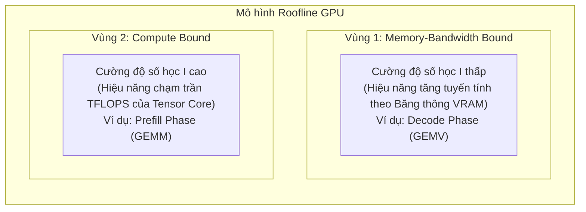
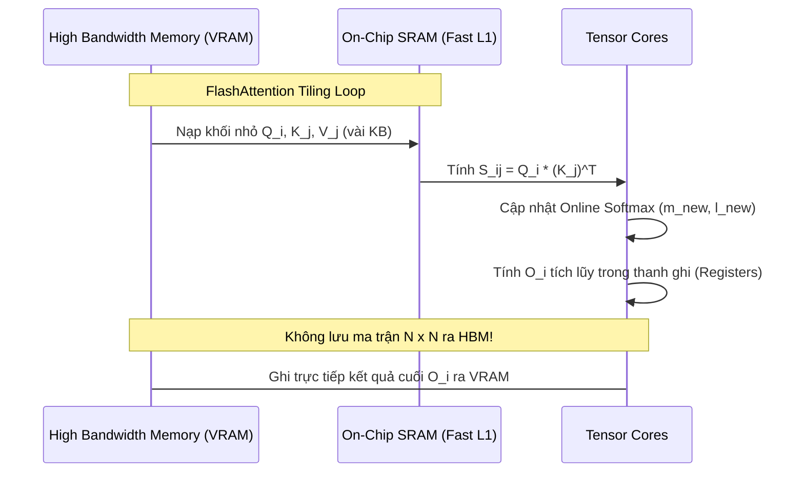
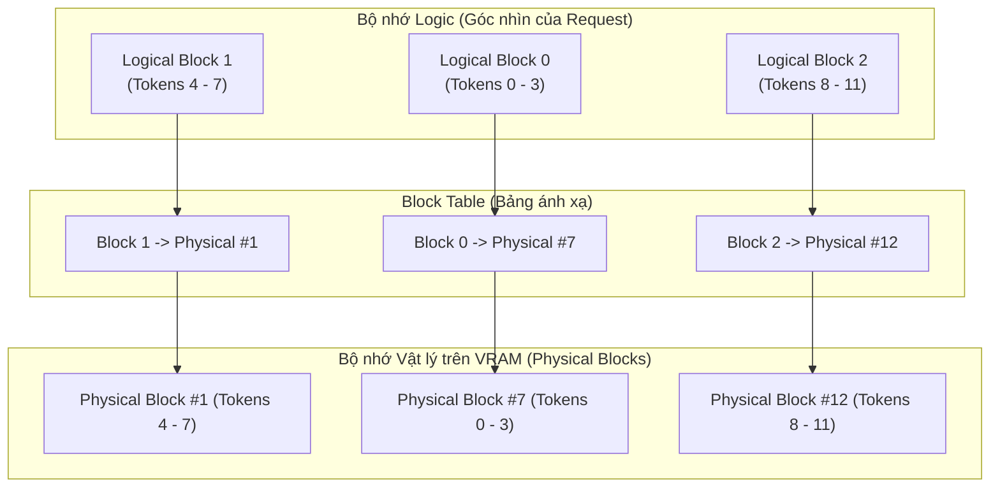

---
{"dg-publish":true,"permalink":"/knowledge/02-tech-second-brain/ai-core/data-lake-house/local-llm/02-gpu-inference-mechanics/","title":"Deep-Dive Kỹ Thuật - Cơ Chế GPU & Tối Ưu Hóa Suy Luận LLM (Inference Mechanics)","pinned":"false","tags":["type/course","topic/data-lakehouse","status/stable"]}
---

# Deep-Dive Kỹ Thuật: Cơ Chế GPU & Tối Ưu Hóa Suy Luận LLM (Inference Mechanics)
*(Tài liệu chuẩn trích xuất từ các công trình nghiên cứu gốc tại NeurIPS, SOSP, MLSys, OSDI và NVIDIA Architecture Whitepapers)*

Tài liệu này đi sâu vào bản chất vật lý phần cứng, toán học ma trận và các đột phá thuật toán giúp tăng tốc độ suy luận LLM gấp hàng chục lần trên GPU.

---

## 1. MÔ HÌNH VẬT LÝ PHẦN CỨNG: ROOFLINE MODEL & THE MEMORY WALL

### 1.1. Bức tường bộ nhớ (The Memory Wall) và Cường độ số học (Arithmetic Intensity)
Trong kiến trúc máy tính, **Cường độ số học ($I$)** được định nghĩa là tỷ số giữa số lượng phép tính dấu phẩy động (FLOPs) thực hiện trên mỗi byte dữ liệu được truyền từ bộ nhớ:

$$I = \frac{\text{Tổng số phép tính (FLOPs)}}{\text{Tổng dung lượng nạp/ghi từ VRAM (Bytes)}} \quad \left(\text{đơn vị: } \frac{\text{FLOP}}{\text{Byte}}\right)$$

Theo **Mô hình Roofline** *(Williams et al., CACM 2009)*, hiệu năng thực tế của một thuật toán bị chặn bởi hai giới hạn:

$$\text{Performance} = \min\left(\text{Peak Compute Performance (TFLOPS)}, \quad I \times \text{Memory Bandwidth (GB/s)}\right)$$



### 1.2. Phân cấp bộ nhớ trên GPU NVIDIA (A100 / H100 / RTX 4090)

| Tầng bộ nhớ | Dung lượng điển hình (A100 80GB) | Băng thông truy xuất | Độ trễ (Latency) |
| :--- | :--- | :--- | :--- |
| **Registers (Thanh ghi)** | ~256 KB / SM (~27 MB toàn chip) | **~30,000 GB/s (~30 TB/s)** | ~1 chu kỳ xung nhịp |
| **SRAM / Shared Memory (L1)** | 192 KB / SM (~20 MB toàn chip) | **~19,000 GB/s (~19 TB/s)** | ~20 - 30 chu kỳ |
| **L2 Cache** | 40 MB - 50 MB | **~5,000 GB/s (~5 TB/s)** | ~100 - 200 chu kỳ |
| **HBM2e / GDDR6X (VRAM)** | 24 GB - 80 GB | **~1,000 - 2,039 GB/s (~1-2 TB/s)** | **~400 - 800 chu kỳ** |

> [!CRITICAL]
> **Kết luận phần cứng:** Đọc một trọng số từ VRAM (HBM) chậm hơn đọc từ bộ nhớ đệm SRAM tới **10 đến 20 lần**, và tốn năng lượng gấp gần 100 lần. Mọi thuật toán tối ưu hóa LLM đều nhằm mục đích: **giữ dữ liệu tính toán nằm lại trong SRAM càng lâu càng tốt**.

---

### 1.3. Bản chất toán học: Prefill (GEMM) vs. Decode (GEMV)

#### Pha 1: Prefill (Prompt Evaluation) — Compute-Bound
Khi prompt đầu vào có $N$ token ($N = 2048$):
- GPU thực hiện phép nhân ma trận giữa ma trận kích hoạt $X \in \mathbb{R}^{N \times d}$ và ma trận trọng số $W \in \mathbb{R}^{d \times d}$.
- Số phép tính: $\approx 2 N d^2$ FLOPs.
- Dung lượng nạp ma trận $W$ từ VRAM: $2 d^2$ bytes (với FP16).
- Cường độ số học:
  $$I_{\text{prefill}} = \frac{2 N d^2}{2 d^2} = N = 2048 \text{ FLOP/Byte}$$
- **Nhận định:** Với $I = 2048$, GPU vượt xa điểm gãy (knee point) của Roofline model $\to$ **Compute-bound**. Toàn bộ Tensor Cores hoạt động hết công suất.

#### Pha 2: Decode (Token Generation) — Memory-Bandwidth-Bound
Khi sinh từng token một tuần tự ($N = 1$):
- GPU nhân vector kích hoạt $x \in \mathbb{R}^{1 \times d}$ với toàn bộ ma trận trọng số $W \in \mathbb{R}^{d \times d}$ để sinh token kế tiếp.
- Số phép tính: $\approx 2 \times 1 \times d^2 = 2 d^2$ FLOPs.
- Dung lượng nạp ma trận $W$ từ VRAM: $2 d^2$ bytes.
- Cường độ số học:
  $$I_{\text{decode}} = \frac{2 d^2}{2 d^2} = 1 \text{ FLOP/Byte}$$
- **Nhận định:** Với $I = 1$, Tensor Core chỉ hoạt động ~1-5% công suất tối đa; 95% thời gian GPU chỉ ngồi **chờ dữ liệu trọng số chạy qua bus VRAM**.

---

## 2. FLASHATTENTION: ĐỘT PHÁ TILING TRONG SRAM & ONLINE SOFTMAX

* **Tác giả:** Tri Dao, Daniel Y. Fu, Stefano Ermon, Atri Rudra, Christopher Ré (Stanford University).
* **Công bố:** *NeurIPS 2022* (FlashAttention-1), *ICLR 2024* (FlashAttention-2).
* **Mã nguồn:** [Dao-AILab/flash-attention](https://github.com/Dao-AILab/flash-attention).

### 2.1. Nút thắt của Self-Attention truyền thống
Cơ chế Attention tiêu chuẩn:

$$\text{Attention}(Q, K, V) = \text{softmax}\left(\frac{QK^T}{\sqrt{d}}\right)V$$

Trong chuẩn PyTorch thông thường:
1. Nạp $Q, K \in \mathbb{R}^{N \times d}$ từ HBM vào chip $\to$ tính $S = QK^T \in \mathbb{R}^{N \times N} \to$ **Ghi ma trận $S$ ngược ra HBM**.
2. Nạp $S$ từ HBM vào chip $\to$ tính $P = \text{softmax}(S) \in \mathbb{R}^{N \times N} \to$ **Ghi ma trận $P$ ngược ra HBM**.
3. Nạp $P, V$ từ HBM vào chip $\to$ tính $O = PV \in \mathbb{R}^{N \times d} \to$ Ghi kết quả $O$ ra HBM.

> Với context length $N = 32,768$, ma trận $N \times N$ chiếm tới **$32768^2 \times 2 \text{ bytes} \approx 2.15\text{ GB}$** bộ nhớ đệm tạm thời cho mỗi attention head. Điều này gây tràn VRAM (OOM) và tắc nghẽn băng thông.

### 2.2. Giải pháp FlashAttention: Tiling & Online Softmax
FlashAttention **hoàn toàn không ghi ma trận $N \times N$ ra HBM**. Thay vào đó:
1. **Tiling (Chia khối):** Chia ma trận $Q, K, V$ thành các block nhỏ (ví dụ kích thước $B_r \times d$ và $B_c \times d$) vừa vặn với dung lượng **SRAM (Shared Memory)** của từng Streaming Multiprocessor (SM).
2. **Online Softmax Rescaling:** Do hàm Softmax đòi hỏi phải tính tổng toàn bộ mẫu số:
   $$\text{softmax}(x_i) = \frac{e^{x_i - m}}{\sum_j e^{x_j - m}} \quad \text{với } m = \max_j(x_j)$$
   FlashAttention áp dụng thuật toán **Online Softmax** *(Milakov & Gimelshein, 2018)*: Lưu trữ running maximum $m^{(new)}$ và running sum $\ell^{(new)}$, cho phép cập nhật lại kết quả của block trước mà không cần đọc lại toàn bộ chuỗi:

$$\ell^{(new)} = e^{m^{(old)} - m^{(new)}} \ell^{(old)} + \sum e^{x_i - m^{(new)}}$$



* **Kết quả:** Giảm độ phức tạp truy xuất bộ nhớ từ $O(N^2)$ xuống $O(N)$, tăng tốc suy luận từ **2x đến 4x** mà không làm mất dù chỉ 0.0001% độ chính xác (Exact Attention).

---

## 3. PAGEDATTENTION & VLLM: QUẢN TRỊ BỘ NHỚ ẢO CHO KV CACHE

* **Tác giả:** Woosuk Kwon, Zhuohan Li, Siyuan Shen, Lianmin Zheng, Patricio Amaral, Xuehai Qian, Ion Stoica (UC Berkeley).
* **Công bố:** *SOSP 2023* (ACM Symposium on Operating Systems Principles).
* **Mã nguồn:** [vllm-project/vllm](https://github.com/vllm-project/vllm).

### 3.1. Vấn đề của KV Cache truyền thống
Trong quá trình Auto-regressive generation, mỗi token sinh ra cần lưu lại vector Key ($K$) và Value ($V$) của chính nó.
- **Phân mảnh nội vi (Internal Fragmentation):** Hệ thống phải cấp phát trước một vùng nhớ liên tục (contiguous memory) cho chiều dài tối đa của câu (ví dụ 4096 tokens). Nếu câu trả lời chỉ dài 50 tokens, **98% dung lượng VRAM cấp phát bị bỏ phí**.
- **Phân mảnh ngoại vi (External Fragmentation):** Các request có độ dài ngẫu nhiên tạo ra các "lỗ hổng" bộ nhớ không thể tái sử dụng.
- **Hậu quả:** 60% - 80% VRAM bị lãng phí, khiến GPU chỉ batch được 2 - 4 request cùng lúc.

### 3.2. Kiến trúc PagedAttention

Mượn nguyên lý **Virtual Memory và Phân trang (Paging)** từ Hệ điều hành Linux, PagedAttention chia KV Cache thành các khối kích thước cố định:



1. **Logical Blocks:** Chuỗi token của request được chia thành các khối logic (mặc định 16 token/block).
2. **Physical Blocks:** Các ô nhớ thực trên VRAM, **không cần nằm liên tục nhau**.
3. **Block Table:** Quản lý ánh xạ động giữa Logical và Physical Block. Khi có token thứ 17 sinh ra, vLLM chỉ cần xin thêm 1 block vật lý trống bất kỳ trên VRAM.

### 3.3. Cơ chế Copy-on-Write (CoW) cho Agent & Multi-Turn
Khi thực hiện Parallel Sampling (sinh 3 câu trả lời khác nhau từ 1 prompt) hoặc chạy Agent nhiều nhánh:
- Cả 3 nhánh đều **dùng chung Physical Blocks** của phần Prompt ban đầu (Reference Count = 3).
- Chỉ khi một nhánh bắt đầu sinh token mới khác biệt, vLLM mới cấp phát block mới cho nhánh đó (Copy-on-Write).
- **Hiệu quả:** Tiết kiệm thêm **55% VRAM**, tăng throughput phục vụ của hệ thống lên **2x - 4x**.

---

## 4. CONTINUOUS BATCHING: ĐIỀU PHỐI CẤP ĐỘ LẶP (ITERATION-LEVEL SCHEDULING)

* **Tác giả:** Gyeong-In Yu et al. (Seoul National University / Microsoft).
* **Công bố:** *OSDI 2022* (Orca System).

### 4.1. Sự khác biệt giữa Static Batching và Continuous Batching

```text
STATIC BATCHING (Truyền thống):
Request A (5 tokens):   [T1][T2][T3][T4][T5]----------------- (GPU ngồi chờ rảnh rỗi)
Request B (12 tokens):  [T1][T2][T3][T4][T5][T6][T7][T8][T9][T10][T11][T12]
                                                                        ^ Batch mới chỉ được nạp ở đây!

CONTINUOUS BATCHING (vLLM / Orca):
Request A (5 tokens):   [T1][T2][T3][T4][T5]
Request C (Mới đến!):                       [T1][T2][T3][T4][T5][T6]... (Chèn ngay lập tức!)
Request B (12 tokens):  [T1][T2][T3][T4][T5][T6][T7][T8][T9][T10][T11][T12]
```

- Thay vì đợi tất cả các câu trong batch hoàn thành, Scheduler của vLLM quyết định phân bổ sau **mỗi chu kỳ sinh 1 token (iteration)**.
- Khi Request A kết thúc, vùng nhớ và slot tính toán lập tức được bàn giao cho Request C mới từ hàng đợi. Điều này triệt tiêu hoàn toàn hiện tượng bong bóng đường ống (**Pipeline Bubbles**).

---

## 5. TOÁN HỌC LƯỢNG TỬ HÓA: BẢN CHẤT CỦA THUẬT TOÁN AWQ (INT4)

* **Tác giả:** Ji Lin, Jiaming Tang, Haotian Tang, Shang Yang, Xingyu Dang, Song Han (MIT HAN Lab).
* **Công bố:** *MLSys 2024* (Paper: *"AWQ: Activation-aware Weight Quantization for LLM Compression and Acceleration"*).
* **Mã nguồn:** [mit-han-lab/llm-awq](https://github.com/mit-han-lab/llm-awq).

### 5.1. Sai lầm của việc Lượng tử hóa truyền thống (Weight-Only Rounding)
Khi nén từ FP16 (16-bit) xuống INT4 (4-bit, chỉ có 16 giá trị từ $-8$ đến $+7$), ta chia dải giá trị cho một hệ số scale $\Delta$:

$$W_{\text{INT4}} = \text{round}\left(\frac{W}{\Delta}\right)$$

Sai số làm tròn $\text{Error} = |W - W_{\text{quantized}}|$ sẽ phá hủy độ chính xác của LLM vì:
> **Phát hiện của MIT:** Trọng số của LLM không quan trọng như nhau. **1% trọng số ngoại lai (Salient Weights)** chi phối toàn bộ khả năng lý luận của mô hình.

### 5.2. Đột phá của AWQ: Nhìn vào Activation thay vì Weight
- Các phương pháp cũ (như RTN, GPTQ) cố gắng phân tích độ lớn của ma trận trọng số $W$.
- **AWQ chỉ ra rằng:** Độ lớn của trọng số không phản ánh tầm quan trọng, mà **kênh kích hoạt (Input Activation $X$) có giá trị lớn** mới quyết định độ nhạy cảm của layer.

### 5.3. Công thức bảo vệ trọng số không cần phần cứng đặc biệt
Để bảo vệ 1% kênh quan trọng mà không làm chậm phần cứng bằng cách trộn kiểu dữ liệu (Mixed-Precision gây nghẽn Tensor Core), AWQ áp dụng phép biến đổi tương đương:

$$Y = X W = (X S^{-1}) \cdot (S W) = \hat{X} \hat{W}$$

Trong đó $S$ là một ma trận đường chéo chứa các hệ số tỷ lệ $s > 1$ cho các kênh quan trọng:
1. $W$ được nhân phóng đại với $s$: $\hat{W} = W \cdot s$. Khi làm tròn xuống INT4, **sai số tương đối của các trọng số quan trọng giảm đi $s$ lần**.
2. Phép chia $S^{-1}$ được gộp trực tiếp vào LayerNorm phía trước, hoàn toàn không tốn thêm bất kỳ chi phí tính toán nào trong lúc inference.

---

## 6. DANH MỤC TÀI LIỆU & NGUỒN TRÍCH DẪN GỐC (CITATIONS)

1. **Roofline Model:**
   * Williams, S., Waterman, A., & Patterson, D. (2009). *Roofline: an insightful visual performance model for multicore architectures*. Communications of the ACM, 52(4), 65-76. [DOI: 10.1145/1498765.1498785](https://doi.org/10.1145/1498765.1498785).
2. **FlashAttention-1 & 2:**
   * Dao, T., Fu, D. Y., Ermon, S., Rudra, A., & Ré, C. (2022). *FlashAttention: Fast and memory-efficient exact attention with IO-awareness*. Advances in Neural Information Processing Systems (NeurIPS 2022). [arXiv:2205.14135](https://arxiv.org/abs/2205.14135).
   * Dao, T. (2023). *FlashAttention-2: Faster Attention with Better Parallelism and Work Partitioning*. International Conference on Learning Representations (ICLR 2024). [arXiv:2307.08691](https://arxiv.org/abs/2307.08691).
3. **PagedAttention & vLLM:**
   * Kwon, W., Li, Z., Shen, S., Zheng, L., Amaral, P., Qian, X., & Stoica, I. (2023). *Efficient Memory Management for Large Language Model Serving with PagedAttention*. Proceedings of the 29th ACM Symposium on Operating Systems Principles (SOSP 2023). [arXiv:2309.06180](https://arxiv.org/abs/2309.06180).
4. **Continuous Batching (Orca):**
   * Yu, G. I., Jeong, J. S., Kim, G. W., Kim, S., & Chun, B. G. (2022). *Orca: A distributed serving system for Transformer-Based generative models*. 16th USENIX Symposium on Operating Systems Design and Implementation (OSDI 2022). [USENIX Link](https://www.usenix.org/conference/osdi22/presentation/yu).
5. **AWQ Quantization:**
   * Lin, J., Tang, J., Tang, H., Yang, S., Dang, X., & Han, S. (2024). *AWQ: Activation-aware Weight Quantization for LLM Compression and Acceleration*. Proceedings of Machine Learning and Systems (MLSys 2024). [arXiv:2306.00978](https://arxiv.org/abs/2306.00978).
